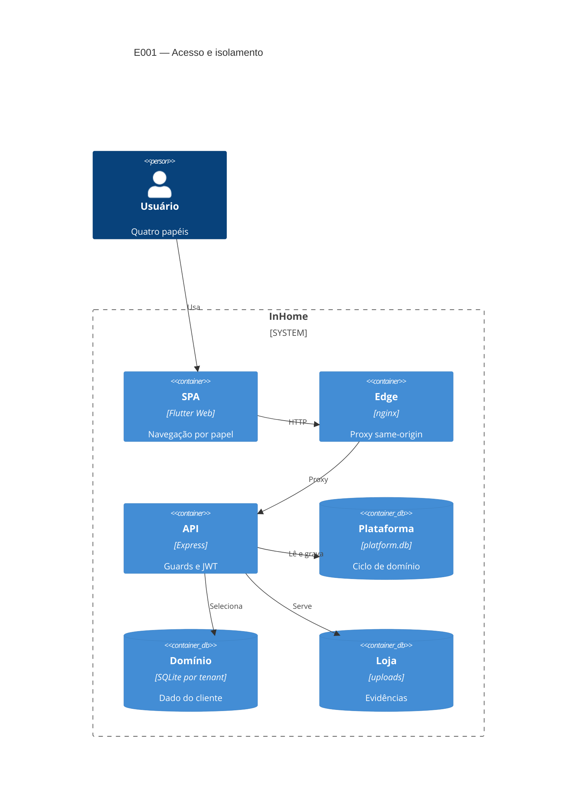

# Implementation Plan: Ciclo de domínio, papéis e acesso (E001)

**Branch**: `00002-e001-ciclo-dominio-papeis-e-acesso` | **Date**: 2026-09-27 | **Spec**: [spec.md](spec.md)

## Summary

**Goal**: Verificar o ciclo de domínio, a matriz dos quatro papéis e os guards de sessão, papel e escopo sobre a base entregue, sem refatoração.
**Approach**: regressão em três suítes (unit co-localizado, `backend/test.sh`, fim a fim com dois domínios) e correção pontual só onde a regressão abrir gap.
**Key Constraint**: isolamento por domínio inegociável; suíte verde antes de qualquer promoção.

## Technical Context

| Campo | Valor |
|-------|-------|
| Language/Version | Dart 3 (Flutter Web); Node.js 22+ |
| Primary Dependencies | Express, Socket.io, jsonwebtoken, bcryptjs, sql.js, nginx, Docker Compose |
| Storage | `data/platform.db` + `data/domains/<id>.db` (sql.js); `backend/uploads/` |
| Testing | `node:test`+supertest (35); `test.sh` (16); fim a fim (28); sem SDK Flutter |
| Target Platform | Docker Compose local `http://localhost/` (nginx :80, API :3001) |
| Project Type / Mode | web multi-tenante / brownfield |
| Performance / Scale | p95 < 2 s; múltiplos domínios, 4 papéis, 9 FR (8 P1) |
| Constraints | isolamento inegociável; deny by default; JWT 24 h; suíte verde; só ambiente local |

Fonte: `specs/sad.md` (decisão 1a).

## Instructions Check

*GATE: re-check após design.*

| Regra | Status |
|-------|--------|
| I–II `dev` primeiro; unit gate de `dev`→`main` | PASS |
| III `TODO.md` lido na sessão | PASS |
| IV saída concisa; artefatos em tabela/kv | PASS |
| `PRESERVE_EXISTING_LAYOUT` | PASS |
| Complexity Tracking | ausente — sem violação |

## Architecture



## Architecture Decisions

| ID | Questão | Opções | Escolha | Rationale |
|----|---------|--------|---------|-----------|
| AD-001 | Entrega sobre a base validada | refatorar / verificar e corrigir | verificação + correção pontual | base validada 28/28; escopo é fechar gap |
| AD-002 | Onde vive a regressão | harness novo / estender suítes | estender `*.test.js` e `backend/test.sh` | gate de promoção já os usa; sem infra nova |
| AD-003 | Prova de isolamento | só unit / E2E dois domínios | dois domínios no roteiro fim a fim | SC-001/SC-004; domínio único não prova |
| AD-004 | Papel do `scopeDomain` | todas as rotas / só com parâmetro | token como tenant; guarda sob demanda | nenhuma rota aceita `domainId` (baseline SAD) |

## Data Model Summary

N/A — nenhum artefato novo (verificação da base entregue)

## API Surface Summary

N/A — nenhum artefato novo

## Testing Strategy

| Tier | Tool | Escopo | Mock Boundary | Install |
|------|------|--------|---------------|---------|
| Unit | `node:test`+supertest | guards, matriz, ciclo, CRUD (`src/**/*.test.js`) | `DATA_DIR` temporário; sem SMTP | configured |
| Integration | `backend/test.sh` (PORT 3199) + roteiro fim a fim | 16 checks + dois domínios, suspensão, 401/403 | stack Docker `http://localhost/` | configured |
| Security | `npm audit --audit-level=high` + revisão OWASP manual | dependências e rotas | — | configured |
| Coverage | N/A — sem meta numérica (v2.1.0); gate = suíte unitária | — | — | — |
| Lint | `flutter analyze`; backend `node --check` | dart / sintaxe | — | sem SDK local |

## Acceptance Test Stubs

Co-localizados `*.test.js` (`node:test`); RED via `test.todo` (pending). P1 = FR-001..FR-008.

| Req ID | Test File | Stub Blocks (framework-native) | RED Status |
|--------|-----------|--------------------------------|------------|
| FR-001 | `backend/src/routes/domains.test.js` | `test.todo('FR-001 habilitação atômica')` | pending |
| FR-002 | `backend/src/routes/auth.test.js` | `test.todo('FR-002 JWT 24h e login')` | pending |
| FR-003 | `backend/src/middleware/auth.test.js` | `test.todo('FR-003 suspensão bloqueia sessão')` | pending |
| FR-004 | `backend/src/routes/domains.test.js` | `test.todo('FR-004 ciclo só system_admin')` | pending |
| FR-005 | `backend/src/middleware/auth.test.js` | `test.todo('FR-005 401/403 deny by default')` | pending |
| FR-006 | `backend/src/routes/contracts.test.js` | `test.todo('FR-006 matriz dos quatro papéis')` | pending |
| FR-007 | `backend/src/middleware/auth.test.js` | `test.todo('FR-007 escopo de domínio')` | pending |
| FR-008 | `backend/src/routes/users.test.js` | `test.todo('FR-008 CRUD usuários e 409')` | pending |

## Error Handling Strategy

| Categoria | Padrão | Resposta | Retry |
|-----------|--------|----------|-------|
| Validação | fail-fast | 400 + campos | não |
| Sessão/papel/escopo | deny by default | 401 sem token; 403 errado | não |
| Domínio suspenso | revalida por requisição | 403 `Domain suspended` | não |
| Cross-domain | sem vazamento | 403/404 sem conteúdo | não |
| Habilitação (falha de gravação) | fail-fast | 500; registro não reaproveitado | não |
| Credenciais ambíguas | recusa | 401/409 sem revelar etapa | não |

## Risk Mitigation

| Risk (from spec) | L | I | Mitigation | Owner |
|------------------|---|---|------------|-------|
| Guard ausente em rota nova | low | high | 401/403 por rota em `backend/test.sh` e no fim a fim | `backend/src/middleware/auth.js` |
| Teste só em domínio único | medium | medium | E2E com dois domínios ativos (AD-003) | `backend/test.sh` |
| Guard de parâmetro de domínio sem uso | medium | high | unit `scopeDomain` + caso divergente na suíte (AD-004) | `backend/src/middleware/auth.js` |
| JWT_SECRET e `/uploads` sem cobertura | low | high | `.env.example`; 401/403 por rota na suíte | `backend/src/middleware/auth.js` |

## Requirement Coverage Map

| Req ID | Component(s) | File Path(s) | Function(s)/Symbol(s) | Notes |
|--------|--------------|--------------|------------------------|-------|
| FR-001 | domains route, database | `backend/src/routes/domains.js`<br/>`backend/src/config/database.js` | `enableDomain({name,adminName,adminEmail,adminPassword})`, `createDomainDb(domainId)` | AD-001; POST `/api/domains/enable` |
| FR-002 | auth route, auth middleware | `backend/src/routes/auth.js`<br/>`backend/src/middleware/auth.js` | `domainSession(domain,user)`, `signJwt(payload)` (24h), `User.findAuthByIdentifier(db,identifier)` | login e-mail/usuário; papel automático |
| FR-003 | auth middleware, domains route | `backend/src/middleware/auth.js`<br/>`backend/src/routes/domains.js` | `assertDomainActive(domainId)`, `suspendDomain(id)`, `reactivateDomain(id)` | 403 imediato; nada apagado |
| FR-004 | domains route | `backend/src/routes/domains.js` | `requireSystemAdmin`, `router.use(authenticateToken, requireSystemAdmin)` | system_admin fora do dado de negócio |
| FR-005 | auth middleware, server | `backend/src/middleware/auth.js`<br/>`backend/src/server.js` | `authenticateToken(req,res,next)`, `requireRole(...roles)` | 401 sem token; deny by default |
| FR-006 | middleware + rotas de negócio | `backend/src/middleware/auth.js`<br/>`backend/src/routes/contracts.js` | `requireRole()` nas listas por rota, `requireSystemAdmin` | matriz README nos 4 papéis |
| FR-007 | auth middleware, database | `backend/src/middleware/auth.js`<br/>`backend/src/config/database.js` | `scopeDomain(param='domainId')`, `getDomainDb(domainId)` | AD-004; tenant do token |
| FR-008 | users route, User model | `backend/src/routes/users.js`<br/>`backend/src/models/User.js` | `createUser(db,body)`, `create/listUser/update/remove`, `User.findByUsername(db,username)` | 409 username repetido |
| FR-009 | frontend shell, login screen | `frontend/lib/main.dart`<br/>`frontend/lib/screens/login_screen.dart` | `_entriesForRole(role)`, `_resolveRole()`, `LoginScreen._submit()`, `ApiService.login()` | P2; ações do papel |

## Project Structure

### Source Code

```text
~ backend/src/routes/domains.js          ciclo enable/suspend/reactivate (FR-001/003/004)
~ backend/src/routes/auth.js             login/JWT (FR-002/003)
~ backend/src/routes/users.js            CRUD + 409 (FR-008)
~ backend/src/middleware/auth.js         guards (FR-003..007, AD-004)
~ backend/src/config/database.js         createDomainDb/getDomainDb (FR-001/007)
~ backend/src/routes/*.test.js           stubs FR-001..008 (AD-002)
~ backend/test.sh                        + dois domínios, suspensão, 401/403 (AD-003)
~ frontend/lib/main.dart                 navegação por papel (FR-009)
~ frontend/lib/screens/login_screen.dart papel no login (FR-009)
+ specs/00002-e001-ciclo-dominio-papeis-e-acesso/checklists/.checklists
```

**Reuse**: guards `requireRole`/`requireSystemAdmin`/`assertDomainActive`; `support/testenv.js`; `test.todo`.
**Extend**: `backend/src/**/*.test.js` (35), `backend/test.sh` (16), fim a fim (28).
**Naming**: co-located `*.test.js` (`node:test`); Conventional Commits.

## Implementation Hints

- **[HINT-001]** Order: stubs RED de FR-001..008 antes de ajustes; unit verde antes do E2E.
- **[HINT-002]** Gotcha: `FR-###` em comentários/nomes de teste segue a numeração de `specs/00001` (ex.: `test('FR-003 sysadmin gate')`) — não é o FR desta spec.
- **[HINT-003]** Gotcha: `server.test.js` exige porta 3001 livre; `npm test` falha se o stack ocupar a porta.
- **[HINT-004]** Constraint: tenant sai do `domainId` do token; `scopeDomain` só se liga em rota com parâmetro de domínio (AD-004).
- **[HINT-005]** Gotcha: `enableDomain` não faz rollback do INSERT se `createDomainDb` falhar — o teste FR-001 fixa o comportamento e abre correção se divergir.
