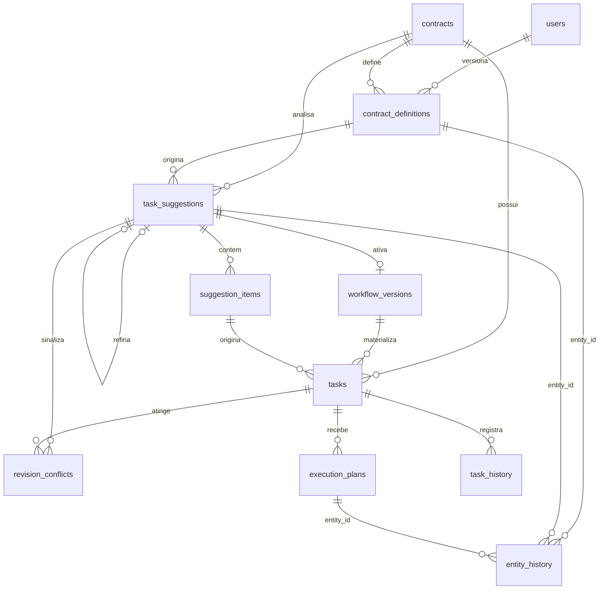

# Data Model: Workflow Assistido OpenCode (00003)

Storage: `data/domains/<id>.db` (sql.js). 00003 estende `DOMAIN_SCHEMA` e `DOMAIN_INDEXES` em `backend/src/config/database.js`; `platform.db` não muda. Convenções mantidas: PK `INTEGER PRIMARY KEY AUTOINCREMENT`, FK `REFERENCES`, `created_at`/`updated_at TEXT DEFAULT (datetime('now'))`, enums por `CHECK`, índices declarados na abertura do banco, consultas sobre entradas livres por parâmetros vinculados (sem concatenação de SQL). Resultado: 7 tabelas novas + 4 colunas aditivas em `tasks`.

**Isolamento multi-tenant (FR-019)**: toda tabela nova nasce dentro do arquivo do domínio (`data/domains/<id>.db`), nunca em `platform.db`. Onde a linha não carrega `domainId`, o escopo é alcançado por FK até `contracts`/`tasks`; o arquivo é o tenant. Leitura e escrita só via `getDomainDb(domainId)`. Inalteradas: `contracts`, `users`, `purposes`, `contract_providers`, `task_history`, `task_photos`, `comments`, `attachments` (FR-011 e FR-016 preservam fluxo de status e evidências).

## Entities

| Entity | Tabela | Atributos | Relações | Transições | FR |
|---|---|---|---|---|---|
| ContractDefinition | `contract_definitions` (nova) | id PK; contract_id FK→contracts NOT NULL; version INT NOT NULL, UNIQUE(contract_id, version); finalidade, limitacoes, alvo, escopo, premissas, entregaveis TEXT NOT NULL; created_by FK→users; created_at | contracts 1—N; origina task_suggestions | sem status: cada edição insere linha nova | FR-001, FR-002, FR-003, FR-017, FR-020 |
| TaskSuggestion | `task_suggestions` (nova) | id PK; contract_id FK→contracts NOT NULL; definitions_id FK→contract_definitions NOT NULL; kind TEXT CHECK ('analise','revisao') DEFAULT 'analise'; status TEXT CHECK ('pendente','analisando','sugerido','falha','aprovada') DEFAULT 'pendente'; refined_from FK→task_suggestions; refine_instructions TEXT; error TEXT; context_json TEXT; started_at, finished_at TEXT; created_by FK→users; created_at, updated_at | contract_definitions 1—N; 1—1 workflow_versions na aprovação; 1—N suggestion_items, revision_conflicts, entity_history | ver State Machines | FR-004, FR-005, FR-006, FR-008, FR-009, FR-018, FR-021, FR-022, FR-024 |
| SuggestionItem | `suggestion_items` (nova) | id PK; suggestion_id FK→task_suggestions NOT NULL ON DELETE CASCADE; title TEXT NOT NULL; description TEXT; justification TEXT NOT NULL; ordem INT NOT NULL DEFAULT 0; removed INT NOT NULL DEFAULT 0; target_task_id FK→tasks NULL, só em kind='revisao'; created_at, updated_at | tasks apontam a origem via tasks.suggestion_item_id | sem status: removed 0→1, resto por UPDATE | FR-005, FR-007, FR-008, FR-009, FR-023 |
| WorkflowVersion | `workflow_versions` (nova) | id PK; contract_id FK→contracts NOT NULL; suggestion_id FK→task_suggestions NOT NULL; status TEXT CHECK ('ativo','substituido') DEFAULT 'ativo'; activated_by FK→users; created_at | tasks 1—N via tasks.workflow_version_id; 1—1 com a sugestão aprovada | ativo → substituido | FR-010, FR-011, FR-012, FR-013, FR-022 |
| ExecutionPlan | `execution_plans` (nova) | id PK; task_id FK→tasks NOT NULL UNIQUE (1 linha por tarefa, upsert); status TEXT CHECK ('pendente','gerado','falha') DEFAULT 'pendente'; passos, criterios, riscos TEXT (JSON, só em 'gerado'); error TEXT; requested_by FK→users; created_at, updated_at | tasks 1—1; conteúdo anterior vai para entity_history | pendente → gerado \| falha; falha → pendente | FR-014, FR-015, FR-016 |
| RevisionConflict | `revision_conflicts` (nova) | id PK; suggestion_id FK→task_suggestions NOT NULL; task_id FK→tasks NOT NULL; status_alvo TEXT NOT NULL; motivo TEXT NOT NULL; created_at | revisão 1—N; tarefa 1—N | sem status: conflito sinaliza, não fila | FR-023 |
| History | `entity_history` (nova) | id PK; entity_type TEXT CHECK ('definition','suggestion','execution_plan'); entity_id INT NOT NULL; version INT NOT NULL; snapshot TEXT (JSON); author_id FK→users; created_at; UNIQUE(entity_type, entity_id, version) | ponteiro polimórfico para contract_definitions, task_suggestions, execution_plans | append-only | FR-008, FR-017 |
| Task (existente) | `tasks` (alterada) | + workflow_version_id FK→workflow_versions NULL; + suggestion_item_id FK→suggestion_items NULL; + opt_in_by FK→users NULL; + opt_in_at TEXT NULL; demais colunas inalteradas | contracts 1—N; workflow_versions 1—N; 1—N execution_plans, task_history | status inalterado: 'A Fazer' → 'Em Progresso' → 'Revisão' → 'Concluída'; elegível de revisão = 'A Fazer' | FR-010, FR-011, FR-023 |

Sem entidade própria: FR-012 e FR-021 emitem eventos a partir de `workflow_versions` e `task_suggestions.status`; FR-019 usa `users.role` com `requireRole()`/`scopeDomain()`.

## State Machines

### TaskSuggestion

```text
pendente → analisando    job assume; grava context_json (allowlist do servidor) e started_at
analisando → sugerido    parse OK; itens gravados com justificativa por item
analisando → falha       timeout 60 s, crash ou resposta vazia/não interpretável; definições preservadas
falha → pendente         retry manual, sem retry automático
sugerido → aprovada      só gestor; exige ao menos 1 item com removed = 0
sugerido → nova linha    refinamento copia os itens e grava refined_from; a versão anterior não sofre UPDATE
```

`kind='revisao'` percorre o mesmo ciclo; `aprovada` ali significa aplicada em tarefas (FR-023). Índice parcial UNIQUE em `task_suggestions(contract_id) WHERE status='analisando'`: revisão durante análise aguarda a anterior (edge case do spec).

WorkflowVersion: `ativo → substituido` a cada nova aprovação. ExecutionPlan: `pendente → gerado | falha`, `falha → pendente` na regeneração (FR-015).

## Validation rules

- FR-003: as 6 colunas de definição são `NOT NULL`; análise recusa com 400 listando o que falta.
- FR-007 e FR-009: aprovação, remoção e edição só com `users.role='gestor'`; aprovação conta itens com `removed = 0`.
- FR-009 e FR-010: aprovação é atômica — materialização das tarefas, criação da versão `ativo` e substituição da anterior ocorrem na mesma transação; falha em qualquer passo devolve o banco ao estado anterior, sem tarefa materializada fora de um workflow ativo.
- FR-002: `admin` edita somente definições; `prestador` não alcança sugestão nem revisão (FR-013), bloqueio no middleware.
- FR-008: refinamento cria linha nova e cópia dos itens; a versão anterior nunca recebe UPDATE.
- FR-010: `tasks.workflow_version_id` só preenche na materialização ou com `opt_in_by`/`opt_in_at` do gestor; `NULL` = fora do workflow. UNIQUE parcial em `workflow_versions(contract_id) WHERE status='ativo'` mantém 1 workflow oficial por contrato.
- FR-014 e FR-015: materialização grava `execution_plans` `pendente` para toda tarefa nova; ativação nunca espera o plano.
- FR-016: escrita em `execution_plans` não toca `tasks`, `task_history` nem `task_photos`.
- FR-023: aplicação de revisão altera ou cria apenas com `tasks.status = 'A Fazer'`; outro status gera linha em `revision_conflicts` e deixa a tarefa intacta. Remoção e fechamento não existem.
- FR-004 e FR-020: `context_json` é montado pelo servidor pela allowlist (6 definições + identificação + vigência); payload de cliente não é persistido nem enviado.

## Migration

- Novas tabelas: `CREATE TABLE IF NOT EXISTS` em `DOMAIN_SCHEMA` e índices em `DOMAIN_INDEXES` (T001), incluindo os dois UNIQUE parciais.
- `tasks`: `ALTER TABLE tasks ADD COLUMN ...` em `migrateSchema()`, mesmo padrão do `username`. Migração aditiva preguiçosa na abertura de cada `data/domains/<id>.db`, sem varredura no boot (precedente Q5/E004 em `specs/project-plan.md`).
- Banco antigo: tarefas pré-00003 ficam com `workflow_version_id IS NULL`, fora do workflow; nada é reescrito ou apagado.
- `MIGRATION` do spec é só aditivo: nenhuma coluna existente é removida ou renomeada.

## Mudanças vs. versão anterior deste arquivo

- `sugerida` → `sugerido` (AD-002); `definition_version`/`instrucoes` → `definitions_id` (FK) + `context_json` + `kind`.
- `status_revisao` (`pendente|mantido|removido|editado`) → `removed` + `target_task_id` (revisão alvo tarefa, FR-023).
- `definition_history` + `suggestion_history` + `execution_plan_history` → `entity_history`; entity `EntityHistory` → `History` (alinhada a `models/History.js` do plan).

<details><summary>ER Diagram (visual reference)</summary>



</details>
