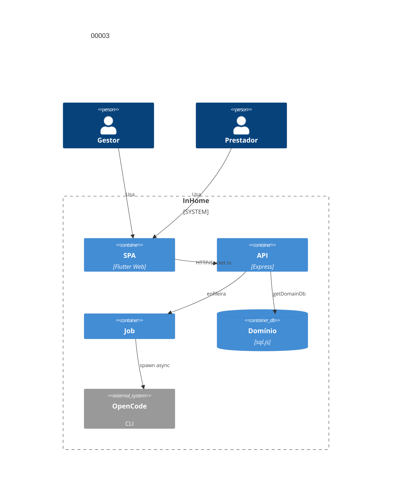

# Implementation Plan: Workflow Assistido OpenCode (00003)

**Branch**: `dev` | **Spec**: [spec.md](spec.md)

## Technical Context

| Campo | Valor |
|---|---|
| Language/Version | Dart 3 (Flutter Web); Node.js 22+ |
| Primary Dependencies | Express, Socket.io, sql.js, jsonwebtoken, nginx, Docker Compose |
| Storage | `data/domains/<id>.db` + `platform.db` (sql.js); migração aditiva |
| Testing | `node --test` (3001), `backend/test.sh` (3199), `flutter analyze` Docker |
| Project Type / Mode | web multi-tenante / brownfield; Docker Compose `:80` |
| Performance Goals | SC-002: 9/10 análises ≤30 s; timeout 60 s → falha |
| Constraints | allowlist servidor (FR-020); sem retry automático; suíte verde p/ `dev`→`main` |
| Scale/Scope | 7 US, 24 FR |

## Instructions Check

| Regra | Status |
|---|---|
| I–III (`dev`, testes, `TODO.md`), IV concisão | PASS |
| Stack, layout, QC (lint, `npm audit`, sem meta) | PASS |
| Complexity Tracking | ausente — sem violação |

## Architecture



## Architecture Decisions

| ID | Questão (opções) | Escolha | Rationale |
|----|------------------|---------|-----------|
| AD-001 | Invocação: HTTP/SDK/CLI | CLI `opencode run` async | FR-018 |
| AD-002 | Estado: memória/BD | `pendente→analisando→sugerido\|falha` | FR-006 |
| AD-003 | Aprovação: manual/materialização | materializa `tasks` | FR-010 |
| AD-004 | Job: worker/in-process | in-process (`runDueSweep`) | FR-015 |
| AD-005 | Realtime: polling/Socket.io | `emitDomainEvent` por domínio | FR-012 |
| AD-006 | Refino: mutar/versionar | nova versão preserva anterior | FR-008 |
| AD-007 | Plano: síncrono/assíncrono | fila pós-ativação; regenera | FR-014 |
| AD-008 | Contexto: dump/allowlist | 6 definições+identificação+vigência | FR-004 |
| AD-009 | Revisão: reescrever/diff | editar/criar só `a_fazer`; conflito | FR-022 |

## Data Model Summary

| Entity | Tabela | Campos-chave |
|---|---|---|
| ContractDefinition | `contract_definitions` | versão + 6 definições + autor |
| TaskSuggestion | `task_suggestions` | contrato, versão, status, refino |
| SuggestionItem | `suggestion_items` | título, justificativa, ordem |
| WorkflowVersion | `workflow_versions` | contrato, sugestão, ativo |
| ExecutionPlan | `execution_plans` | tarefa, passos/critérios/riscos |
| RevisionConflict | `revision_conflicts` | revisão, tarefa, motivo |
| History | `entity_history` | tipo, entidade, versão, snapshot, autor |

## API Surface Summary

| Método | Path | Papel | FR |
|---|---|---|---|
| GET/PUT | `/api/contracts/:id/definitions`, `/history` | admin,gestor | FR-001/FR-002/FR-017 |
| POST/GET | `/api/contracts/:id/analysis`+retry+status | gestor | FR-003/FR-004/FR-005/FR-006/FR-018/FR-021 |
| PATCH/POST | `/api/suggestions/:sid` (items/refine/approve) | gestor | FR-007/FR-008/FR-009/FR-010/FR-012 |
| GET | `/api/contracts/:id/workflow` | todos | FR-011/FR-013 |
| POST | `/api/contracts/:id/review`, `/:rid/apply` | gestor | FR-022/FR-023/FR-024 |
| GET/POST | `/api/tasks/:id/execution-plan(/regenerate)` | GET gestor,prestador; POST gestor | FR-014/FR-015/FR-016 |
| GET/PUT | `/api/opencode/config` | GET admin,gestor; PUT gestor | FR-018 |
| evento | `workflow_activated`, `analysis_state` | sala domínio | FR-012/FR-021 |

## Testing Strategy

| Tier | Tool | Escopo | Mock Boundary | Install |
|---|---|---|---|---|
| Unit | `node --test`+supertest | rotas, modelos, parser/allowlist | spawn CLI; DATA_DIR temp | configured |
| Integration | `backend/test.sh` | análise→aprovação→evento | CLI fake | configured |
| Security | `npm audit --audit-level=high` + OWASP manual | dependências, papéis, domínio | — | configured |

## Acceptance Test Stubs

P1 = US1–US5 (20 FR); `node:test` co-localizado; RED `pending`.

| Req ID | Test File | Stub Blocks (framework-native) | RED Status |
|--------|-----------|--------------------------------|------------|
| FR-001 | backend/src/routes/definitions.test.js | test.todo('FR-001 persiste definições') | pending |
| FR-002 | backend/src/models/ContractDefinition.test.js | test.todo('FR-002 versiona e restringe') | pending |
| FR-003 | backend/src/routes/suggestions.test.js | test.todo('FR-003 bloqueia análise') | pending |
| FR-004 | backend/src/services/opencode.test.js | test.todo('FR-004 só allowlist') | pending |
| FR-005 | backend/src/services/opencode.test.js | test.todo('FR-005 justifica itens') | pending |
| FR-006 | backend/src/services/opencode.test.js | test.todo('FR-006 falha preserva') | pending |
| FR-007 | backend/src/routes/suggestions.test.js | test.todo('FR-007 edita/remove') | pending |
| FR-008 | backend/src/routes/suggestions.test.js | test.todo('FR-008 refino versiona') | pending |
| FR-009 | backend/src/routes/suggestions.test.js | test.todo('FR-009 exige ≥1 item') | pending |
| FR-010 | backend/src/routes/workflow.test.js | test.todo('FR-010 vira workflow') | pending |
| FR-011 | backend/src/routes/workflow.test.js | test.todo('FR-011 fluxo preservado') | pending |
| FR-012 | backend/src/server.socket.test.js | test.todo('FR-012 evento domínio') | pending |
| FR-013 | backend/src/routes/workflow.test.js | test.todo('FR-013 só aprovadas') | pending |
| FR-014 | backend/src/services/opencode.test.js | test.todo('FR-014 plano completo') | pending |
| FR-015 | backend/src/routes/executionPlan.test.js | test.todo('FR-015 plano não bloqueia') | pending |
| FR-016 | backend/src/models/ExecutionPlan.test.js | test.todo('FR-016 não altera status') | pending |
| FR-018 | backend/src/services/opencode.test.js | test.todo('FR-018 timeout 60s') | pending |
| FR-019 | backend/src/routes/definitions.test.js | test.todo('FR-019 isolamento') | pending |
| FR-020 | backend/src/services/opencode.test.js | test.todo('FR-020 sem partes/CNPJ') | pending |
| FR-021 | backend/src/server.socket.test.js | test.todo('FR-021 estado + retry') | pending |

## Error Handling Strategy

| Categoria | Padrão | Resposta | Retry |
|---|---|---|---|
| Definições ausentes / aprovação vazia | fail-fast | 400 + falta | não |
| Timeout/crash/resposta vazia | `falha`, preserva | `analysis_state` | manual |
| Revisão em iniciada/concluída | conflito | 200 + `revision_conflicts` | não |
| Domínio/papel errado | 403/404 | genérico | não |

## Risk Mitigation

| Risk (from spec) | Likelihood | Impact | Mitigation | Owner |
|---|---|---|---|---|
| Definições sensíveis enviadas ao OpenCode | medium | high | allowlist no servidor (FR-004/FR-020) | `services/opencode.js` |
| Sugestões desalinhadas ao contrato | medium | medium | aprovação humana obrigatória (FR-009) | `routes/suggestions.js` |

## Requirement Coverage Map

| Req ID | File Path(s) | Function(s)/Symbol(s) | Decision |
|---|---|---|---|
| FR-001 | backend/src/routes/definitions.js | saveDefinitions(), getDefinitions() | |
| FR-002 | backend/src/models/ContractDefinition.js | versionDefinitions(), listVersions() | |
| FR-003 | backend/src/routes/suggestions.js | assertDefinitionsComplete() | |
| FR-004 | backend/src/services/opencode.js | buildContext(), requestAnalysis() | AD-008 |
| FR-005 | backend/src/services/opencode.js | parseSuggestion(), createSuggestion() | |
| FR-006 | backend/src/services/opencode.js | runAnalysisJob(), markFailed() | AD-002, AD-004 |
| FR-007 | backend/src/routes/suggestions.js | updateItem(), removeItem() | |
| FR-008 | backend/src/models/TaskSuggestion.js | refineSuggestion() | AD-006 |
| FR-009 | backend/src/routes/suggestions.js | approveSuggestion() | |
| FR-010 | backend/src/routes/workflow.js | activateWorkflow(), optInManualTask() | AD-003 |
| FR-011 | backend/src/routes/tasks.js | listTasks(), updateTaskStatus() | |
| FR-012 | backend/src/services/events.js | emitDomainEvent() | AD-005 |
| FR-013 | backend/src/routes/workflow.js | getActiveWorkflow() | |
| FR-014 | backend/src/services/opencode.js | requestExecutionPlan(), parsePlan() | AD-007 |
| FR-015 | backend/src/routes/executionPlan.js | getPlan(), regeneratePlan() | AD-004, AD-007 |
| FR-016 | backend/src/models/ExecutionPlan.js | upsertPlan() | AD-007 |
| FR-017 | backend/src/models/History.js | recordVersion(), listVersions() | AD-006 |
| FR-018 | backend/src/config/opencode.js | isEnabled(), getTimeoutMs(), run({prompt, timeoutMs}) | AD-001 |
| FR-019 | backend/src/middleware/auth.js | requireRole(), scopeDomain(), getDomainDb() | |
| FR-020 | backend/src/services/opencode.js | buildContext() allowlist | AD-008 |
| FR-021 | backend/src/server.js | emitDomainEvent(), getAnalysisStatus() | AD-002, AD-005 |
| FR-022 | backend/src/routes/review.js | loadReviewContext(), submitRevision() | AD-009 |
| FR-023 | backend/src/routes/review.js | applyApprovedRevision() só `a_fazer` | AD-009 |
| FR-024 | backend/src/routes/review.js | startManualReview() | AD-009 |

## Project Structure

```text
+ backend/src/config/opencode.js, backend/src/services/opencode.js
+ backend/src/routes/{definitions,suggestions,workflow,executionPlan,review,opencodeConfig}.js
+ backend/src/models/{ContractDefinition,TaskSuggestion,WorkflowVersion,ExecutionPlan,History}.js
~ backend/src/config/database.js, backend/src/server.js, backend/src/routes/{tasks,contracts}.js
~ frontend/lib/screens/contract_detail_screen.dart, frontend/lib/services/api_service.dart
```

**Reuse**: `getDomainDb`, `requireRole`, `emitDomainEvent`.

## Implementation Hints

- **[HINT-001]** Order: stubs RED → tabelas → serviço → rotas → revisão → plano → frontend.
- **[HINT-002]** Gotcha: resposta não-JSON/vazia → `falha`, nunca sugestão; retry manual.
- **[HINT-003]** Constraint: payload só via allowlist; testes negam partes, CNPJ, valores.
