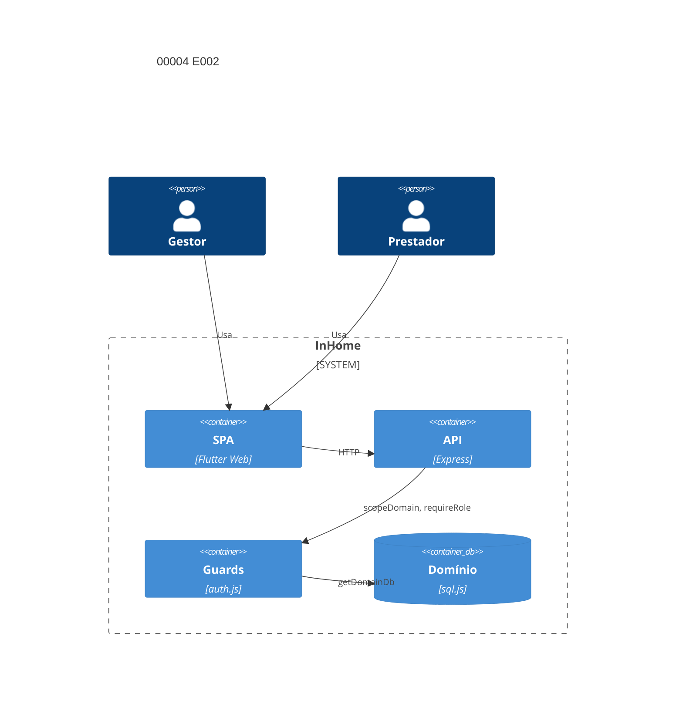

# Implementation Plan: Contrato e vigência E002 (00004)

**Branch**: `dev` | **Date**: 2026-10-08 | **Spec**: [spec.md](spec.md)

## Technical Context

| Campo | Valor |
|---|---|
| Language/Version | Dart 3 (Flutter Web); Node.js 22+ |
| Primary Dependencies | Express, Socket.io, sql.js, jsonwebtoken, bcryptjs, Docker Compose |
| Storage | `data/domains/<id>.db` + `platform.db` (sql.js); sem migração de esquema |
| Testing | `node --test` (3001), `backend/test.sh` (3199), `flutter analyze` Docker |
| Project Type / Mode | web multi-tenante / brownfield; só backend muda |
| Performance Goals | SC-004: p95 <2 s na listagem com 5.000 contratos; 100% dos vigentes com previsão |
| Constraints | `atrasado` só derivado; 403 antes de qualquer linha lida; suíte verde p/ `dev`→`main` |
| Scale/Scope | 4 US, 15 FR, 0 nova entidade |

## Instructions Check

| Regra | Status |
|---|---|
| I–III (`dev`, testes, `TODO.md`), IV concisão | PASS |
| Stack, layout, QC (`node --check`, `npm audit --audit-level=high`, sem meta) | PASS |
| Complexity Tracking | ausente — sem violação |

## Architecture



## Architecture Decisions

| ID | Questão (opções) | Escolha | Rationale |
|----|------------------|---------|-----------|
| AD-001 | Status: gravar `atrasado`/job vs derivar na leitura | derivar em `effectiveStatus()` | FR-005..FR-008; sem escrita de rotina |
| AD-002 | Filtro: pós-filtrar a página vs partição no SQL | SQL `forecast_date < date('now')` | FR-013; preserva `total` e paginação |
| AD-003 | Escopo: checagem por handler vs guarda no roteador | `router.use(scopeDomain())` | FR-011; precedente em `definitions.js` |
| AD-004 | Perf: script externo vs seed no teste | seed 5.000 + p95 em `node:test` | FR-015; evidência dentro do `npm test` |

## Data Model Summary

N/A — sem nova entidade nem migração; esquema de `contracts` inalterado (sinais da spec sem `NEW-ENTITY`/`MIGRATION`).

## API Surface Summary

| Método | Path | Papel | FR |
|---|---|---|---|
| GET/POST | `/api/contracts` | GET admin,gestor,prestador; POST admin,gestor | FR-012/013/014/015; FR-001 |
| GET/PUT | `/api/contracts/:id` | GET todos os papéis de contrato; PUT admin,gestor | FR-001; FR-012 |
| POST/DELETE | `/api/contracts/:id/prestadores(/:userId)` | admin,gestor | FR-002 |
| POST | `/api/contracts/:id/prorrogar` | admin,gestor | FR-003/008 |
| POST | `/api/contracts/:id/encerrar` | admin,gestor | FR-004 |
| DELETE | `/api/contracts/:id` | admin | FR-004 |
| query `domainId` | qualquer rota de contrato | 403 para domínio estrangeiro | FR-010/011 |

**Detail**: [contracts/openapi.yaml](contracts/openapi.yaml)

## Testing Strategy

| Tier | Tool | Escopo | Mock Boundary | Install |
|---|---|---|---|---|
| Unit | `node --test`+supertest | rotas de contrato, status derivado, filtro, guards | sql.js temporário (`DATA_DIR`) | configured |
| Integration | `backend/test.sh` (PORT=3199) | ciclo contrato→prestadores→prorrogação→encerramento + smoke | backend no ar | configured |
| Lint | `node --check` em `backend/src/**/*.js` | sintaxe | — | configured |
| Security | `npm audit --audit-level=high` + testes de 403/escopo | dependências, papéis, isolamento de domínio | — | configured |

## Acceptance Test Stubs

P1 = FR-001..FR-015 (15); `node:test` co-localizado; RED `pending`.

| Req ID | Test File | Stub Blocks (framework-native) | RED Status |
|--------|-----------|--------------------------------|------------|
| FR-001 | backend/src/routes/contracts.test.js | test.todo('FR-001 cria contrato validado') | pending |
| FR-002 | backend/src/routes/contracts.test.js | test.todo('FR-002 vincula e desvincula prestadores') | pending |
| FR-003 | backend/src/routes/contracts.test.js | test.todo('FR-003 prorroga contrato vigente') | pending |
| FR-004 | backend/src/routes/contracts.test.js | test.todo('FR-004 encerra e restringe exclusão') | pending |
| FR-005 | backend/src/models/Contract.test.js | test.todo('FR-005 status derivado na leitura') | pending |
| FR-006 | backend/src/models/Contract.test.js | test.todo('FR-006 atrasado nunca é gravado') | pending |
| FR-007 | backend/src/models/Contract.test.js | test.todo('FR-007 previsão passada é aceita') | pending |
| FR-008 | backend/src/models/Contract.test.js | test.todo('FR-008 prorrogação devolve vigente') | pending |
| FR-009 | backend/src/routes/tasks.test.js | test.todo('FR-009 tarefas seguem em atrasado') | pending |
| FR-010 | backend/src/routes/contracts.test.js | test.todo('FR-010 403 antes de qualquer linha') | pending |
| FR-011 | backend/src/routes/contracts.test.js | test.todo('FR-011 domainId estrangeiro 403') | pending |
| FR-012 | backend/src/routes/contracts.test.js | test.todo('FR-012 consulta restrita ao domínio') | pending |
| FR-013 | backend/src/routes/contracts.test.js | test.todo('FR-013 filtro particiona os status') | pending |
| FR-014 | backend/src/routes/contracts.test.js | test.todo('FR-014 100% dos vigentes com previsão') | pending |
| FR-015 | backend/src/routes/contracts.test.js | test.todo('FR-015 p95 abaixo de 2s com 5000') | pending |

## Error Handling Strategy

| Categoria | Padrão | Resposta | Retry |
|---|---|---|---|
| Nome/datas/finalidade inválidos | fail-fast | 400 + `{error}` | não |
| Papel, domínio suspenso, `domainId` estrangeiro | deny by default | 401/403 antes da consulta | não |
| Contrato inexistente ou não vinculado ao prestador | esconde existência | 404 + `{error}` | não |
| Prorrogação/encerramento inválido | conflito de estado | 400 + `{error}` | não |
| Falha interna | catch-all | 500 + `{error}` | não |

## Risk Mitigation

| Risk (from spec) | Likelihood | Impact | Mitigation | Owner |
|---|---|---|---|---|
| Fonte de dados instável para alertas | low | high | asserção FR-014 (100% dos vigentes devolvem `forecast_date`) e `parseBodyDates` obrigatório no cadastro | `routes/contracts.js` |
| Regressão em prorrogação | medium | medium | cenário fim a fim FR-003/FR-008: prorrogar devolve `vigente` no derivado sem escrita manual | `models/Contract.js` |

## Requirement Coverage Map

| Req ID | File Path(s) | Function(s)/Symbol(s) | Decision |
|---|---|---|---|
| FR-001 | backend/src/routes/contracts.js, backend/src/routes/contracts.test.js | createContract(), parseBodyDates(), validate(CONTRACT_SCHEMA) | |
| FR-002 | backend/src/routes/contracts.js, backend/src/routes/contracts.test.js | linkPrestador(), unlinkPrestador() | |
| FR-003 | backend/src/routes/contracts.js, backend/src/routes/contracts.test.js | extendContract() | |
| FR-004 | backend/src/routes/contracts.js, backend/src/routes/contracts.test.js | closeContract(), deleteContract() | |
| FR-005 | backend/src/models/Contract.js, backend/src/models/Contract.test.js | effectiveStatus(), isOverdue(), Contract.decorate() | AD-001 |
| FR-006 | backend/src/models/Contract.js, backend/src/routes/contracts.js, backend/src/models/Contract.test.js | effectiveStatus() só leitura; escritas passam por closeContract() | AD-001 |
| FR-007 | backend/src/routes/contracts.js, backend/src/models/Contract.js, backend/src/models/Contract.test.js, backend/src/routes/contracts.test.js | createContract(), isOverdue() | AD-001 |
| FR-008 | backend/src/routes/contracts.js, backend/src/models/Contract.js, backend/src/models/Contract.test.js, backend/src/routes/contracts.test.js | extendContract(), effectiveStatus() | AD-001 |
| FR-009 | backend/src/routes/tasks.js, backend/src/models/Task.js, backend/src/routes/tasks.test.js | createTask(), updateTaskStatus(), assertMover() | |
| FR-010 | backend/src/middleware/auth.js, backend/src/routes/contracts.js, backend/src/routes/contracts.test.js | requireRole(), authenticateToken(), assertDomainActive() | |
| FR-011 | backend/src/routes/contracts.js, backend/src/middleware/auth.js, backend/src/routes/contracts.test.js | router.use(scopeDomain()) | AD-003 |
| FR-012 | backend/src/routes/contracts.js, backend/src/routes/contracts.test.js | listContracts() join prestador, getContract() checagem de vínculo | |
| FR-013 | backend/src/routes/contracts.js, backend/src/routes/contracts.test.js, backend/test.sh | listContracts() statusWhere particionado | AD-002 |
| FR-014 | backend/src/routes/contracts.js, backend/src/models/Contract.js, backend/src/routes/contracts.test.js | listContracts() → Contract.decorate() com previsão | |
| FR-015 | backend/src/routes/contracts.test.js | teste de p95 com seed 5.000 (runBatch, ensureIndexes) | AD-004 |

## Project Structure

```text
~ backend/src/routes/contracts.js (guard de escopo + filtro particionado)
~ backend/src/models/Contract.js (status derivado)
~ backend/src/routes/contracts.test.js (stubs, regressão, p95 com 5.000)
~ backend/src/routes/tasks.test.js (tarefas sobre contrato atrasado)
+ backend/src/models/Contract.test.js (status derivado)
~ backend/test.sh (smoke do filtro e da partição)
```

**Reuse**: `scopeDomain`, `requireRole`, `effectiveStatus`/`isOverdue`, `Contract.decorate`, `runBatch`/`ensureIndexes`.

## Implementation Hints

- **[HINT-001]** Order: stubs RED → `scopeDomain` no roteador → filtro particionado → seed 5.000.
- **[HINT-002]** Gotcha: particionar no SQL, nunca pós-filtrar a página — `total` e paginação quebram.
- **[HINT-003]** Constraint: o banco guarda só `vigente`/`encerrado`; `atrasado` existe só na leitura (FR-006).
- **[HINT-004]** Gotcha: `finalidade_id` segue opcional (`test.sh` cria sem ela); 400 só para inexistente/aposentada.
- **[HINT-005]** Perf: seed em lote e p95 sobre repetições, com `ensureIndexes` antes da consulta.
