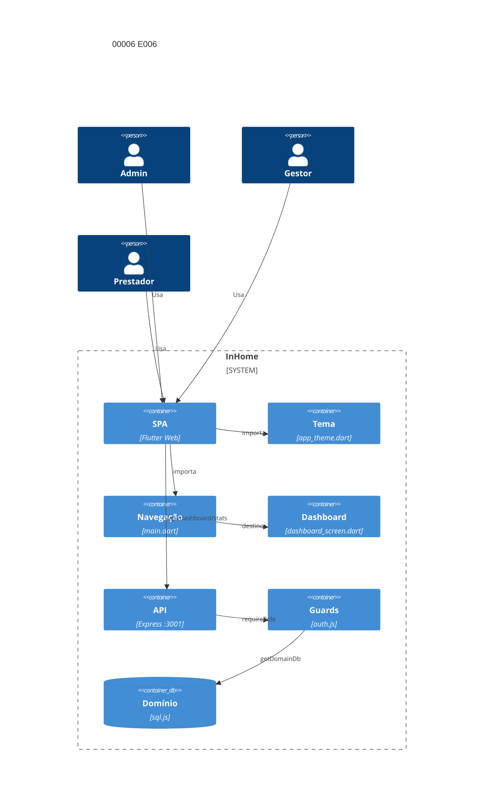

# Implementation Plan: Painel por papel E006 (00006)

**Branch**: `dev` | **Date**: 2026-10-09 | **Spec**: [spec.md](spec.md)

## Technical Context

| Campo | Valor |
|---|---|
| Language/Version | Dart 3 (Flutter Web); Node.js 22+ |
| Primary Dependencies | Express, Socket.io, sql.js, jsonwebtoken, Docker Compose |
| Storage | `data/domains/<id>.db` + `platform.db` (sql.js); sem migração nova |
| Testing | `node --test` (3001), `backend/test.sh` (3199), `flutter test` Docker, `flutter analyze` Docker |
| Project Type / Mode | web multi-tenante / brownfield; `frontend/lib/` + `backend/src/routes/dashboard.js` |
| Performance Goals | painel carrega em p95 < 2 s; 403 antes de qualquer consulta |
| Constraints | permissão mínima por papel; acessibilidade básica sem AA; suíte verde antes de promoção |
| Scale/Scope | 2 US, 6 FR, 0 nova tabela, 0 novo endpoint |

## Instructions Check

| Regra | Status |
|---|---|
| I–III (`dev`, testes, `TODO.md`), IV concisão | PASS |
| Stack, layout, QC (`flutter analyze`, `node --check`, `npm audit --audit-level=high`) | PASS |
| Complexity Tracking | ausente — sem violação |

## Architecture



## Architecture Decisions

| ID | Questão (opções) | Escolha | Rationale |
|----|------------------|---------|-----------|
| AD-001 | Verificação do painel por papel: teste automatizado vs manual | teste automatizado em `backend/src/routes/dashboard.test.js` (admin/gestor/prestador/system_admin) | FR-001/002/003; precedente no teste existente de métricas |
| AD-002 | Foco de teclado: Focus explícito vs traversal padrão do Material 3 | traversal padrão do Material 3 + `Semantics` label em cada destino e ação | FR-005; T031 já fecha traversal via NavigationRail; sem widget Focus novo |
| AD-003 | `scopeDomain()` no dashboard: ligar vs não ligar | não ligar — rota não recebe parâmetro `domainId`, token já isola o domínio | FR-003; `scopeDomain()` é no-op quando não há `domainId` na requisição (Q2) |
| AD-004 | Telas principais de US2: escopo | dashboard + tasks + projects (destinos do NavigationRail para os três papéis) | Clarify Q3; NavigationRail é a navegação universal |

## Data Model Summary

N/A — sem nova entidade (spec sem `NEW-ENTITY`/`MIGRATION`); `contracts`, `tasks` e `users` inalterados — leitura existente.

## API Surface Summary

N/A — nenhum endpoint novo; `GET /api/dashboard/stats` já existe e muda só em verificação de escopo (FR-003).

## Testing Strategy

| Tier | Tool | Escopo | Mock Boundary | Install |
|---|---|---|---|---|
| Unit | `node --test`+supertest | dashboard por papel (admin/gestor/prestador/system_admin), 403 | sql.js temporário (`DATA_DIR`) | configured |
| Unit | `flutter test` (Docker) | bootstrap web, a11y labels, NavigationRail traversal | ApiService mock | configured |
| Integration | `backend/test.sh` (3199) | smoke fim a fim (118/118 baseline) | backend no ar | configured |
| Lint | `flutter analyze` (Docker) + `node --check` | sintaxe | — | configured |
| Security | `npm audit --audit-level=high` + 403 system_admin | dependências, isolamento de papel | — | configured |

## Acceptance Test Stubs

P1 = FR-001..FR-006 (6); `node --test` co-localizado para FR-001..003; `flutter test` para FR-004..006; RED `pending`.

| Req ID | Test File | Stub Blocks (framework-native) | RED Status |
|--------|-----------|--------------------------------|------------|
| FR-001 | backend/src/routes/dashboard.test.js | test.todo('FR-001 admin/gestor veem totais do domínio') | pending |
| FR-002 | backend/src/routes/dashboard.test.js | test.todo('FR-002 prestador vê só tarefas próprias') | pending |
| FR-003 | backend/src/routes/dashboard.test.js | test.todo('FR-003 403 para system_admin') | pending |
| FR-004 | frontend/test/web_browsers_test.dart | testWidgets('FR-004 bootstrap web aplicado sem conteúdo sem estilo') | pending |
| FR-005 | frontend/test/a11y_labels_test.dart | testWidgets('FR-005 rótulos e foco nas telas principais') | pending |
| FR-006 | frontend/test/web_browsers_test.dart | testWidgets('FR-006 regressão fim a fim verde após main.dart') | pending |

## Error Handling Strategy

| Categoria | Padrão | Resposta | Retry |
|---|---|---|---|
| system_admin consultando o dashboard | deny by default | 403 antes de qualquer consulta | não |
| Token de domínio divergente | token isolation (sem `scopeDomain`) | 403 via `authenticateToken` (domínio já fixado no token) | não |
| Prestador pedindo escopo completo | visão restrita no handler | 200 com `scope: 'own'` (não 403) | não |
| Falha de rede no carregamento do painel | error state no widget | mensagem de erro + retry manual | não |

## Risk Mitigation

| Risk (from spec) | Likelihood | Impact | Mitigation | Owner |
|---|---|---|---|---|
| Bootstrap quebrando tela existente | medium | medium | regressão fim a fim completa (`flutter test` + `backend/test.sh`) após alteração em `main.dart` | `frontend/lib/main.dart` |
| Escopo de acessível crescendo para AA | low | medium | manter perímetro em rótulos, contraste e teclado; sem widget AA novo | `frontend/lib/theme/app_theme.dart` |
| Prestador vendo dados alheios | low | high | teste automatizado com mock de banco (FR-002) + asserção `scope: 'own'` | `backend/src/routes/dashboard.test.js` |

## Requirement Coverage Map

| Req ID | File Path(s) | Function(s)/Symbol(s) | Decision |
|--------|--------------|------------------------|----------|
| FR-001 | backend/src/routes/dashboard.js, backend/src/routes/dashboard.test.js | getDomainMetrics(db, user), router.get('/stats') | AD-001 |
| FR-002 | backend/src/routes/dashboard.js, backend/src/routes/dashboard.test.js | getDomainMetrics() prestador branch, summarizeTasks() | AD-001 |
| FR-003 | backend/src/routes/dashboard.js, backend/src/routes/dashboard.test.js | requireRole('admin','gestor','prestador'), authenticateToken | AD-003 |
| FR-004 | frontend/lib/main.dart, frontend/test/web_browsers_test.dart | ProjectManagerApp, main(), MaterialApp | AD-002 |
| FR-005 | frontend/lib/theme/app_theme.dart, frontend/lib/screens/dashboard_screen.dart, frontend/lib/screens/tasks_screen.dart, frontend/lib/screens/projects_screen.dart, frontend/test/a11y_labels_test.dart | AppTheme.light, Semantics(container:true,label:), NavigationRail destinations | AD-002, AD-004 |
| FR-006 | frontend/test/web_browsers_test.dart, backend/test.sh | flutter test suite, smoke suite | |

## Project Structure

### Source Code

```text
~ backend/src/routes/dashboard.test.js (FR-001/002/003: admin/gestor/prestador/system_admin)
~ frontend/lib/theme/app_theme.dart (FR-005: Semantics label em AppTheme.light se necessário)
~ frontend/lib/screens/dashboard_screen.dart (FR-005: Semantics label nos StatCard e ações)
~ frontend/lib/screens/tasks_screen.dart (FR-005: Semantics label nos filtros e lista)
~ frontend/lib/screens/projects_screen.dart (FR-005: Semantics label na lista e ações)
~ frontend/test/a11y_labels_test.dart (FR-005: extensão para telas principais)
~ frontend/test/web_browsers_test.dart (FR-004/006: bootstrap + regressão)
```

**Reuse**: `getDomainMetrics`, `requireRole`, `authenticateToken`, `getDomainDb`, `AppTheme.light`, `NavigationRail` destinations existentes.

## Implementation Hints

- **[HINT-001]** Order: stubs RED → teste de dashboard por papel (FR-001/002/003) → `Semantics` nas telas principais (FR-005) → regressão `flutter test` + `backend/test.sh` (FR-006).
- **[HINT-002]** Gotcha: `scopeDomain()` é no-op quando não há parâmetro `domainId` — não ligar em `GET /api/dashboard/stats` (AD-003).
- **[HINT-003]** Gotcha: `main.dart` é compartilhado por todas as telas — regressão fim a fim obrigatória após qualquer alteração (FR-006).
- **[HINT-004]** Constraint: `contracts`, `tasks` e `users` não mudam de esquema (superfície de E007/E008); corrigir só o que a verificação apontar.
- **[HINT-005]** Order: `docker compose build backend && docker compose up -d backend` após mudança de código backend; `docker compose build frontend && docker compose up -d frontend` após mudança de código frontend.
