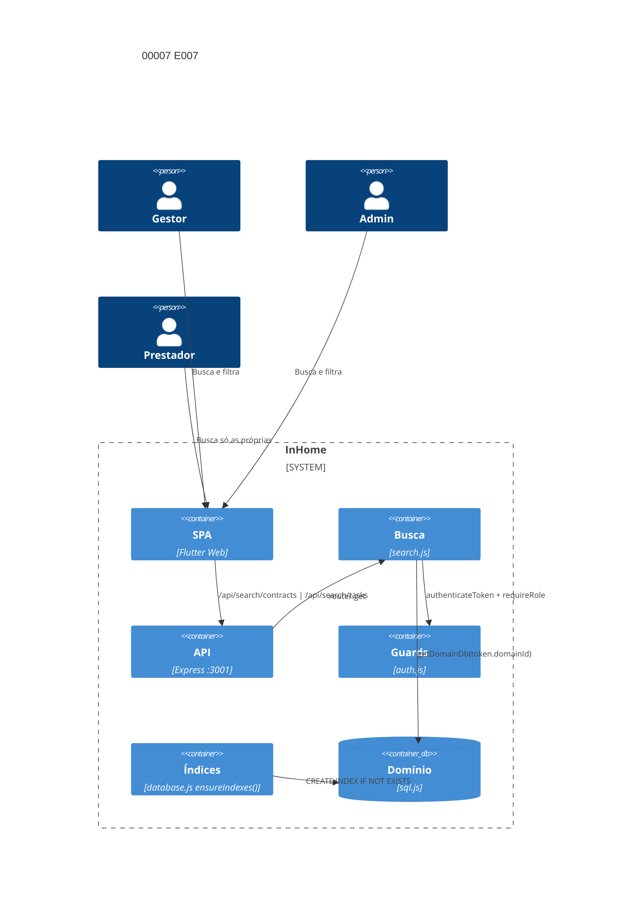

# Implementation Plan: Busca e filtros E007 (00007)

**Branch**: `dev` | **Date**: 2026-10-09 | **Spec**: [spec.md](spec.md)

## Technical Context

| Campo | Valor |
|---|---|
| Language/Version | Node.js 22+; Dart 3 (Flutter Web, regressão) |
| Primary Dependencies | Express, sql.js, Docker Compose |
| Storage | `data/domains/<id>.db` (sql.js); índices aditivos em `ensureIndexes()` |
| Testing | `node --test` (3001), `backend/test.sh` (3199), `flutter test` Docker, `flutter analyze` Docker |
| Project Type / Mode | web multi-tenante / brownfield; `backend/src/routes/search.js` + `backend/src/config/database.js` |
| Performance Goals | p95 da busca/listagem < 2 s em volume representativo; sem cache; leitura única |
| Constraints | escopo de domínio do token obrigatório; sem camada de cache; suíte verde antes de promoção |
| Scale/Scope | 2 US, 5 FR, 0 nova tabela, 0 novo endpoint, 0–2 índices condicionais |

## Instructions Check

| Regra | Status |
|---|---|
| I–III (`dev`, testes, `TODO.md`), IV concisão | PASS |
| Stack, layout, QC (`flutter analyze`, `node --check`, `npm audit --audit-level=high`) | PASS |
| Complexity Tracking | ausente — sem violação |

## Architecture



## Architecture Decisions

| ID | Questão (opções) | Escolha | Rationale |
|----|------------------|---------|-----------|
| AD-001 | Escopo de domínio na busca: `scopeDomain()` vs token-only | token-only — rota não recebe `domainId`, `getDomainDb(req.user.domainId)` isola | Mesma construção do painel (E006 AD-003); `scopeDomain()` é no-op sem `domainId` na requisição |
| AD-002 | Índice para p95: aditivo preguiçoso vs migração formal | `CREATE INDEX IF NOT EXISTS` em `ensureIndexes()` apenas se a medição apontar lacuna | `ensureIndexes()` já roda a cada abertura do banco do domínio; idempotente; sem `migrateSchema()` para índice puro |
| AD-003 | Medição de p95: fixtures + requisições sequenciais vs ferramenta externa | fixtures de teste + N requisições sequenciais cronometradas, cálculo de p95 no teste | Ambiente local determinístico; sem dependência nova; cache proibido pela restrição de leitura única |
| AD-004 | Correção de gap: filtro/índice vs cache | sempre índice — nunca cache | Restrição explícita do SAD e do PRD: sem camada de cache, leitura única por requisição |

## Data Model Summary

N/A — sem nova entidade (spec sem `NEW-ENTITY`/`MIGRATION`); `contracts`, `tasks` e `contract_providers` inalterados — leitura existente. Índices aditivos condicionais são `CREATE INDEX IF NOT EXISTS` em colunas já existentes (`tasks.priority`, `tasks.due_date`).

## API Surface Summary

N/A — nenhum endpoint novo; `GET /api/search/contracts` e `GET /api/search/tasks` já existem sob FR-016 e mudaem apenas se a verificação apontar gap de filtro ou escopo.

## Testing Strategy

| Tier | Tool | Escopo | Mock Boundary | Install |
|---|---|---|---|---|
| Unit | `node --test`+supertest | seis filtros isolados/ combinados, escopo prestador, página além do total | sql.js temporário (`DATA_DIR`) | configured |
| Unit | `node --test` (latência) | p95 de `/api/search/tasks` com filtros combinados em volume representativo | fixtures em sql.js temporário | configured |
| Integration | `backend/test.sh` (3199) | smoke fim a fim (118/118 baseline) | backend no ar | configured |
| Integration | `flutter test` (Docker) | regressão da SPA (16/16 baseline) | ApiService mock | configured |
| Lint | `node --check` + `flutter analyze` (Docker) | sintaxe | — | configured |
| Security | `npm audit --audit-level=high` + escopo de domínio | dependências, isolamento | — | configured |

## Acceptance Test Stubs

P1 = FR-001..FR-005 (5); `node --test` co-localizado em `search.test.js`; RED `pending`.

| Req ID | Test File | Stub Blocks (framework-native) | RED Status |
|--------|-----------|--------------------------------|------------|
| FR-001 | backend/src/routes/search.test.js | test.todo('FR-001 seis filtros isolados e combinados') | pending |
| FR-002 | backend/src/routes/search.test.js | test.todo('FR-002 resultado vazio sem erro e paginação consistente') | pending |
| FR-003 | backend/src/routes/search.test.js | test.todo('FR-003 p95 abaixo de 2 s com ensureIndexes ativo') | pending |
| FR-004 | backend/src/routes/search.test.js | test.todo('FR-004 escopo de domínio e papel na busca') | pending |
| FR-005 | backend/test.sh | test.todo('FR-005 regressão verde das listagens após índice') | pending |

## Error Handling Strategy

| Categoria | Padrão | Resposta | Retry |
|---|---|---|---|
| Combinação de filtros sem resultado | lista vazia legível | 200 com `total: 0`, arrays vazios | não |
| Página além do total | lista vazia com total correto | 200 com `total` real, arrays vazios | não |
| Parâmetro de domínio divergente | token isolation (sem `scopeDomain`) | ignora o parâmetro; responde só com o domínio do token | não |
| P95 acima de 2 s | regressão de performance | atacar por índice (`ensureIndexes()`), nunca cache | não |
| LIKE com curinga do usuário | escape em `likeParam()` | `%` e `_` escapados com `ESCAPE '\\'` | não |

## Risk Mitigation

| Risk (from spec) | Likelihood | Impact | Mitigation | Owner |
|---|---|---|---|---|
| Regressão por índice em listagens de E002/E003 | low | medium | bateria completa (unit 107+, smoke 118+) após qualquer mudança em `ensureIndexes()` | `backend/src/config/database.js` |
| Latência acima de 2 s em volume | medium | medium | medição de p95 com fixtures; índice composto se necessário; sem cache | `backend/src/routes/search.js` |
| Escopo vazando em combinação de filtros | low | high | teste automatizado com mock de banco (FR-004) + asserção de conjunto por domínio/papel | `backend/src/routes/search.test.js` |

## Requirement Coverage Map

| Req ID | File Path(s) | Function(s)/Symbol(s) | Decision |
|--------|--------------|------------------------|----------|
| FR-001 | backend/src/routes/search.js, backend/src/routes/search.test.js | searchContracts(), searchTasks(), likeParam(), paging() | AD-001 |
| FR-002 | backend/src/routes/search.js, backend/src/routes/search.test.js | paging(limit, offset), total COUNT query | AD-001 |
| FR-003 | backend/src/config/database.js, backend/src/routes/search.test.js | ensureIndexes(wrapper), DOMAIN_INDEXES | AD-002, AD-003, AD-004 |
| FR-004 | backend/src/routes/search.js, backend/src/routes/search.test.js | getDomainDb(req.user.domainId), requireRole('admin','gestor','prestador') | AD-001 |
| FR-005 | backend/test.sh, backend/src/config/database.js | smoke suite 118/118, ensureIndexes() idempotente | AD-002 |

## Project Structure

### Source Code

```text
~ backend/src/routes/search.test.js (FR-001/002/004: filtros, vazio, escopo)
~ backend/src/routes/search.js (FR-001/002/004: correção pontual de filtro segap apontado)
~ backend/src/config/database.js (FR-003/005: índice condicional em ensureIndexes() se gap apontado)
~ backend/test.sh (FR-005: regressão fim a fim)
```
