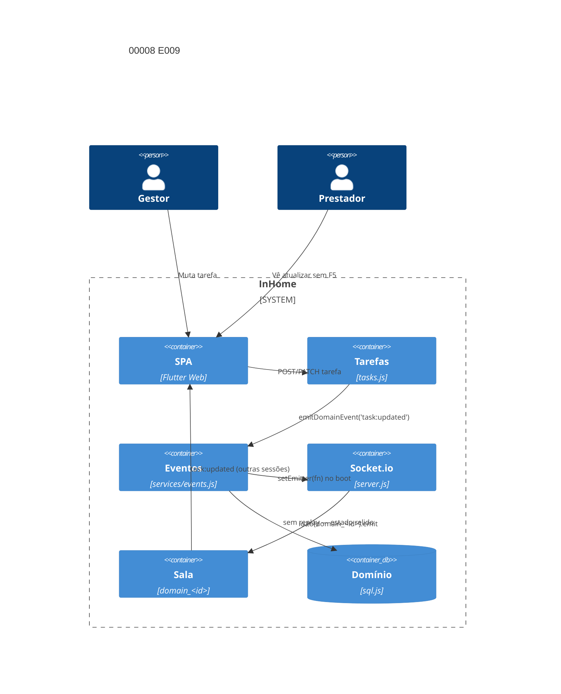

# Implementation Plan: Comunicação em tempo real E009 (00008)

**Branch**: `dev` | **Date**: 2026-10-10 | **Spec**: [spec.md](spec.md)

## Technical Context

| Campo | Valor |
|---|---|
| Language/Version | Node.js 22+; Dart 3 (Flutter Web, regressão) |
| Primary Dependencies | Express, Socket.io, sql.js, Docker Compose |
| Storage | `data/domains/<id>.db` (sql.js); sem migração — transporte entregue |
| Testing | `node --test` (3001) + socket.io client, `backend/test.sh` (3199), `flutter test` Docker, `flutter analyze` Docker |
| Project Type / Mode | web multi-tenante / brownfield; `backend/src/server.js` + `backend/src/services/events.js` + `backend/src/routes/tasks.js` |
| Performance Goals | resposta HTTP da mutação nunca depende da emissão; evento entregue à sala do domínio |
| Constraints | entrega melhor esforço sem replay; falha de emissão nunca propaga para a resposta HTTP; salas por domínio; instância única |
| Scale/Scope | 2 US, 4 FR, 0 nova tabela, 0 novo endpoint, 0 nova rota Socket.io |

## Instructions Check

| Regra | Status |
|---|---|
| I–III (`dev`, testes, `TODO.md`), IV concisão | PASS |
| Stack, layout, QC (`flutter analyze`, `node --check`, `npm audit --audit-level=high`) | PASS |
| Complexity Tracking | ausente — sem violação |

## Architecture



## Architecture Decisions

| ID | Questão (opções) | Escolha | Rationale |
|----|------------------|---------|-----------|
| AD-001 | Prova ponta a ponta HTTP → socket: teste automatizado vs manual | teste automatizado em `server.socket.test.js` (supertest + socket.io client no mesmo processo) | FR-001/FR-002; precedente nos testes de sala existentes (SC-004) |
| AD-002 | Injeção de falha de emissão: mock vs quebra real | `setEmitter(fn)` com fn que lança; emitter ausente via chamada sem emitter registrado | FR-003/FR-004; exercita o `try/catch` real de `services/events.js` sem tocar no Socket.io |
| AD-003 | Escopo de mutação de contrato: incluir emitter vs verificar só tarefa | verificar só tarefa — `contracts.js` não emite, consumidores não ouvem `contract:*` | Clarify Q1; demo e cenários são de tarefa; adicionar emitter de contrato seria escopo novo |
| AD-004 | Regressão de consumidores: reescrever vs confiar na bateria | confiar na bateria completa (unit 111+, smoke 118+, flutter 16+) | FR-004/SC-004; telas consumidoras cobertas pelos testes de widget existentes |

## Data Model Summary

N/A — sem nova entidade (spec sem `NEW-ENTITY`/`MIGRATION`); sessão, evento de domínio e domínio inalterados — transporte entregue sob FR-020/FR-012.

## API Surface Summary

N/A — nenhum endpoint novo; nenhuma rota Socket.io nova. `join_domain`/`leave_domain` e `emitDomainEvent` já existem e mudaem apenas em verificação.

## Testing Strategy

| Tier | Tool | Escopo | Mock Boundary | Install |
|---|---|---|---|---|
| Unit | `node --test`+supertest+socket.io client | HTTP→socket ponta a ponta, isolamento de sala, inércia da falha, emitter ausente | Socket.io real em processo; emitter injetado via `setEmitter` | configured |
| Integration | `backend/test.sh` (3199) | smoke fim a fim (118/118 baseline) | backend no ar | configured |
| Integration | `flutter test` (Docker) | regressão das telas consumidoras (16/16 baseline) | ApiService mock | configured |
| Lint | `node --check` + `flutter analyze` (Docker) | sintaxe | — | configured |
| Security | `npm audit --audit-level=high` + isolamento de sala | dependências, não-vazamento entre domínios | — | configured |

## Acceptance Test Stubs

P2 = FR-001..FR-004 (4); `node --test` co-localizado em `server.socket.test.js`; RED `pending`.

| Req ID | Test File | Stub Blocks (framework-native) | RED Status |
|--------|-----------|--------------------------------|------------|
| FR-001 | backend/src/server.socket.test.js | test.todo('FR-001 mutação HTTP publica task:updated na sala do domínio') | pending |
| FR-002 | backend/src/server.socket.test.js | test.todo('FR-002 outro domínio não recebe o evento') | pending |
| FR-003 | backend/src/server.socket.test.js | test.todo('FR-003 falha de emissão não altera a resposta HTTP') | pending |
| FR-004 | backend/src/server.socket.test.js | test.todo('FR-004 emitter ausente retorna false sem replay') | pending |

## Error Handling Strategy

| Categoria | Padrão | Resposta | Retry |
|---|---|---|---|
| Emissor lança exceção | try/catch em `services/events.js` | retorna `false`; resposta HTTP da mutação segue normalmente | não |
| Emissor não registrado | guarda `if (!emitter) return false` | retorna `false` sem lançar | não |
| Sessão de outro domínio | sala por `domain_<id>` | não recebe o evento | não |
| Sessão desconectada na mutação | entrega melhor esforço | evento perdido; estado relido do banco na reconexão | não |
| Token expirado em reconexão | revalidação no handshake | conexão recusada; sala antiga abandonada | não |

## Risk Mitigation

| Risk (from spec) | Likelihood | Impact | Mitigation | Owner |
|---|---|---|---|---|
| Evento perdido sem replay | medium | low | estado sempre relido do banco na reconexão (FR-004) | `backend/src/services/events.js` |
| Resposta HTTP dependendo da emissão | low | high | `try/catch` retorna `false` (FR-003) + teste de inércia | `backend/src/services/events.js` |
| Regressão nas telas consumidoras | low | medium | bateria completa (unit/smoke/flutter) após verificação | `backend/test.sh`, `frontend/test/` |

## Requirement Coverage Map

| Req ID | File Path(s) | Function(s)/Symbol(s) | Decision |
|--------|--------------|------------------------|----------|
| FR-001 | backend/src/server.socket.test.js, backend/src/routes/tasks.js | emitDomainEvent('task:updated'), io.to(`domain_${id}`).emit | AD-001, AD-003 |
| FR-002 | backend/src/server.socket.test.js, backend/src/server.js | socket.join(`domain_${id}`), io.to room scoping | AD-001 |
| FR-003 | backend/src/server.socket.test.js, backend/src/services/events.js | emitDomainEvent try/catch → false, setEmitter | AD-002 |
| FR-004 | backend/src/server.socket.test.js, backend/src/services/events.js | if (!emitter) return false, sem replay | AD-002, AD-004 |

## Project Structure

### Source Code

```text
~ backend/src/server.socket.test.js (FR-001/002/003/004: ponta a ponta, isolamento, inércia, emitter ausente)
~ backend/src/services/events.js (FR-003/004: try/catch e guarda — só se a verificação apontar gap)
~ backend/test.sh (FR-004: regressão fim a fim)
```
