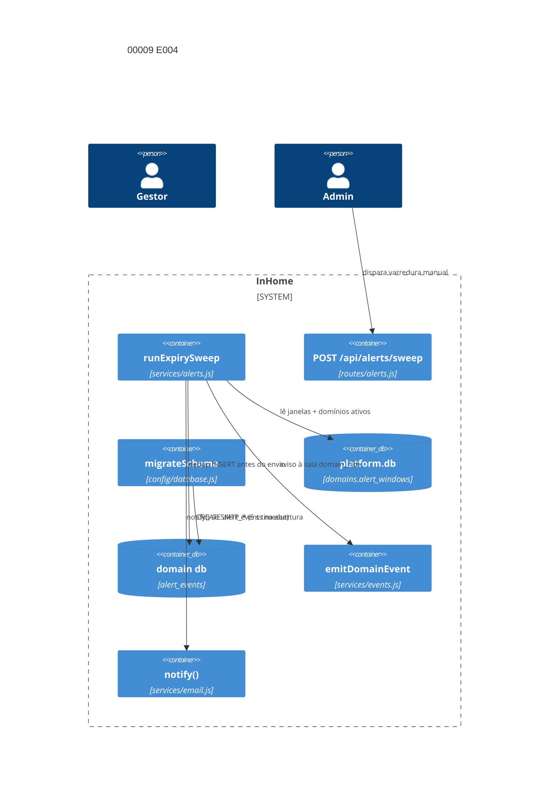

# Implementation Plan: Motor de alertas de vigência E004 (00009)

**Branch**: `dev` | **Date**: 2026-10-11 | **Spec**: [spec.md](spec.md)

## Technical Context

| Campo | Valor |
|---|---|
| Language/Version | Node.js 22+; Dart 3 (Flutter Web, regressão) |
| Primary Dependencies | Express, Socket.io, sql.js, nodemailer (já em uso), Docker Compose |
| Storage | `data/domains/<id>.db` (sql.js, migração preguiçosa) + `platform.db` (coluna `domains.alert_windows`) |
| Testing | `node --test` (3001) + supertest, `backend/test.sh` (3199), `flutter test` Docker, `flutter analyze` Docker |
| Project Type / Mode | web multi-tenante / brownfield; `backend/src/config/database.js`, novo `backend/src/services/alerts.js`, novo `backend/src/routes/alerts.js`, `backend/src/server.js` |
| Performance Goals | varredura fora do caminho de requisição; p95 < 2 s nas listagens (suíte existente) |
| Constraints | dedup gravada antes do envio; migração preguiçosa; SMTP opcional com timeout 5 s; erro engolido; processo único |
| Scale/Scope | 3 US, 6 FR, 1 nova tabela por domínio, 1 nova coluna na plataforma, 1 novo worker, 1 novo endpoint |

## Instructions Check

| Regra | Status |
|---|---|
| I–III (`dev`, testes, `TODO.md`), IV concisão | PASS |
| Stack, layout, QC (`flutter analyze`, `node --check`, `npm audit --audit-level=high`) | PASS |
| Complexity Tracking | ausente — sem violação |

## Architecture



## Architecture Decisions

| ID | Questão (opções) | Escolha | Rationale |
|----|------------------|---------|-----------|
| AD-001 | Onde criar `alert_events`: DOMAIN_SCHEMA vs guarda em `migrateSchema` | guarda idempotente em `migrateSchema` (`tableExists` + `CREATE TABLE`) | Q5/diretriz da run: precedente purposes/contract_providers; histórico de aditivas fica num lugar só |
| AD-002 | Janelas por domínio: coluna vs tabela vs env | coluna nullable `alert_windows` (TEXT, JSON `[90,60,30,15]`) em `domains` (plataforma) | Clarify Q2; leitura única por passo; NULL = default sem setup |
| AD-003 | Nome e casa do worker | `runExpirySweep` em novo `backend/src/services/alerts.js`; agendada em `server.js start()` | Clarify Q1; `runDueSweep` (tarefas, email.js) intacto e SMTP-gated; E004 nunca SMTP-gated |
| AD-004 | Disparo manual | `POST /api/alerts/sweep`, `requireRole('admin')` + `scopeDomain()` | Clarify Q4; demo sob demanda; guarda de domínio aplicado (obrigação SAD) |
| AD-005 | Migração da coluna de plataforma | branch `kind === 'platform'` em `migrateSchema` com guarda `PRAGMA table_info(domains)` | precedente `username`/colunas de `tasks`; additive lazy também no platform.db |
| AD-006 | Testabilidade do e-mail | `runExpirySweep({ notifyFn })` injetável, default `require('./email').notify` | FR-006 determinístico sem SMTP real; timeout 5 s testável com fn lenta |

## Data Model Summary

- `alert_events` (novo, por domínio, via migrateSchema): `id`, `contract_id INTEGER`, `window_days INTEGER`, `email_status TEXT CHECK (email_status IN ('sent','failed','skipped'))`, `created_at TEXT DEFAULT (datetime('now'))`, `UNIQUE(contract_id, window_days)` — dedup.
- `domains.alert_windows` (novo, plataforma, additive lazy): `TEXT` JSON array de inteiros; `NULL` = `[90,60,30,15]`.
- `contracts.forecast_date` (existente, E002) — fonte da varredura; sem alteração.

## API Surface Summary

- `POST /api/alerts/sweep` (novo): admin + `scopeDomain()`; dispara `runExpirySweep()` uma vez; retorna `{ swept, emitted, emailed, failed }`. Leitura/config de janelas (E005, IP-001) fica fora.

## Testing Strategy

| Tier | Tool | Escopo | Mock Boundary | Install |
|---|---|---|---|---|
| Unit | `node --test`+supertest | migração, janelas, dedup, sala, e-mail on/off/timeout | `notifyFn` injetado; `emitDomainEvent` spy via setEmitter | configured |
| Integration | `backend/test.sh` (3199) | smoke fim a fim (118/118 baseline) | backend no ar | configured |
| Integration | `flutter test` (Docker) | regressão telas consumidoras (16/16 baseline) | ApiService mock | configured |
| Lint | `node --check` + `flutter analyze` (Docker) | sintaxe | — | configured |
| Security | `npm audit --audit-level=high` + `scopeDomain` no novo endpoint | dependências, isolamento de domínio | — | configured |

## Acceptance Test Stubs

P1 = FR-001..FR-006 (6); `node --test` co-localizado em `backend/src/routes/alerts.test.js` (worker testado via require direto de `services/alerts.js`); RED `pending`.

| Req ID | Test File | Stub Blocks (framework-native) | RED Status |
|--------|-----------|--------------------------------|------------|
| FR-001 | backend/src/routes/alerts.test.js | test.todo('FR-001 alert_events criada por migração preguiçosa') | pending |
| FR-002 | backend/src/routes/alerts.test.js | test.todo('FR-002 runExpirySweep varre forecast_date contra janelas; suspenso pulado') | pending |
| FR-003 | backend/src/routes/alerts.test.js | test.todo('FR-003 dedup: repetição não duplica nem reenvia') | pending |
| FR-004 | backend/src/routes/alerts.test.js | test.todo('FR-004 aviso emitDomainEvent na sala do domínio') | pending |
| FR-005 | backend/src/routes/alerts.test.js | test.todo('FR-005 janelas default e janelas alteradas observadas') | pending |
| FR-006 | backend/src/routes/alerts.test.js | test.todo('FR-006 SMTP on/off/timeout com notifyFn injetado') | pending |

## Error Handling Strategy

| Categoria | Padrão | Resposta | Retry |
|---|---|---|---|
| SMTP sem resposta em 5 s | `Promise.race` timeout no notifyFn | `email_status='failed'`, sweep segue | não |
| SMTP ausente | `smtpConfigured()` false | `email_status='skipped'`, aviso em aplicativo OK | não |
| Erro em um domínio | try/catch por domínio dentro do loop | log, próximo domínio | não |
| Erro do agendador | `sweep().catch(() => {})` (precedente server.js:156) | agendador vivo | não |
| Contrato sem `forecast_date` | coluna NOT NULL na base; sweep só lê linhas válidas | fora da varredura | não |
| Endpoint sem escopo | `scopeDomain()` | 403 cross-domain | não |

## Risk Mitigation

| Risk (from spec) | Likelihood | Impact | Mitigation | Owner |
|---|---|---|---|---|
| Janela padrão errada | medium | medium | `alert_windows` por domínio desde o dia 1 (FR-005) | `backend/src/services/alerts.js` |
| Host fora da janela | low | medium | varredura roda na inicialização (FR-002) | `backend/src/server.js` |
| Custo em domínio grande | low | medium | fora do caminho de requisição; p95 suíte existente | `backend/src/services/alerts.js` |

## Requirement Coverage Map

| Req ID | File Path(s) | Function(s)/Symbol(s) | Decision |
|--------|--------------|------------------------|----------|
| FR-001 | backend/src/config/database.js | migrateSchema → tableExists('alert_events') + CREATE TABLE | AD-001 |
| FR-002 | backend/src/services/alerts.js, backend/src/server.js | runExpirySweep, start() setInterval 60 min | AD-003 |
| FR-003 | backend/src/services/alerts.js | INSERT OR IGNORE/UNIQUE guard antes do envio | AD-001, AD-003 |
| FR-004 | backend/src/services/alerts.js | emitDomainEvent('contract_alert', domainId, payload) | AD-003 |
| FR-005 | backend/src/config/database.js, backend/src/services/alerts.js | domains.alert_windows (migrateSchema platform), readWindows() | AD-002, AD-005 |
| FR-006 | backend/src/services/alerts.js, backend/src/routes/alerts.js | notifyFn injectable, Promise.race 5 s, POST /api/alerts/sweep | AD-004, AD-006 |

## Error Handling Notes

Novo endpoint valida admin + domínio antes de disparar; worker nunca propaga exceção para o caller HTTP (responde com contadores parciais).

## Project Structure

### Source Code

```text
M backend/src/config/database.js (FR-001/FR-005: migrateSchema alert_events + domains.alert_windows)
M backend/src/server.js (FR-002: agenda runExpirySweep subida + 60 min)
A backend/src/services/alerts.js (FR-002..006: runExpirySweep, readWindows, dedup, emit, notify)
A backend/src/routes/alerts.js (FR-006/AD-004: POST /api/alerts/sweep, scopeDomain)
A backend/src/routes/alerts.test.js (FR-001..006 acceptance stubs)
M backend/src/config/database.test.js (FR-001/005: guards de migração)
```
