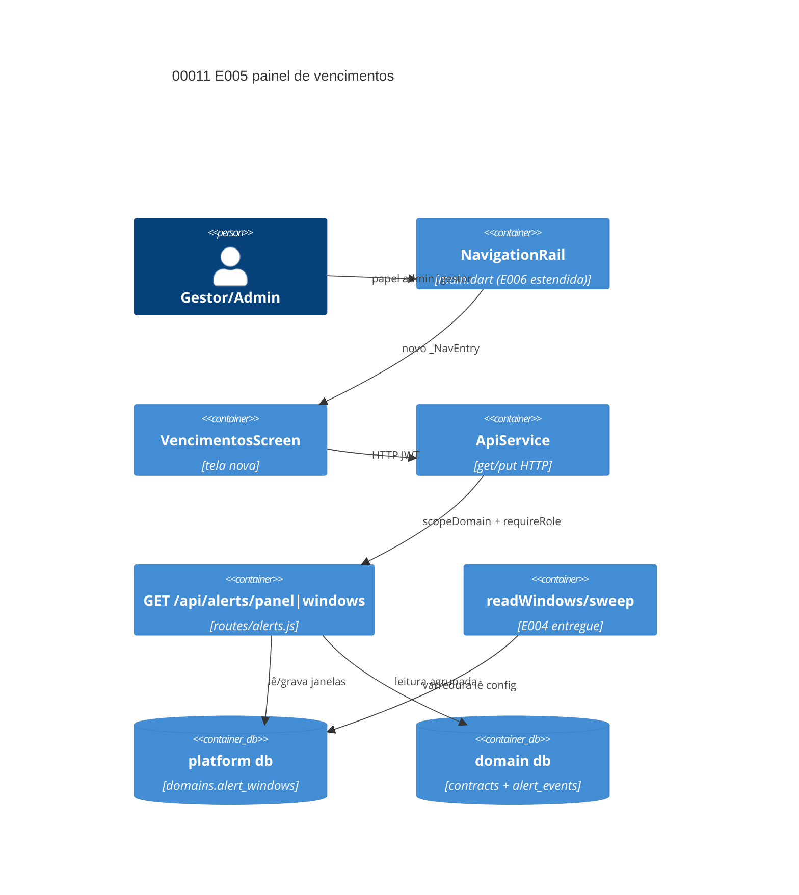

# Implementation Plan: Painel de próximos vencimentos E005 (00011)

**Branch**: `dev` | **Date**: 2026-10-11 | **Spec**: [spec.md](spec.md)

## Technical Context

| Campo | Valor |
|---|---|
| Language/Version | Node.js 22+ (backend); Dart 3 (Flutter Web) |
| Primary Dependencies | Express, sql.js, Socket.io — **nenhuma dependência nova** |
| Storage | escrita: `domains.alert_windows` (coluna existente); leitura: `contracts`/`alert_events` |
| Testing | `node --test`+supertest (3001), `test.sh` (3199), `flutter test`/`analyze` (Docker) |
| Primary Ext | `routes/alerts.js` (+3 rotas), `services/alerts.js` (+`daysUntil`), `vencimentos_screen.dart` |
| Performance Goals | painel p95 < 2 s com milhares de contratos, leitura única por requisição |
| Constraints | 403 papel/domínio; sem cache compartilhado; `main.dart`/`app_theme.dart` estendidos (E006); suíte verde |
| Scale/Scope | 2 US, 7 FR, 3 rotas, 1 tela, 1 índice, 0 dependências novas |
| Project Type / Mode | web / brownfield |

## Instructions Check

| Regra | Status |
|---|---|
| I–III (`dev`, testes, `TODO.md`), IV concisão | PASS |
| Stack, layout PRESERVE_EXISTING_LAYOUT, QC (`flutter analyze`, `node --check`, `npm audit`) | PASS |
| Complexity Tracking | ausente — sem violação |

## Architecture



## Architecture Decisions

| ID | Questão (opções) | Escolha | Rationale |
|----|------------------|---------|-----------|
| AD-001 | rotas: `routes/panel.js` novo / estender `routes/alerts.js` | estender `routes/alerts.js` | IP-001; guards já no arquivo (alerts.js:9,16-18) |
| AD-002 | atribuição: SQL `julianday` / reusar `daysUntil()` do motor | exportar `daysUntil()` de `services/alerts.js` | STF-001: aritmética única (meia-noite local) elimina divergência painel × motor |
| AD-003 | painel: N consultas por bloco / leitura única | 1 SELECT com `EXISTS alert_events` + CASE, `LIMIT/OFFSET`, desempate `id` | FR-004 leitura única; STF-003; bloco do item (campo `window`) |
| AD-004 | janelas: coluna nova / reusar `domains.alert_windows` | reusar coluna, validação espelhada de `readWindows` (400 inválido; `null` → reset default) | FR-006 sem migração; E004 já lê a coluna (IP-002) |
| AD-005 | rota quente: sem índice / índice aditivo | `CREATE INDEX IF NOT EXISTS idx_contracts_forecast ON contracts(forecast_date)` em `DOMAIN_INDEXES` | p95 < 2 s; padrão E004 |
| AD-006 | tela: cartão no dashboard / tela própria | `_NavEntry` novo para admin e gestor | E006 é dono de `main.dart`/`app_theme.dart` — estender sem forcar |

## Data Model Summary

| Entity | Key Fields | Relationships | Notes |
|--------|------------|---------------|-------|
| `domains.alert_windows` (platform) | TEXT JSON `[dias]` | domínio 1-1 | escrita nova; `NULL` = default 90/60/30/15 |
| `alert_events` (domínio, E004) | `contract_id`, `window_days`, `email_status` | UNIQUE(contrato, janela) | leitura pura do painel |
| `contracts` (domínio, E002) | `forecast_date`, `status` | 1-N `alert_events` | + `idx_contracts_forecast` (AD-005) |

## API Surface Summary

| Method | Path | Purpose | Auth | Req/Res Types |
|--------|------|---------|------|---------------|
| GET | `/api/alerts/panel` | contratos com `window`/`alertado`/`incomplete` | admin, gestor + scopeDomain | `?limit&offset` → `{items, incomplete, total, limit, offset, windows}` |
| GET | `/api/alerts/windows` | janelas efetivas do domínio | admin, gestor + scopeDomain | → `{windows: [90,60,30,15]}` |
| PUT | `/api/alerts/windows` | grava/reset janelas | admin, gestor + scopeDomain | `{windows: [n,n]}` ou `{windows: null}` → `{windows}`; 400 inválido |

## Testing Strategy

| Tier | Tool | Escopo | Mock Boundary | Install |
|---|---|---|---|---|
| Unit | `node --test`+supertest | FR-001..007 (agrupamento, alertado, 403, paginação, janelas, sweep) | fixtures temporários | configured |
| Integration | `backend/test.sh` (3199) | smoke baseline 118/118 | backend no ar | configured |
| Integration | `flutter test` (Docker) | regressão 16/16 + widget da tela | ApiService mock | configured |
| Lint | `node --check` + `flutter analyze` (Docker) | sintaxe/análise | — | configured |
| Security | `npm audit --audit-level=high` + 403 na suíte | dependências, papel/domínio | — | configured |

## Acceptance Test Stubs

P1 = FR-001..FR-007 (7); testes em `backend/src/routes/alerts.test.js`; RED `pending`.

| Req ID | Test File | Stub Blocks (framework-native) | RED Status |
|--------|-----------|--------------------------------|------------|
| FR-001 | backend/src/routes/alerts.test.js | test.todo('FR-001 painel agrupa por janela, ordena e expõe incompletos') | pending |
| FR-002 | backend/src/routes/alerts.test.js | test.todo('FR-002 alertado vem de alert_events da janela atribuída') | pending |
| FR-003 | backend/src/routes/alerts.test.js | test.todo('FR-003 prestador e domínio divergente → 403 antes da leitura') | pending |
| FR-004 | backend/src/routes/alerts.test.js | test.todo('FR-004 paginação limit/offset estável (desempate id)') | pending |
| FR-005 | backend/src/routes/alerts.test.js | test.todo('FR-005 GET windows devolve default 90/60/30/15 sem setup') | pending |
| FR-006 | backend/src/routes/alerts.test.js | test.todo('FR-006 PUT windows valida (400), grava e restaura default') | pending |
| FR-007 | backend/src/routes/alerts.test.js | test.todo('FR-007 config reflete no painel e na varredura seguinte') | pending |

## Error Handling Strategy

| Categoria | Padrão | Resposta | Retry |
|---|---|---|---|
| Papel/domínio sem permissão | `requireRole` + `scopeDomain` | 403 antes da leitura | não |
| Janela inválida | validação espelhada de `readWindows` | 400 `{error}` | não |
| Falha de leitura do banco | catch do handler | 500 | não |
| Domínio sem contratos | lista vazia | 200 `items: []` + janelas visíveis | não |
| Varredura não lê config nova | try/catch E004 (entregue) | sweep segue | E004 |

## Risk Mitigation

| Risk (from spec) | Likelihood | Impact | Mitigation | Owner |
|---|---|---|---|---|
| Divergência painel × motor | low | high | AD-002/AD-004: reusar `daysUntil`/`readWindows` exportados (STF-001/002) | `services/alerts.js` |
| Listagem lenta em domínio grande | medium | medium | AD-003 paginação + AD-005 índice; sem cache | `routes/alerts.js`, `config/database.js` |
| Configuração acidental | low | low | 400 em inválida + reset por `null` + default visível no GET | `routes/alerts.js` |

## Requirement Coverage Map

| Req ID | File Path(s) | Function(s)/Symbol(s) | Decision |
|--------|--------------|------------------------|----------|
| FR-001 | backend/src/routes/alerts.js | `listPanel(req,res)` (CASE de atribuição + seções) | AD-002, AD-003 |
| FR-002 | backend/src/routes/alerts.js | `listPanel(req,res)` (EXISTS `alert_events`) | AD-003 |
| FR-003 | backend/src/routes/alerts.js | `requireRole`, `scopeDomain` (entregues) | AD-001 |
| FR-004 | backend/src/routes/alerts.js | `listPanel(req,res)` (limit/offset, `ORDER BY forecast_date, id`) | AD-003 |
| FR-005 | backend/src/routes/alerts.js, backend/src/services/alerts.js | `getWindows(req,res)`, `readWindows()` (entregue) | AD-004 |
| FR-006 | backend/src/routes/alerts.js | `putWindows(req,res)` (validação + UPDATE `domains.alert_windows`) | AD-004 |
| FR-007 | backend/src/routes/alerts.js, backend/src/services/alerts.js | `putWindows(req,res)`, `runExpirySweep()` (lê coluna, entregue) | AD-004 |

## Project Structure

### Source Code

```text
~ backend/src/routes/alerts.js (FR-001..007: listPanel/getWindows/putWindows)
~ backend/src/routes/alerts.test.js (FR-001..007 acceptance)
~ backend/src/services/alerts.js (export daysUntil + validateWindows p/ reuso)
~ backend/src/config/database.js (AD-005 índice)
+ frontend/lib/screens/vencimentos_screen.dart (tela dos blocos + config)
~ frontend/lib/main.dart (FR-001/AD-006: _NavEntry admin|gestor)
~ frontend/lib/services/api_service.dart (getPanel/getWindows/putWindows)
```

**Patterns to reuse**: guards `routes/alerts.js` (E004); `_NavEntry`/`_entriesForRole` (E006); `api_service.dart` `get/put`; paginação `listContracts` (limit 1–200, offset ≥0).
**Tests to extend**: `routes/alerts.test.js` (6 E004), `test.sh` (118), suíte Flutter.
**Naming**: inglês em DDL/código/rotas; UI em português.

## Implementation Hints

- **[HINT-001]** Constraint: dias **só** de `daysUntil()` exportado por `services/alerts.js`, nunca SQL (STF-001/002: `janela >= dias` inclusivo, meia-noite local).
- **[HINT-002]** Order: `idx_contracts_forecast` em `DOMAIN_INDEXES` via `ensureIndexes`; `migrateSchema` roda antes de `applySchema` (sem `contracts`) — índice impossível lá.
- **[HINT-003]** Gotcha: `PUT {windows: null}` grava `NULL` (reset default); corpo inválido → 400, nunca fallback silencioso na escrita.
- **[HINT-004]** Compatibility: `main.dart` compartilhada (E006) — só adicionar `_NavEntry`, sem reordenar; tema via `app_theme.dart`.
- **[HINT-005]** Performance: 1 SELECT por requisição (`EXISTS`+CASE); sem cache nem agregação entre requisições.

## Dependencies

- E004: `alert_events`, `readWindows`, `runExpirySweep`, guards — consumo sem refactor.
- E002: `contracts.forecast_date`/`status` — fonte do agrupamento.
- E006: `main.dart`/`app_theme.dart` — estender, não forcar.
- E009: sala `domain_<id>` — fora do escopo (painel não emite eventos).
