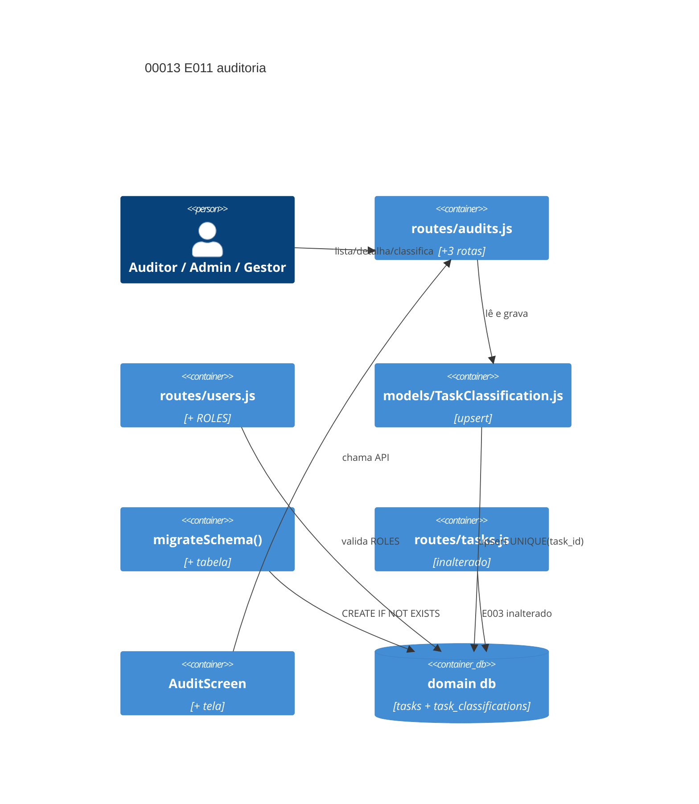

# Implementation Plan: Acesso de auditoria e classificação de tarefas executadas (E011 / 00013)

**Branch**: dev · **Date**: 2026-10-11 · **Spec**: `spec.md`

## Instructions Check

| Regra | Status |
|---|---|
| I dev/testes/TODO antes de código | PASS (battery; item 3 `pending`) |
| II produto/escopo/legacy | PASS (E003 intacto; `+`/`~` na estrutura) |
| III ciclo de trabalho com QC | PASS (QC do pipeline) |
| IV concisão (código, mensagens, commits) | PASS (sem commit no run) |
| Stack + PRESERVE_EXISTING_LAYOUT | PASS (Node 22/Express/sql.js/Flutter; `routes/`, `lib/`) |
| QC mínimo: `flutter analyze`, `node --check`, `npm audit --audit-level=high` | PASS (Testing Strategy) |
| Complexity Tracking | N/A (sem deficiência de design adiada) |

## Technical Context

| Campo | Valor |
|---|---|
| Language / Version | Node.js 22+ (backend); Dart 3 (Flutter Web) |
| Primary Dependencies | Express, sql.js, supertest — **0 novas** |
| Storage | `task_classifications` em `data/domains/<id>.db`; migração aditiva preguiçosa |
| Testing | `node --test` + supertest, `backend/test.sh`, `flutter test`/`analyze` (Docker) |
| Primary Ext | `routes/audits.js` e `models/TaskClassification.js` (novos), `routes/users.js`, `config/database.js`, telas Flutter |
| Perf. Goals | lista ≤ 200 ms p95 com 1k executadas |
| Constraints | 401/403 papel e domínio; 1 registro corrente por tarefa; nota ≤ 500; suíte verde |
| Scale / Scope | 2 US · 7 FR · 3 endpoints · 1 tabela · 1 tela · 1 papel |
| Project Type / Mode | web / brownfield |

## Architecture



## Architecture Decisions

| ID | Opções | Decisão | Racional |
|---|---|---|---|
| AD-001 | namespace `/api/audits/*` · estender `/api/tasks` | **namespace novo** | FR-001 executado + FR-006 `prestador` fora; rotas E003 intactas |
| AD-002 | tabela nova · coluna `tasks` · evento `task_history` | **`task_classifications` UNIQUE(task_id)** | FR-003 único registro; contrato E003 não muda |
| AD-003 | literais PT · códigos EN + mapeamento | **literais PT** | precedente `tasks.status`; spec/API/UI mesmos 3 literais (FR-002) |
| AD-004 | agregação própria · auditor nas rotas de tarefa | **agregação em `GET /api/audits/tasks/:id`** | FR-001 histórico+anexos sem expor não executadas |
| AD-005 | helper de papel · rota escondida no servidor | **helper + gate em `main.dart`** (padrão E006) | FR-007; `prestador`/`system_admin` sem entrada |

## Data Model Summary

| Entity | Key Fields | Relationships | Notes |
|---|---|---|---|
| `task_classifications` (nova) | `task_id` UNIQUE, `state` CHECK (3 literais), `note` ≤500, `classified_by`, `classified_at` | tasks 1—1 | substituição total, sem versões (FR-003) |
| `tasks` (existente) | `status` ∈ 'Revisão' \| 'Concluída' | 1—1 nova | inalterada (FR-001, FR-004) |

Detalhe: `data-model.md`. Migração: `CREATE TABLE IF NOT EXISTS` em `migrateSchema()` antes de `applySchema()` (padrão `alert_events`).

## API Surface Summary

| Method | Path | Purpose | Auth | Req / Res |
|---|---|---|---|---|
| GET | `/api/audits/tasks` | executadas do domínio + classificação | A | — / `AuditTaskItem[]` |
| GET | `/api/audits/tasks/:id` | detalhe + histórico + anexos + classificação | A | — / `AuditTaskDetail` |
| PUT | `/api/audits/tasks/:id/classification` | upsert `state`+`note?` | A | `ClassificationInput` / `Classification` |

**A** = `requireRole('auditor','admin','gestor')` + `scopeDomain()`. `role: "auditor"` aceito via `ROLES` (FR-005). Contrato: `contracts/openapi.yaml`.

## Project Structure

```text
~ backend/src/config/database.js         (+ migrateSchema: task_classifications)
~ backend/src/routes/users.js            (+ 'auditor' em ROLES)
~ backend/src/routes/users.test.js       (+ casos de papel)
+ backend/src/routes/audits.js
+ backend/src/routes/audits.test.js
+ backend/src/models/TaskClassification.js
+ backend/src/models/TaskClassification.test.js
~ backend/src/server.js (monta /api/audits)
~ frontend/lib/main.dart                 (gate de navegação)
~ frontend/lib/models/user.dart          (hasAuditAccess)
~ frontend/lib/services/api_service.dart (+ métodos auditoria)
+ frontend/lib/screens/audit_screen.dart
+ frontend/test/audit_nav_test.dart
```

**Reuso**: guards E001, migração `alert_events` (E004), gate de nav (E006). **Naming**: inglês em DDL/código/rotas; literais e UI em português.

## Testing Strategy

| Type | Stack / Command | What it verifies |
|---|---|---|
| Unit | `node --test` + supertest | FR-001..006: lista, validação, upsert, papel/domínio, ROLES |
| Integration | `backend/test.sh` (PORT 3199) | smoke baseline 118 + casos novos |
| Integration | `flutter test` (Docker) | regressão 24 + navegação auditor |
| Lint | `node --check`, `flutter analyze` (Docker) | sintaxe; zero diagnostic |
| Security | `npm audit --audit-level=high` + suíte 403 | dependências; papel e domínio |
| Coverage | N/A — alvo numérico indefinido | — |

## Acceptance Test Stubs

| Req | Test file | Root test (describe/it · test()) | Status |
|---|---|---|---|
| FR-001 | `backend/src/routes/audits.test.js` | `describe('FR-001 executed-only domain list') / it('returns only Revisão/Concluída of own domain')` | pending |
| FR-002 | `backend/src/routes/audits.test.js` | `describe('FR-002 classification validation') / it('rejects unknown state and note over 500 with 400')` | pending |
| FR-003 | `backend/src/models/TaskClassification.test.js` | `describe('FR-003 single current record') / it('replaces in place keeping one row per task')` | pending |
| FR-004 | `backend/src/routes/audits.test.js` | `describe('FR-004 classify only executed tasks') / it('400 when task not in Revisão/Concluída')` | pending |
| FR-005 | `backend/src/routes/users.test.js` | `describe('FR-005 auditor in role enum') / it('accepts auditor and still 400 for unknown role')` | pending |
| FR-006 | `backend/src/routes/audits.test.js` | `describe('FR-006 role and domain guards') / it('403 prestador/system_admin and cross-domain before query')` | pending |
| FR-007 | `frontend/test/audit_nav_test.dart` | `test('FR-007 shows Auditoria entry for auditor, admin, gestor only')` | pending |

## Error Handling

| Category | Pattern | Response | Retry |
|---|---|---|---|
| Estado/nota inválido | validação antes de gravar | 400 `{error}`, sem escrita | não |
| Papel/domínio errado | middleware antes de consulta | 401/403 | não |
| Tarefa inexistente/outsider | SELECT antes do upsert | 404 outro domínio; 400 fora de executadas | — |
| Concorrência | `ON CONFLICT(task_id) DO UPDATE` | 200 last-write-wins | não |

## Risk Mitigation

| Risk | Prob | Impact | Mitigation | Trigger |
|---|---|---|---|---|
| Vazamento entre domínios | low | high | `scopeDomain()` em toda rota de audits + teste A→B | 403 ausente |
| Papel inflado | medium | medium | `requireRole` por rota; `auditor` fora de `/api/tasks`; suíte 403 | falha em role test |
| Migração colide com base | low | medium | `CREATE TABLE IF NOT EXISTS` em `migrateSchema` | erro na abertura |

## Requirement Coverage Map

| Req ID | File Path(s) | Function(s)/Symbol(s) | Decision |
|---|---|---|---|
| FR-001 | backend/src/routes/audits.js, backend/src/routes/audits.test.js | `listAuditTasks(req,res)`, `getAuditTask(req,res)` | AD-001, AD-004 |
| FR-002 | backend/src/routes/audits.js, backend/src/routes/audits.test.js, backend/src/models/TaskClassification.js | `putClassification(req,res)`, `upsert(db, taskId, state, note, actor)` | AD-002, AD-003 |
| FR-003 | backend/src/models/TaskClassification.js, backend/src/models/TaskClassification.test.js | `upsert()` (ON CONFLICT task_id), `getByTask(db, taskId)` | AD-002 |
| FR-004 | backend/src/routes/audits.js, backend/src/routes/audits.test.js | `putClassification` (status gate), `listAuditTasks` (status filter) | AD-001 |
| FR-005 | backend/src/routes/users.js, backend/src/routes/users.test.js | `ROLES` (+ `'auditor'`), `createUser(req,res)` | — |
| FR-006 | backend/src/routes/audits.js, backend/src/routes/audits.test.js, backend/src/middleware/auth.js | `requireRole('auditor','admin','gestor')`, `scopeDomain('domainId')` | AD-001 |
| FR-007 | frontend/lib/main.dart, frontend/lib/screens/audit_screen.dart, frontend/lib/services/api_service.dart, frontend/test/audit_nav_test.dart | `hasAuditAccess(role)`, `AuditScreen`, `listAuditTasks()`, `putClassification()` | AD-005 |

## Implementation Hints

- **[HINT-001]** Order: `ROLES` em `users.js` **antes** dos testes de `auditor` — `createUser` recusa papel fora da lista.
- **[HINT-002]** Constraint: `auditor` **não** entra em `/api/tasks`; visão só via `/api/audits/*`; `GET /api/tasks/:id` sem mudança de payload (FR-006).
- **[HINT-003]** Order: `CREATE TABLE IF NOT EXISTS task_classifications` em `migrateSchema()` **antes** de `applySchema()`.
- **[HINT-004]** Gotcha: `ON CONFLICT(task_id) DO UPDATE` mantém 1 linha; `state`/`note`/`classified_by`/`classified_at` trocam juntos (FR-003).
- **[HINT-005]** Gotcha: nota ≤ 500 validada na rota — `CHECK` do SQLite não mede comprimento → 400 sem escrita.

## Dependencies

- **E003** (00005): `tasks`, `task_history`, `attachments`, fluxo de status — consumo sem alteração.
- **E001** (00002): `authenticateToken`, `requireRole()`, `scopeDomain()`, CRUD de usuários — `ROLES` estendido.
- **E006** (00008): gate de navegação por papel (`main.dart`, `user.dart`) — extensão para `auditor`.
