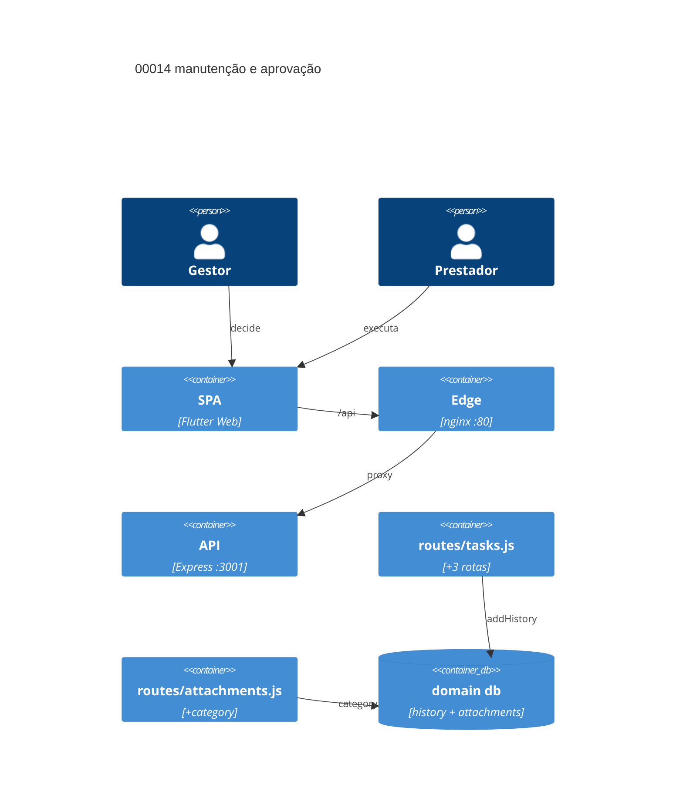

# Implementation Plan: Manutenção de tarefas com aprovação do gestor (00014)

**Branch**: dev · **Date**: 2026-10-18 · **Spec**: `spec.md`

## Instructions Check

| Regra | Status |
|---|---|
| I dev/testes/TODO antes de código | PASS (itens 1–2 do TODO) || II produto/escopo/legacy | PASS (adições; 00005 intacto) |
| III ciclo com QC | PASS (pipeline SDD; sem commit) |
| IV concisão | PASS |
| Stack + PRESERVE_EXISTING_LAYOUT | PASS |
| QC mínimo (`node --check`, `flutter analyze`, `npm audit`) | PASS (Testing Strategy) |
| Complexity Tracking | N/A |

## Technical Context

| Campo | Valor |
|---|---|
| Language / Version | Node.js 22+ (backend); Dart 3 (Flutter Web) |
| Primary Dependencies | Express, Socket.io, sql.js, supertest — 0 novas |
| Storage | `tasks`/`task_history`/`attachments` por domínio; `category` aditiva; uploads em disco |
| Testing | `node --test` + supertest, `test.sh`, `flutter test`/`analyze` (Docker) |
| Project Type / Mode | web multi-tenante / brownfield |
| Perf. Goals | 400/403 antes de qualquer escrita || Constraints | 00005 inalterado; `/uploads` sem token; suíte verde p/ `dev`→`main` |
| Scale / Scope | 3 US (2 P1 + 1 P2) · 8 FR · 3 endpoints · 1 coluna aditiva · 1 sheet |
## Architecture



## Architecture Decisions

| ID | Opções | Decisão | Racional |
|---|---|---|---|
| AD-001 | estender PATCH · novos POST approve/reject | **POST dedicado por ação** | FR-030/032: gestor-only, só em Revisão; PATCH é do prestador (`assertMover`); preserva 00005 |
| AD-002 | estender PATCH · novo POST maintenance | **endpoint `{status, motivo}`** | FR-033: não-sequencial, admin/gestor, motivo obrigatório; reusa `Task.FLOW` |
| AD-003 | tabela nova · linhas em `task_history` | **`task_history` (approve/reject/maintain)** | FR-031/034: `action` TEXT livre; `GET /tasks/:id` expõe autor+data; `note` = motivo/`old → new`; 00013 reusa |
| AD-004 | rebuild · coluna aditiva | **`ADD COLUMN category DEFAULT 'evidence'`** | FR-036: CHECK não alterável; `attachments` = superfície E003/E011; migração preguiçosa (`alert_windows`); validação na rota |
| AD-005 | sem gate de etapa · gate no upload | **prestador bloqueado em Concluída (403)** | FR-036: gestor/admin em qualquer etapa, prestador nas 3 primeiras; gate em `uploadAttachment` pós `canSee`; FR-037 inalterada |

## Data Model Summary

| Entity | Key Fields | Relationships | Notes |
|---|---|---|---|
| `task_history` | `action` ∈ approve/reject/maintain; `note` = motivo/`old → new` | tasks 1—N | autor=`user_id`, data=`created_at` (FR-031/034) |
| `attachments` | + `category` DEFAULT `'evidence'` CHECK (`'evidence'`,`'documentation'`) | tasks 1—N | `kind`/`task_photos` (00005) intocados (FR-036) |
| `tasks` | `status` ∈ 4 estados — enum intocado | — | saída de Concluída limpa `completed_*` (espelha `reopenTask`) |

Migração: `ADD COLUMN category TEXT NOT NULL DEFAULT 'evidence'` (PRAGMA em `migrateSchema()`); DDL fresh carrega o CHECK.

## API Surface Summary

| Method | Path | Purpose | Auth | Req / Res |
|---|---|---|---|---|
| POST | `/api/v2/tasks/:id/approve` | aprova Revisão → Concluída | G | — / `{task}` |
| POST | `/api/v2/tasks/:id/reject` | rejeita → Em Progresso | G | `{motivo}` / `{task}` |
| POST | `/api/v2/tasks/:id/maintenance` | muda estado com motivo | GM | `{status, motivo}` / `{task}` |
| POST | `/api/v2/tasks/:id/attachments` | + `category`; prestador fora de Concluída | A/P | `{category?}` / `{attachment}` |
| GET | `/api/v2/tasks/:id/attachments` | inalterado — autor/data (FR-037) | A/P | — / `{attachments}` |

G = `requireRole('gestor')`; GM = `requireRole('admin','gestor')`; A/P = `requireRole('admin','gestor','prestador')`; `scopeDomain()` herdado.

## Testing Strategy

| Tier | Tool | Scope | Mock Boundary | Install |
|---|---|---|---|---|
| Unit | `npm --prefix backend test` (`node --test` + supertest) | FR-030..037: decisão, manutenção, guards, anexos | sql.js temporário (`DATA_DIR`) | configured |
| Integration | `backend/test.sh` (3199) | smoke aprovar/rejeitar/manutenção/anexo | backend no ar | configured |
| Integration | `flutter test` + `flutter analyze` (Docker) | regressão 25 + sheet por papel | fachada `ApiService` | configured |
| Security | `npm audit --audit-level=high` + suíte 403 | audit + 403 papel/domínio | — | configured |
| Coverage | N/A — sem alvo (policy v2.1.0) | — | — | — |

## Acceptance Test Stubs

P1 = FR-030..035 (6); `node --test` co-localizado; RED `pending`. SC-001→FR-030/031/032 · SC-002→FR-033/034/035 · SC-003→FR-036/037 (P2 sem stub).

| Req ID | Test File | Stub Blocks (framework-native) | RED Status |
|--------|-----------|--------------------------------|------------|
| FR-030 | backend/src/routes/tasks.test.js | test.todo('FR-030 aprovação do gestor fecha Revisão') | pending |
| FR-031 | backend/src/routes/tasks.test.js | test.todo('FR-031 decisão registra autor/tipo/motivo/data') | pending |
| FR-032 | backend/src/routes/tasks.test.js | test.todo('FR-032 rejeição sem motivo 400; papel 403') | pending |
| FR-033 | backend/src/routes/tasks.test.js | test.todo('FR-033 manutenção admin/gestor; prestador 403') | pending |
| FR-034 | backend/src/routes/tasks.test.js | test.todo('FR-034 manutenção registra autor/estados/motivo') | pending |
| FR-035 | backend/src/routes/tasks.test.js | test.todo('FR-035 domínio estrangeiro/suspenso 403') | pending |

## Error Handling Strategy

| Categoria | Padrão | Resposta | Retry |
|---|---|---|---|
| Decisão fora de Revisão | fail-fast | 400 + `TASK_DECISION_STATUS_REQUIRED` | não |
| Motivo/status ausente, inválido ou repetido | fail-fast | 400 + `TASK_REJECT_REASON_REQUIRED`/`TASK_MAINTENANCE_REASON_REQUIRED`/`TASK_MAINTENANCE_STATUS_REQUIRED`/`TASK_MAINTENANCE_NOOP` | não |
| Papel indevido | deny by default | 403 + `{error: 'Forbidden'}` (`requireRole`) | não |
| Domínio estrangeiro/suspenso | guards E001 | 403 antes da consulta | não |
| Upload inválido | validação antes da gravação | 400 + `{error}`; nada em disco nem banco | não |
| Prestador anexando em Concluída | stage gate | 403 + `TASK_ATTACHMENT_STATUS_FORBIDDEN` | não |

## Risk Mitigation

| Risk (from spec) | Likelihood | Impact | Mitigation | Owner |
|---|---|---|---|---|
| Quebra do fluxo existente | medium | high | endpoints aditivos; PATCH/complete/reopen e enum intocados; regressão 00005 | `routes/tasks.js` |
| Manutenção como atalho | medium | medium | motivo obrigatório (400 antes de escrita); linha `maintain` com `old → new` | `routes/tasks.js`, `Task.addHistory` |
| Duplicação com anexos | low | low | default `category='evidence'`; `task_photos`/conclusão 00005 intocados | `routes/attachments.js`, `migrateSchema` |

## Requirement Coverage Map

| Req ID | File Path(s) | Function(s)/Symbol(s) | Decision |
|---|---|---|---|
| FR-030 | backend/src/routes/tasks.js | approveTask(), rejectTask() | AD-001 |
| FR-031 | backend/src/models/Task.js, backend/src/routes/tasks.js | Task.addHistory(db, taskId, action, userId, note), Task.history() | AD-003 |
| FR-032 | backend/src/routes/tasks.js | requireRole('gestor'), httpError(), errorPayload() | AD-001 |
| FR-033 | backend/src/routes/tasks.js | maintainTaskStatus(), requireRole('admin','gestor'), Task.FLOW | AD-002 |
| FR-034 | backend/src/models/Task.js, backend/src/routes/tasks.js | Task.addHistory(..., 'maintain', ..., `old → new: motivo`) | AD-003 |
| FR-035 | backend/src/routes/tasks.js, backend/src/middleware/auth.js | router.use(scopeDomain()), assertDomainActive() | — (reuso E001) |
| FR-036 | backend/src/routes/attachments.js, backend/src/config/database.js, backend/src/middleware/upload.js | uploadAttachment(), migrateSchema(), decodeAndValidate(), saveToUploads() | AD-004, AD-005 |
| FR-037 | backend/src/routes/attachments.js, frontend/lib/widgets/task_detail_sheet.dart, frontend/lib/screens/tasks_screen.dart | listAttachments(), decorate(), _TaskDetailSheetState | — (reuso GET) |

## Project Structure

```text
~ backend/src/routes/tasks.js (+approveTask, rejectTask, maintainTaskStatus)
~ backend/src/routes/tasks.test.js (+stubs FR-030..035)
~ backend/src/routes/attachments.js (+category, stage gate)
~ backend/src/routes/comments.test.js (+casos FR-036/037)
~ backend/src/config/database.js (+category: DDL + migrateSchema)
~ backend/test.sh (+checks decisão/manutenção/anexo)
~ frontend/lib/services/api_service.dart (+métodos decisão/manutenção/anexo)
~ frontend/lib/screens/tasks_screen.dart (+abre o detalhe na tarefa)
+ frontend/lib/widgets/task_detail_sheet.dart
+ frontend/test/task_detail_sheet_test.dart
```

**Reuso**: `requireRole`, `scopeDomain`, `Task.addHistory`, `Task.FLOW`, `getTaskOr404`, `emitDomainEvent`, padrão `reopenTask`. **Naming**: rotas/codes EN; motivos/literais PT.

## Implementation Hints

- **[HINT-001]** Order: stubs RED → rotas decisão/manutenção → migração `category` → stage gate → sheet → `test.sh`.
- **[HINT-002]** Gotcha: decisão/manutenção comparam `label` PT de `getTaskOr404`; escrita via `code('tasks.status', ...)` — nunca grave literal PT.
- **[HINT-003]** Gotcha: saída de Concluída limpa `completed_*` (espelha `reopenTask`); entrada deixa `completed_*` NULL — E008 conta por status.
- **[HINT-004]** Constraint: CHECK não é alterável — `category` legada vale default + validação da rota (precedente `username`); DDL fresh carrega o CHECK.
- **[HINT-005]** Constraint: decisão é gestor-ONLY (FR-032); `admin` só em manutenção; `auditor`/`system_admin` fora (deny-by-default).
