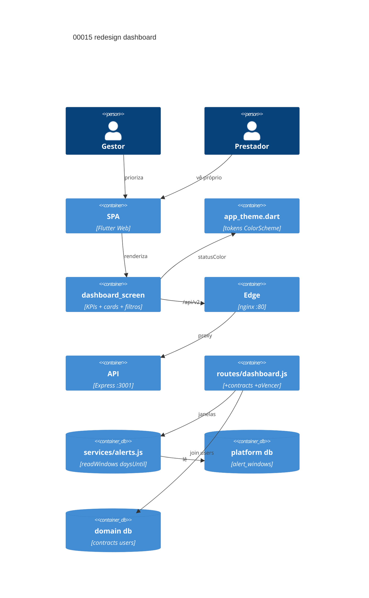

# Implementation Plan: Redesign visual do dashboard (00015)

**Branch**: dev · **Date**: 2026-10-24 · **Spec**: `spec.md`


**mockup**: `mockup.png`

## Instructions Check

| Regra | Status |
|---|---|
| I dev/testes/TODO antes de código | PASS (item E013 do TODO) |
| II produto/escopo/legacy | PASS (só UI + payload aditivo; E006 preservado) |
| III ciclo com QC | PASS (pipeline SDD; sem commit) |
| IV concisão | PASS |
| Stack + PRESERVE_EXISTING_LAYOUT | PASS (tema/UI; sem deps novas) |
| QC mínimo (`node --check`, `flutter analyze`, `npm audit`) | PASS (Testing Strategy) |
| Complexity Tracking | N/A |

## Technical Context

| Campo | Valor |
|---|---|
| Language / Version | Node.js 22+ (backend); Dart 3 (Flutter Web) |
| Primary Dependencies | Express, Socket.io, sql.js, Flutter/M3 — 0 novas |
| Storage | sem migração; junção existente `contracts.created_by` → `users`; janelas em `domains.alert_windows` |
| Testing | `node --test` + supertest, `test.sh`, `flutter test`/`analyze` (Docker) |
| Project Type / Mode | web multi-tenante / brownfield |
| Perf. Goals | repaint sobre payload já servido; 0 requisição nova por filtro |
| Constraints | só tokens `ColorScheme`; sem hex; APIs M3; E006 role scoping + teclado/rótulos intactos |
| Scale / Scope | 3 US (2 P1 + 1 P2) · 6 FR · 0 endpoints novos · 0 migrações · 1 rewrite UI + payload aditivo |

## Architecture



## Architecture Decisions

| ID | Opções | Decisão | Racional |
|---|---|---|---|
| AD-001 | redefinir `recentProjects` · campos aditivos | **`+ contracts[]` completo e `+ responsavel` em `recentProjects`** | FR-040 precisa do conjunto servido (não 5); consumidores/testes E006 de `recentProjects` ficam intactos |
| AD-002 | duplicar parse de janelas · reusar serviço | **importar `readWindows`, `daysUntil` de `services/alerts.js`** | FR-039/SC-002: mesma semântica de E005; NULL → default [90,60,30,15]; sem rota nova |
| AD-003 | ThemeExtension · helper em AppTheme | **`AppTheme.statusColor(ColorScheme, String)`** | restrição da épica: estender `app_theme.dart`, só tokens do `ColorScheme`; 4 status cabem nos papéis M3 (error/primary/outline/tertiary) |
| AD-004 | filtro server-side · estado no cliente | **filtros no `State` do dashboard, reaplicados a cada payload (E009)** | FR-043/SC-005: 0 requisição nova; refresh em tempo real preserva filtros |
| AD-005 | filtrar no cliente · escopo no servidor | **`contracts` do prestador = join `contract_providers` no backend** | FR-041/SC-004: escopo autoritativo de E006 no servidor; nada de domínio vaza ao cliente |

## Data Model Summary

N/A — nenhum dado persistente novo; junção já existente `contracts.created_by` → `users` e leitura de `domains.alert_windows` (sem migração).

## API Surface Summary

N/A — nenhuma rota nova; campos aditivos em `GET /api/v2/dashboard/stats` (AD-001, AD-002): `stats.contractsAVencer`, `contracts[]` (admin/gestor: domínio inteiro; prestador: só vinculados), `recentProjects[].responsavel`.

## Testing Strategy

| Tier | Tool | Scope | Mock Boundary | Install |
|---|---|---|---|---|
| Unit | `npm --prefix backend test` (`node --test` + supertest) | payload `contracts`/`responsavel`/`contractsAVencer`, escopo prestador | sql.js temporário (`DATA_DIR`) | configured |
| Unit | `flutter test` + `flutter analyze` (Docker) | KPIs, ordenação, filtros, reflow, a11y | fachada `ApiService` | configured |
| Integration | `backend/test.sh` (3199) | smoke dashboard stats no stack | backend no ar | configured |
| Security | `npm audit --audit-level=high` + suíte 403 | audit + scoping prestador | — | configured |
| Coverage | N/A — sem alvo (policy v2.1.0) | — | — | — |

## Acceptance Test Stubs

P1 = FR-038..041 (4); backend `test.todo` (pending), frontend `skip` (RED). SC-001→FR-038/039 · SC-003→FR-040 · SC-004→FR-041 (P2 FR-042/043 sem stub).

| Req ID | Test File | Stub Blocks (framework-native) | RED Status |
|--------|-----------|--------------------------------|------------|
| FR-038 | frontend/test/dashboard_redesign_test.dart | test('FR-038 KPIs por status com tokens do ColorScheme', skip: 'RED', ...) | skip |
| FR-039 | backend/src/routes/dashboard.test.js | test.todo('FR-039 contractsAVencer segue janelas do domínio') | pending |
| FR-040 | frontend/test/dashboard_redesign_test.dart | test('FR-040 cards por urgência com vencimento e responsável', skip: 'RED', ...) | skip |
| FR-041 | backend/src/routes/dashboard.test.js | test.todo('FR-041 prestador recebe só contratos vinculados') | pending |

## Error Handling Strategy

| Categoria | Padrão | Resposta | Retry |
|---|---|---|---|
| Falha de carga do stats | estado de erro preservado de E006 | mensagem + botão retry no corpo | sim (manual) |
| Domínio sem dados | empty state | KPIs zerados + card vazio, sem quebra | não |
| Payload parcial/antigo | defensivo no cliente | `?? []`/guard `is List` em todos os campos novos | não |

## Risk Mitigation

| Risk (from spec) | Likelihood | Impact | Mitigation | Owner |
|---|---|---|---|---|
| Escopo crescendo para dados novos | medium | medium | perímetro travado: nenhum campo novo em banco/tabela; diff revisado contra `pubspec.yaml` e rotas | reviewer de diff |
| Regressão de acessibilidade de E006 | medium | medium | preservar `Focus(autofocus)`, atalhos Ctrl+seta/PageDown, `Semantics`/tooltips; `a11y_labels_test` + `web_browsers_test` estendidos | `dashboard_screen.dart`, testes |
| Tokens fixos vazando do mockup | medium | low | `AppTheme.statusColor` só consulta `ColorScheme`; CI: grep do diff por `0x` hex novo | `app_theme.dart` |

## Requirement Coverage Map

| Req ID | File Path(s) | Function(s)/Symbol(s) | Notes |
|---|---|---|---|
| FR-038 | frontend/lib/theme/app_theme.dart, frontend/lib/screens/dashboard_screen.dart | AppTheme.statusColor(ColorScheme, String), _KpiRow | AD-003 |
| FR-039 | backend/src/services/alerts.js, backend/src/routes/dashboard.js, frontend/lib/screens/dashboard_screen.dart | readWindows(), daysUntil(), getDomainMetrics() → stats.contractsAVencer, _KpiRow | AD-002 |
| FR-040 | backend/src/routes/dashboard.js, frontend/lib/screens/dashboard_screen.dart | getDomainMetrics() → contracts[] (responsavel via created_by→users), _ContractCards | AD-001 |
| FR-041 | backend/src/routes/dashboard.js, frontend/lib/screens/dashboard_screen.dart | getDomainMetrics() branch prestador → contracts join contract_providers, _DashboardScreenState.build | AD-005 |
| FR-042 | frontend/lib/screens/dashboard_screen.dart | _ContractCards (LayoutBuilder), _StatGrid | reflow 600/840dp |
| FR-043 | frontend/lib/screens/dashboard_screen.dart | _DashboardFilters, _DashboardScreenState._applyFilters() | AD-004 |

## Project Structure

### Source Code

```text
~ backend/src/routes/dashboard.js (+contracts[], contractsAVencer, responsavel)
~ backend/src/routes/dashboard.test.js (+stubs FR-039/041 + payload cases)
~ frontend/lib/theme/app_theme.dart (+statusColor)
~ frontend/lib/screens/dashboard_screen.dart (rewrite: KPIs, cards, filtros)
~ frontend/test/dashboard_redesign_test.dart (+novo)
~ frontend/test/a11y_labels_test.dart (+rótulos KPI/filtros)
~ frontend/test/web_browsers_test.dart (ajusta seletores do painel se necessário)
~ frontend/test/dashboard_projects_nav_test.dart (ajusta aos widgets novos)
```

**Patterns to reuse**: `LayoutBuilder` do `_StatGrid`, estados loading/erro/vazio de E006, `Contract.effectiveStatus`, `readWindows`/`daysUntil` (E005), guards `requireRole`/`scopeDomain`. **Naming**: chaves JSON EN, literais PT; cards em PT.

## Implementation Hints

- **[HINT-001]** Order: stubs RED → payload backend (`contracts`, `responsavel`, `contractsAVencer`) → `statusColor` → rewrite da tela → filtros → `test.sh`/a11y.
- **[HINT-002]** Gotcha: janelas vivem no platform db (`domains.alert_windows`), não no domain db — o branch do domínio usa `getPlatformDb()` como em `alerts.js`.
- **[HINT-003]** Gotcha: `recentProjects` tem consumidores E006 (tela + testes) — só campos aditivos, nunca renomear/remover.
- **[HINT-004]** Constraint: branch prestador não pode vazar KPIs de domínio (SC-004) — `contracts` do prestador sai do join `contract_providers`, e a tela esconde a faixa de KPIs quando `scope == 'own'`.
- **[HINT-005]** Compatibility: valores de status/effective_status são literais PT (`vigente`/`atrasado`/`encerrado`) vindos do backend — mapear sem revalidar enums.
