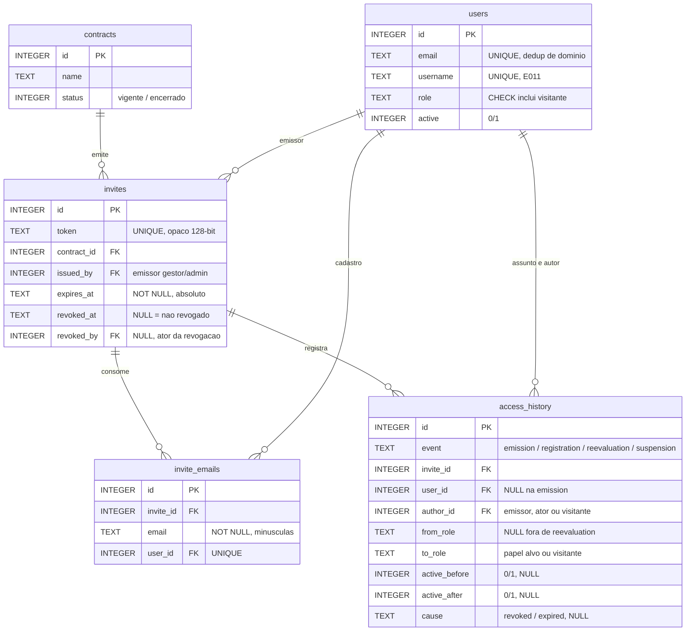

# Data Model: Convite temporário e papel visitante (00016)

## Entities

| Entity | Attributes | Relationships | State Transitions |
|--------|------------|---------------|-------------------|
| Invite (`invites`, nova) | id: INTEGER PK AUTOINCREMENT; token: TEXT NOT NULL UNIQUE (base64url de `randomBytes(16)`, ≥ 128 bits; credencial: nunca em listagem, erro ou log); contract_id: INTEGER NOT NULL REFERENCES contracts(id); issued_by: INTEGER NOT NULL REFERENCES users(id) (emissor, gestor/admin); expires_at: TEXT NOT NULL (absoluto: criação + 24 h / 7 d / 30 d fixados no ato); revoked_at: TEXT NULL; revoked_by: INTEGER NULL REFERENCES users(id); created_at: TEXT NOT NULL DEFAULT (datetime('now')); CHECK ((revoked_at IS NULL) = (revoked_by IS NULL)) | belongs_to contracts; belongs_to users (emissor); has_many invite_emails; has_many access_history | ativo → revogado (grava revoked_at + revoked_by, ator); ativo → expirado (derivado de expires_at em T+0, sem escrita); sem reversão; precedência: revogado > expirado > ativo |
| InviteEmail (`invite_emails`, nova: e-mails consumidos) | id: INTEGER PK AUTOINCREMENT; invite_id: INTEGER NOT NULL REFERENCES invites(id); email: TEXT NOT NULL (minúsculas); user_id: INTEGER NOT NULL UNIQUE REFERENCES users(id); created_at: TEXT NOT NULL DEFAULT (datetime('now')); UNIQUE (invite_id, email) | belongs_to invites; belongs_to users; sustenta o escopo do visitante (join → invites.contract_id); "cadastros" da lista de convites = COUNT(*) por invite_id | — (ledger append-only) |
| Visitor/User (`users`, existente, alterada) | inalterados: id INTEGER PK AUTOINCREMENT, name TEXT NOT NULL, email TEXT NOT NULL UNIQUE (dedup de domínio), username TEXT UNIQUE (E011), password_hash TEXT NOT NULL, active INTEGER NOT NULL DEFAULT 1, created_at/updated_at TEXT NOT NULL DEFAULT (datetime('now')); alterado: role TEXT NOT NULL CHECK (role IN ('admin','gestor','prestador','auditor','visitante')): CHECK alargado pelo rebuild in-place do E011, ids e REFERENCES preservados; sem coluna nova de escopo | has_many invite_emails (origem do cadastro); has_many access_history (user_id = assunto, author_id = autor); escopo do visitante = invite_emails → invites.contract_id | visitante ativo → promovido (role novo, evento `reevaluation`); ativo → suspenso (active 0: `reevaluation` manual ou `suspension` por convite); suspenso → reativado (exige convite válido OU `reevaluation` registrada, STF-001); promovido opera pela matriz do novo papel |
| AccessHistory (`access_history`, nova) | id: INTEGER PK AUTOINCREMENT; event: TEXT NOT NULL CHECK (event IN ('emission','registration','reevaluation','suspension')); invite_id: INTEGER NOT NULL REFERENCES invites(id); user_id: INTEGER NULL REFERENCES users(id) (NULL só em `emission`); author_id: INTEGER NOT NULL REFERENCES users(id); from_role: TEXT NULL (só `reevaluation`); to_role: TEXT NULL (`registration` = 'visitante'; `reevaluation` = papel alvo); active_before: INTEGER NULL CHECK (active_before IN (0,1)); active_after: INTEGER NULL CHECK (active_after IN (0,1)); cause: TEXT NULL CHECK (cause IN ('revoked','expired')) (NOT NULL só em `suspension`); created_at: TEXT NOT NULL DEFAULT (datetime('now')) | belongs_to invites; belongs_to users (user_id = assunto, author_id = autor) | — (append-only: INSERT sem UPDATE/DELETE) |
| Contract (`contracts`, existente) | inalterada: id INTEGER PK AUTOINCREMENT, name TEXT NOT NULL, status INTEGER NOT NULL (código `contracts.status`: vigente/encerrado), start_date/forecast_date TEXT NOT NULL, perpetual INTEGER 0/1 | has_many invites | — (fluxo vigente/encerrado inalterado) |

## Constraints

- **Storage/escopo**: `data/domains/<id>.db` (sql.js); tabelas novas entram em `DOMAIN_SCHEMA`/`migrateSchema` no padrão E011 (`CREATE TABLE IF NOT EXISTS` + guarda `PRAGMA table_info`); `platform.db` intocado; DDL em inglês, timestamps `TEXT DEFAULT (datetime('now'))`, booleano `INTEGER 0/1`.
- **FR-044**: token UNIQUE ≥ 128 bits, exposto apenas na criação (nunca em listagem, erro ou log); `issued_by` restrito a gestor/admin pela guarda `requireRole` (sem CHECK de papel no banco); validade fixa gravada só em `expires_at` (duração derivada de `expires_at - created_at`, sem coluna de duração); convite nasce no contrato do próprio domínio (arquivo por domínio).
- **FR-045 / STF-003**: estado do convite derivado a cada requisição, sem coluna persistida: revogado = `revoked_at IS NOT NULL`; expirado = `revoked_at IS NULL AND expires_at <= now`; ativo = caso contrário; precedência revogado > expirado; revogação grava `revoked_at` + `revoked_by` na mesma transação.
- **FR-045 / STF-004**: revogação ou expiração põe `users.active = 0` em cada visitante de `invite_emails` do convite e grava uma linha `suspension` por visitante com `cause` e autor: `revoked` → `author_id = revoked_by`; `expired` → `author_id = issued_by`; `active_before`/`active_after` registram a transição; a suspensão prevalece sobre mudança de papel concorrente (promoção exige `active = 1`).
- **FR-046 / STF-002**: dedup de domínio = `users.email` UNIQUE → 409 sem escrita: nenhuma linha em `invite_emails` (convite não consumido, inclusive em outro convite); consumo = linha em `invite_emails` na mesma transação do INSERT em `users`; `username` = local part do e-mail + sufixo numérico em colisão, respeitando `users.username` UNIQUE (app-level em bancos legados); token inválido/expirado/revogado → 409 sem vazar o token.
- **FR-047 / STF-003**: escopo do visitante lido por requisição = JOIN `invite_emails(user_id UNIQUE)` → `invites.contract_id`; estado do convite e escopo nunca cacheados na sessão.
- **FR-048 / FR-049**: `role` CHECK ganha `'visitante'` via rebuild in-place (precedente E011, ids e REFERENCES preservados); promover exige `role = 'visitante' AND active = 1`; reativar exige convite válido (predicado do STF-003) OU `reevaluation` registrada em `access_history`; suspensão manual = `reevaluation` com `active 1 → 0` e `from_role = to_role`; gestão de usuário com outro papel é de admin (gestor → 403, validação de rota).
- **FR-050**: semântica por evento em `access_history`: `emission` (`user_id` NULL, `author_id = issued_by`, mesma transação do INSERT do convite); `registration` (`user_id = author_id` = novo visitante, `to_role = 'visitante'`); `reevaluation` (`author_id` = ator, `from_role`/`to_role`/`active_*` preenchidos); `suspension` (`cause` NOT NULL); append-only como `entity_history` (INSERT sem UPDATE/DELETE).
- **Índices / FK**: UNIQUE de `token`; UNIQUE de `invite_emails(user_id)`; UNIQUE de `invite_emails(invite_id, email)`; índices em `invites(contract_id)`, `access_history(invite_id)`, `access_history(user_id)`; REFERENCES resolvidas em DML (sql.js com `foreign_keys` OFF, precedente 00003).

ER Diagram (visual reference)

