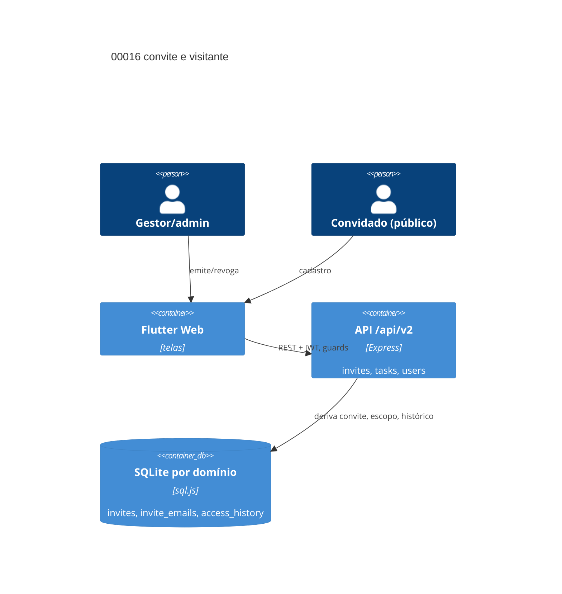

# Implementation Plan: Convite temporário e papel visitante (00016)

**Branch**: dev · **Date**: 2026-11-18 · **Spec**: `spec.md` · **Epic**: E015

## Summary

**Goal**: Convite com prazo, cadastro público como visitante restrito ao contrato e reavaliação com histórico.
**Approach**: tabelas `invites`/`invite_emails`/`access_history`, escopo no guard, rate limit próprio, validade por request.
**Key Constraint**: deny-by-default 00002 FR-005; token fora de logs; 0 dependência nova.

## Instructions Check

| Regra | Status |
|---|---|
| I — `dev`, `main` intocada | PASS |
| II — suíte verde antes de promoção | PASS |
| III — TODO intake | PASS |
| IV — saída concisa | PASS |
| Stack + PRESERVE_EXISTING_LAYOUT | PASS — 4 arquivos estendidos; 0 deps novas |
| QC mínimo (lint, segurança, unit) | PASS |
| Complexity Tracking | N/A — tabelas novas + rebuild CHECK (E011) |

**Instructions Check (2026-11-18): PASS** — 0 violações.

## Technical Context

| Campo | Valor |
|---|---|
| Language / Version | Dart 3 (Flutter Web) + Node.js ≥22 (Express, sql.js) |
| Primary Dependencies | Flutter/Material 3, express/sql.js, bcryptjs, jsonwebtoken — 0 novas |
| Storage | SQLite por domínio: 3 tabelas novas + CHECK `users.role` com `visitante`; `platform.db` intocada |
| Testing | `npm test`, `backend/test.sh`, `flutter test`, `flutter analyze` |
| Project Type / Mode | web multi-tenant, brownfield |
| Perf. Goals | validade e escopo derivados por request; rate limit em memória |
| Constraints | token ≥128 bits fora de logs; recusa uniforme; `/api/v2/*` em PT |
| Scale / Scope | 3 US · 7 FR (P1) · 4 endpoints · 3 tabelas · 6 BE + 3 FE |

## Architecture



## Architecture Decisions

| ID | Decisão | Opções | Escolhida | Racional |
|----|---------|--------|-----------|----------|
| AD-001 | Estado do convite | enum / derivação | `revoked_at`+`expires_at` | STF-003: nega em T+0 sem job |
| AD-002 | Token | JWT / UUID / opaco | `randomBytes(16)` base64url | ≥128 bits, revogável |
| AD-003 | Rate limit | lib / janela própria | janela em memória, 11ª → 429 | 0 dependência nova |
| AD-004 | Username | campo / derivado | local part + sufixo | `users.username` UNIQUE (E011) |
| AD-005 | Escopo do visitante | coluna / join por request | `invite_emails`→`invites.contract_id` | sem cache (STF-003) |
| AD-006 | Papel visitante | tabela / CHECK | CHECK `users.role` + rebuild | E011 preserva ids e REFERENCES |
| AD-007 | Histórico de acesso | `entity_history` / própria | `access_history` própria | `entity_history` versiona snapshot |
| AD-008 | Recusa de token | distintos / uniforme | 409 idêntico nos 3 casos | não vaza existência |
| AD-009 | Reativação | só convite / convite ou reavaliação | reavaliação ou convite vigente; vale até nova suspensão | STF-006/008 |

## Data Model Summary

| Entity | Key Fields | Relationships | Notes |
|--------|------------|---------------|-------|
| `invites` | token UNIQUE, contract_id, issued_by, expires_at, revoked_at/by | N:1 contracts, users; 1:N invite_emails, access_history | estado derivado; revogado > expirado |
| `invite_emails` | invite_id, email, user_id UNIQUE; UNIQUE(invite_id, email) | N:1 invites; 1:1 users | ledger; escopo; COUNT = cadastros |
| `users` | CHECK `role` + `visitante` (rebuild) | 1:N invite_emails, access_history | `email` UNIQUE; promoção exige ativo |
| `access_history` | event CHECK, invite_id, user_id, author_id, cause | N:1 invites, users | append-only; autor expirado = emissor |

**Detalhe**: `data-model.md`

## API Surface Summary

| Method | Path | Purpose | Auth | Req/Res |
|--------|------|---------|------|---------|
| POST | `/api/v2/invites` | emitir; contrato encerrado → 409; token só no 201; `emission` | JWT · admin/gestor | `{contract_id, validity}` → `{id, url, expires_at}` |
| GET | `/api/v2/invites` | lista com estado derivado e cadastros; sem token | JWT · admin/gestor | → `invites[]` |
| DELETE | `/api/v2/invites/:id` | revogar + suspender visitantes; expirado → 409 | JWT · admin/gestor | 200 idempotente |
| POST | `/api/v2/invites/:token/register` | cadastro público; username derivado | público; rate limit → 429 | `{name,email,password}` → sessão |

Nota FR-047: `GET /api/v2/tasks[/:id]` ganha papel `visitante` escopado ao convite (fora → 404; demais → 403; revalida convite ou reavaliação registrada); contrato não redefinido.

**Detalhe**: `contracts/openapi.yaml`

## Testing Strategy

| Tier | Tool | Scope | Mock Boundary | Install |
|------|------|-------|---------------|---------|
| Unit backend | `node --test` + supertest | rotas, guards, migração | `DATA_DIR` temporário | configured |
| Unit frontend | `flutter test` | convites, cadastro, escopo | `ApiService` stub | configured |
| Integration | `backend/test.sh` | E2E servidor real | `DATA_DIR`/`PORT` descartáveis | configured |
| Lint / Security | `flutter analyze` / `npm audit` | frontend / deps | — | configured |

## Acceptance Test Stubs

| Req ID | Test File | Stub Blocks | RED Status |
|--------|-----------|-------------|------------|
| FR-044 | `backend/src/routes/invites.test.js` | `test('FR-044 emite convite com validade e token')` | failing-assertion |
| FR-045 | `backend/src/routes/invites.test.js` | `test('FR-045 lista com estado; revogar suspende')` | failing-assertion |
| FR-046 | `backend/src/routes/invites.test.js` | `test('FR-046 registro cria visitante; 409 e 429')` | failing-assertion |
| FR-047 | `backend/src/routes/tasks.test.js` | `test('FR-047 visitante vê só tarefas do contrato')` | failing-assertion |
| FR-048 | `backend/src/middleware/auth.test.js` | `test('FR-048 visitante aceito na matriz')` | failing-assertion |
| FR-049 | `backend/src/routes/users.test.js` | `test('FR-049 reavaliação com precedência')` | failing-assertion |
| FR-050 | `backend/src/routes/invites.test.js` | `test('FR-050 histórico dos 3 eventos')` | failing-assertion |

## Error Handling Strategy

| Error Category | Pattern | Response | Retry |
|----------------|---------|----------|-------|
| Token inválido/expirado/revogado | recusa uniforme, corpo idêntico | 409 `{error}` | não |
| E-mail no domínio | UNIQUE na mesma transação | 409; convite não consumido | não |
| Rate limit por IP | janela de 10 por 60 s em memória | a 11ª → 429 | 60 s |
| Auth/domínio/papel | inalterado (00002) | 401/403/404 | não |
| Migração | `PRAGMA table_info` + rebuild CHECK (E011) | startup falha se SQL inválido | não |

## Risk Mitigation

| Risk (from spec) | L | I | Mitigation | Owner |
|---|---|---|---|---|
| Vazamento de escopo | M | H | deny-by-default 00002 FR-005 + derivação por request | `auth.js`, `tasks.js` |
| Link como credencial longa | L | M | opções curtas, revogação e expiração | `invites.js` |
| Abuso do cadastro aberto | L | M | rate limit 429 + `UNIQUE` por e-mail | `invites.js` |

## Requirement Coverage Map

| Req ID | File Path(s) | Function(s)/Symbol(s) | Notes |
|---|---|---|---|
| FR-044 | backend/src/routes/invites.js, frontend/lib/screens/invites_screen.dart | `createInvite`, `_emitDialog` | AD-002 |
| FR-045 | backend/src/routes/invites.js, backend/src/models/Invite.js | `listInvites`, `revokeInvite`, `deriveState`, `suspendInviteVisitors` | AD-001, STF-003/004 |
| FR-046 | backend/src/routes/invites.js, backend/src/models/User.js | `registerByToken`, `User.create`, `deriveUsername` | AD-003, AD-004, AD-008, STF-002 |
| FR-047 | backend/src/routes/tasks.js, backend/src/middleware/auth.js, frontend/lib/screens/tasks_screen.dart | `canSeeTask`, `visitorScope`, listagem filtrada | AD-005, STF-003 |
| FR-048 | backend/src/middleware/auth.js, backend/src/config/database.js | `requireRole`, CHECK `users.role` com `visitante` | AD-006 |
| FR-049 | backend/src/routes/users.js, backend/src/models/AccessHistory.js, frontend/lib/screens/users_screen.dart | `reevaluateVisitor`, `assertActiveVisitor`, `_reavaliarDialog` | AD-007, AD-009, STF-001 |
| FR-050 | backend/src/models/AccessHistory.js, frontend/lib/screens/users_screen.dart | `recordAccess` (emission/registration/reevaluation/suspension), `_historicoList` | AD-007 |

## Project Structure

### Source Code

```text
+ backend/src/routes/invites.js (+ invites.test.js)
+ backend/src/models/Invite.js, AccessHistory.js (+ testes)
~ backend/src/config/database.js (3 tabelas + CHECK visitante, padrão E011)
~ backend/src/middleware/auth.js (papel visitante + escopo por request)
~ backend/src/routes/tasks.js (escopo do visitante na listagem e no detalhe)
~ backend/src/routes/users.js (reavaliação de visitante)
+ frontend/lib/screens/invites_screen.dart, invite_register_screen.dart
~ frontend/lib/screens/users_screen.dart (reavaliação), tasks_screen.dart (escopo)
~ backend src/**/*.test.js (+ stubs FR-044..050)
```

**Patterns**: `requireRole`, migração E011, append-only de `entity_history`, rota pública de `auth.js`.
**Naming**: EN em DDL/payload, PT em telas.

## Implementation Hints

- **[HINT-001]** Ordem: stubs RED → migração → modelos → rotas → guards → reavaliação → telas → `flutter analyze`/`test` → `npm test` → `test.sh`.
- **[HINT-002]** Estado do convite sempre derivado; nunca gravar coluna de estado (STF-003).
- **[HINT-003]** Recusa do token idêntica nos 3 casos; e-mail duplicado → 409 sem consumo (STF-002).
- **[HINT-004]** Suspender só visitantes sem reavaliação vigente, na mesma transação; autor por causa (revogação→ator, expiração→emissor); promoção revalida no commit; reativação vale até nova suspensão.
- **[HINT-005]** Token só no 201; nunca em listagem, erro ou log.
