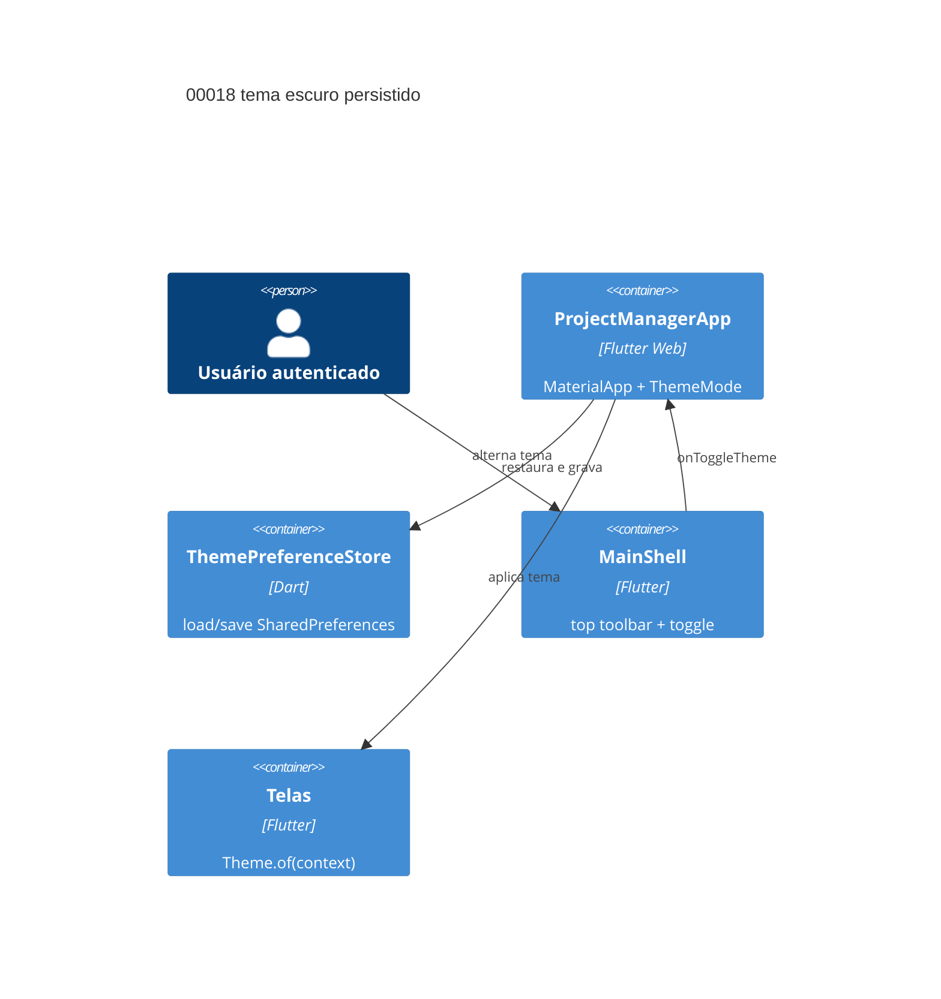

# Implementation Plan: Tema escuro por padrão e alternância persistida (00018)

**Branch**: dev · **Date**: 2026-10-28 · **Spec**: `spec.md` · **Epic**: E014

## Instructions Check

| Regra | Status |
|---|---|
| I — mudanças em `dev`, `main` intocada | PASS — plano para `dev`; 0 commit de promoção |
| II — suíte verde antes de promoção | PASS — `flutter test` + `flutter analyze` no gate |
| III — TODO intake | PASS — E014 ativo no `TODO.md` (linha 8) |
| IV — saída concisa | PASS |
| Stack + PRESERVE_EXISTING_LAYOUT | PASS — Dart/Flutter, arquivos existentes, 0 dependência nova |
| QC mínimo (lint, segurança, unit) | PASS — `flutter analyze`, `flutter test`; `npm audit` N/A (sem backend) |
| Complexity Tracking | N/A — 0 dependência, 0 migração, só UI |
| `TECHNICAL.md` após o plano | PASS — entrada E014 marcada `in progress` |

## Technical Context

| Campo | Valor |
|---|---|
| Language / Version | Dart 3 (Flutter Web); backend não tocado |
| Primary Dependencies | Flutter/Material 3, `shared_preferences ^2.2.3` — 0 nova |
| Storage | SharedPreferences, chave `theme_mode` = `light`\|`dark`; ausente/inválida → `dark` |
| Testing | `flutter test`, `flutter analyze` (Docker); sem teste de backend novo |
| Project Type / Mode | web multi-tenant, brownfield, UI-only |
| Perf. Goals | preferência lida uma vez antes do `runApp`; toggle só `setState`, sem I/O no frame |
| Constraints | sem dependência nova; toggle só na toolbar existente; tokens `ColorScheme`; a11y de E006 intacta; escolha vence o SO |
| Scale / Scope | 2 US P1 · 5 FR · 0 endpoint · 0 migração · 2 arquivos de lib + 1 serviço + testes |

## Architecture



## Architecture Decisions

| ID | Opções | Decisão | Racional |
|---|---|---|---|
| AD-001 | ler no `build` · `ThemeMode.system` · ler antes do `runApp` | **`await ThemePreferenceStore.load()` em `main()` e passar `initialThemeMode`** | FR-065/SC-002: sem pintura clara intermitente; fallback escuro resolvido antes da primeira renderização |
| AD-002 | `provider` · estado global · `StatefulWidget` raiz | **`ProjectManagerApp` stateful com `ThemeMode _themeMode`** | FR-066/SC-003: rebuild do `MaterialApp` alcança todas as telas via `Theme.of`; sem dependência nova |
| AD-003 | bool `is_dark` · enum do sistema · string explícita | **chave `theme_mode` com `light`/`dark`; valor desconhecido → `dark`** | FR-067/SC-004: legível, tolerante a lixo e independente do SO; nunca grava `system` |
| AD-004 | nova barra · trailing do rail · `_SessionToolbar` | **`IconButton` com tooltip/Semantics dentro de `_SessionToolbar`** | FR-066: mora na toolbar existente; usuário, papel e Sair permanecem; callback opcional preserva testes isolados do shell |
| AD-005 | reescrever telas · hex novo · tokens existentes | **reusar `AppTheme.light`/`dark`; estender `light` só se contraste de E013 falhar** | FR-068/SC-005: `statusColor` já usa `ColorScheme`; 0 hex novo e 0 dependência |
| AD-006 | manter `ThemeMode.system` no teste · atualizar expectativa | **atualizar `web_browsers_test.dart` para `ThemeMode.dark`** | assertion E006 contradiz o novo default; teste é contrato, não código de produção |

## Data Model Summary

N/A — nenhum dado de domínio novo; apenas uma preferência local, sem migração e sem tabela.

## API Surface Summary

N/A — nenhuma rota ou payload de backend; a escolha nunca sai do dispositivo.

## Testing Strategy

| Tier | Tool | Scope | Mock Boundary | Install |
|---|---|---|---|---|
| Unit/Widget | `flutter test` | default escuro, fallback, restauração, toggle, contraste | `SharedPreferences.setMockInitialValues` e callback do shell | configured |
| Static | `flutter analyze` | sem warning novo | — | configured |
| Widget | `flutter test web_browsers_test.dart` | `MaterialApp.themeMode` e boot | entrypoint real | configured |
| Security | N/A | sem backend, rota ou dependência nova | — | — |
| Coverage | N/A — sem alvo numérico (policy v2.1.0) | — | — | — |

## Acceptance Test Stubs

P1 = FR-064..FR-068 (5). Stubs criados em RED por T003/T004/T008/T011/T013 antes da implementação de cada requisito. SC-001/002→FR-064/065 · SC-003→FR-066 · SC-004→FR-067 · SC-005→FR-068.

| Req ID | Test File | Stub Blocks (framework-native) | RED Status |
|---|---|---|---|
| FR-064 | frontend/test/theme_preference_test.dart | `testWidgets('FR-064 primeira execução abre escuro', ...)` | active |
| FR-065 | frontend/test/theme_preference_test.dart | `testWidgets('FR-065 ausente ou inválida cai no escuro', ...)` | active |
| FR-066 | frontend/test/shell_toolbar_test.dart | `testWidgets('FR-066 toggle alterna o tema na toolbar', ...)` | active |
| FR-067 | frontend/test/theme_preference_test.dart | `testWidgets('FR-067 escolha persiste e restaura', ...)` | active |
| FR-068 | frontend/test/a11y_labels_test.dart | `testWidgets('FR-068 contraste AA nos dois modos', ...)` | active |

## Error Handling Strategy

| Categoria | Padrão | Resposta | Retry |
|---|---|---|---|
| Leitura de preferência falha | catch no `main()` | cai em `ThemeMode.dark`, sem erro visível | não |
| Valor desconhecido/corrompido | decode com allowlist | retorna `dark` | não |
| Gravação falha | `try/catch` no serviço | tema muda em memória; erro silencioso | não |
| Toolbar sem callback | parâmetro nullable | toolbar renderiza sem toggle; fluxo real sempre injeta | não |

## Risk Mitigation

| Risk (from spec) | Likelihood | Impact | Mitigation | Owner |
|---|---|---|---|---|
| Toolbar atrasada bloqueando o toggle | medium | medium | default + persistência entregues antes; toggle entra com a toolbar | `main.dart` |
| Token ilegível no modo claro | medium | medium | contraste nos dois modos em `a11y_labels_test`, com AA só como referência de teste (E006 não fixa meta AA); `statusColor` só `ColorScheme` | `app_theme.dart`, testes |
| Preferência legada ou inválida | low | low | allowlist `light`/`dark`; todo o resto → `dark` | `theme_preference_store.dart` |

## Requirement Coverage Map

| Req ID | File Path(s) | Function(s)/Symbol(s) | Notes |
|---|---|---|---|
| FR-064 | frontend/lib/main.dart, frontend/test/theme_preference_test.dart | `main()`, `ProjectManagerApp(initialThemeMode)`, `ThemeMode.dark` | AD-001, AD-002 |
| FR-065 | frontend/lib/services/theme_preference_store.dart, frontend/lib/main.dart, frontend/test/theme_preference_test.dart | `ThemePreferenceStore.load()`, `ThemePreferenceStore.decode()`, `main()` | AD-001, AD-003 |
| FR-066 | frontend/lib/main.dart, frontend/test/shell_toolbar_test.dart | `ProjectManagerApp._toggleTheme()`, `MainShell.onToggleTheme`, `_SessionToolbar` | AD-002, AD-004 |
| FR-067 | frontend/lib/services/theme_preference_store.dart, frontend/lib/main.dart, frontend/test/theme_preference_test.dart | `ThemePreferenceStore.save()`, `ThemePreferenceStore.load()`, `ProjectManagerApp._toggleTheme()` | AD-002, AD-003 |
| FR-068 | frontend/lib/theme/app_theme.dart, frontend/lib/main.dart, frontend/test/a11y_labels_test.dart | `AppTheme.light`, `AppTheme.dark`, `AppTheme.statusColor()`, `MaterialApp.themeMode` | AD-005 |

## Project Structure

### Source Code

```text
~ frontend/lib/main.dart (main assíncrono, ThemeMode state, callback do toggle)
+ frontend/lib/services/theme_preference_store.dart (load/save/decode)
~ frontend/lib/theme/app_theme.dart (só ajuste de contraste; AD-005)
~ frontend/test/theme_preference_test.dart (+ stubs FR-064/065/067)
~ frontend/test/shell_toolbar_test.dart (+ toggle; AD-004)
~ frontend/test/web_browsers_test.dart (system → dark; AD-006)
~ frontend/test/a11y_labels_test.dart (+ contraste nos dois modos)
```

**Patterns to reuse**: `SharedPreferences.getInstance()` de `api_service.dart`, tokens de `AppTheme`, `Semantics`/`Tooltip` de `_SessionToolbar`, `setMockInitialValues` dos testes. **Naming**: chave e valores EN (`theme_mode`, `light`/`dark`), UI em PT.

## Implementation Hints

- **[HINT-001]** Ordem: stubs RED → `ThemePreferenceStore` → `main()`/estado → toggle na toolbar → testes de boot/a11y → `flutter analyze`/`flutter test`.
- **[HINT-002]** `ProjectManagerApp` continua com construtor `const` e `initialThemeMode = ThemeMode.dark` para não quebrar os testes que pumpam o entrypoint sem `main()`.
- **[HINT-003]** Não use `ThemeMode.system` após a primeira escolha: `themeMode` vem de `_themeMode`, não do brilho da plataforma.
- **[HINT-004]** Preserve `userName`, `roleLabel` e `Sair` na toolbar; o toggle é ação adicional e não reabre o escopo ad-hoc.
- **[HINT-005]** `AppTheme.light.scaffoldBackgroundColor` é hex fixo de E006 — só altere se o contraste de E013 falhar; evite hex novo em widgets.
