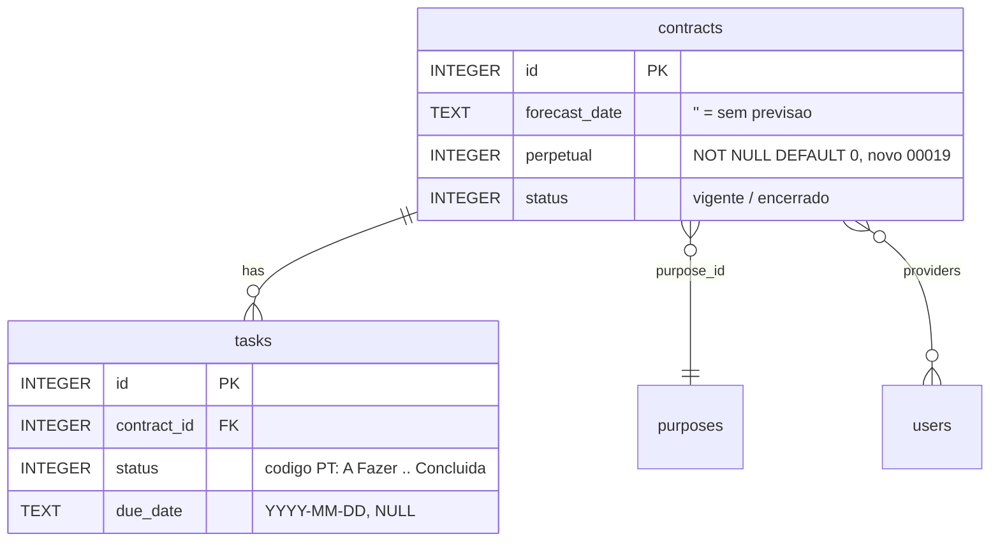

# Data Model: Indicadores de perpétuo, conclusão e tarefas atrasadas (00019)

Storage: `data/domains/<id>.db` (sql.js). 00019 é aditivo: **1 coluna** `contracts.perpetual` em `migrateSchema()`/`CONTRACTS_DDL` (`backend/src/config/database.js`); **nenhuma tabela nova**; `platform.db` não muda. Convenções: identificadores em inglês no DDL, estado em português (AD-003), parâmetros vinculados, booleano `INTEGER 0/1` sem CHECK (como `users.active`).

**Multi-tenant (FR-070, FR-076)**: coluna e contagens só no arquivo do domínio (`getDomainDb(domainId)`). **Inalterados**: `platform.db`, `tasks` (DDL, dados, índices), `task_history`/`task_photos`/`comments`/`attachments`/`task_classifications` — contagens são leitura derivada de `tasks`, sem tabela de agregados (Assumptions: "sem tabela nova").

## Entities

| Entity | Tabela | Atributos | Relações | Transições | FR |
|---|---|---|---|---|---|
| Contract | `contracts` (existente) | **+ `perpetual INTEGER NOT NULL DEFAULT 0`** (0/1, sem backfill); inalterados: id PK, name, start_date, `forecast_date TEXT NOT NULL` (`''` = sem previsão), status INTEGER (`contracts.status`: `vigente`/`encerrado`) | 1—N `tasks` (contract_id); N—M users via `contract_providers`; belongs_to `purposes` (purpose_id, created_by) | `perpetual` 0↔1 (toggle manual); status gravado `vigente`↔`encerrado`; effective `vigente`/`atrasado`/`encerrado` — perpétuo nunca retorna `atrasado` | FR-069, FR-070, FR-071, FR-072, FR-073, FR-075 |
| Task (existente) | `tasks` | inalterada; base das contagens: status INTEGER (`tasks.status` código → PT `A Fazer`\|`Em Progresso`\|`Revisão`\|`Concluída`), `due_date TEXT NULL` (YYYY-MM-DD), `contract_id NOT NULL` | N—1 `contracts` | fluxo E003; sem mudança | FR-074, FR-076 |
| Dashboard `contracts[]` (lido, não persistido) | — | por item: `perpetual`, `effective_status`, `a_vencer`, `tasks_total`, `tasks_done`, `tasks_overdue`; em `stats`: `tasksOverdue` (escopo por papel) | deriva de `contracts` + `tasks` no request | — | FR-070, FR-076, FR-077, FR-078 |

## Validation rules

- **FR-069**: `forecast_date` segue `NOT NULL`; sem previsão grava `''`; com marcador ativo a data persiste e é ignorada pelos derivadores (marcador é a autoridade; STF-001). Rota valida YYYY-MM-DD (400); previsão exigida sem marcador, opcional com marcador.
- **FR-072**: predicado único "sem previsão": `perpetual = 0 AND (forecast_date IS NULL OR forecast_date = '')` em todo derivador de "incompleto" de `routes/alerts.js` (CASE, window `incomplete_total`, COUNT) e nos demais derivadores via `forecast_date`.
- **FR-073**: `Contract.isOverdue` retorna false com `perpetual = 1` → `effectiveStatus` nunca dá `atrasado`; `isAVencer` (dashboard) também exclui perpétuo mesmo com data preenchida. `tasks_overdue` por contrato não é afetado.
- **FR-074/FR-076**: `tasks_total` = COUNT(*) por contract_id; `tasks_done` = COUNT WHERE status = código `'Concluída'` (único que conta — resolve STF-002); "Concluído" exibido só com `total > 0` (apresentação, não banco).
- **FR-076**: `tasks_overdue` = `status ≠ 'Concluída'` e `due_date < hoje UTC` (`toISOString().slice(0, 10)`, mesmo cálculo de `summarizeTasks`); concluída com due_date passado não conta; mesmo valor para todo papel.
- **FR-075**: conclusão não grava — distinta de `status`/`effective_status`; chip de status não muda.
- Parâmetros vinculados; leitura/escrita restritas ao domínio; `stats.tasksOverdue` mantém escopo por papel (FR-078).

## Migration

- **Coluna aditiva**: `ALTER TABLE contracts ADD COLUMN perpetual INTEGER NOT NULL DEFAULT 0` em `migrateSchema()`, ANTES do loop `ENUM_TABLE_MIGRATIONS`, guardado por `tableExists('contracts')` + `PRAGMA table_info` + `!columns.includes('perpetual')` — padrão `username`/workflow; 2ª abertura = no-op.
- Coluna também no `CONTRACTS_DDL` (bancos novos nascem com ela — mesmo precedente de `attachments.category`); rebuild de enum usa o mesmo DDL e `perpetual` cai no DEFAULT em tabela legada.
- SQLite exige DEFAULT não-NULL em ADD COLUMN NOT NULL → `0`; linhas antigas = prazo fixo; **sem backfill** (marcação manual).
- Sem tabela nova, sem índice novo (`idx_tasks_contract`, `idx_tasks_status`, `idx_tasks_due_date`, `idx_contracts_forecast` existem), sem rebuild de `forecast_date` (12-step fora de escopo). `MIGRATION` é só aditivo; `platform.db` intocado.

ER Diagram (visual reference)

