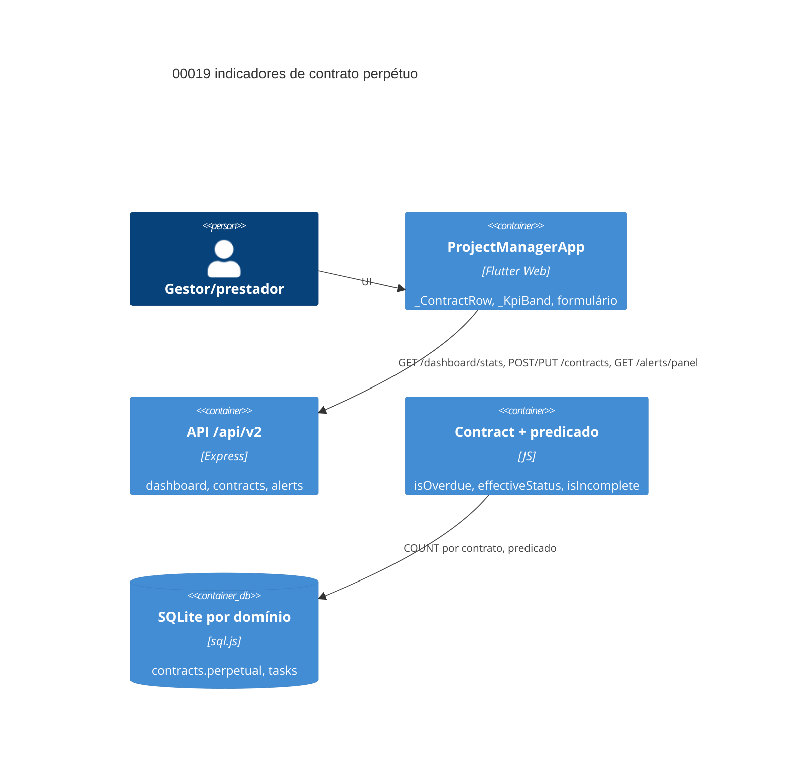

# Implementation Plan: Indicadores do painel — perpétuo, conclusão e tarefas atrasadas (00019)

**Branch**: dev · **Date**: 2026-11-07 · **Spec**: `spec.md` · **Epic**: E017

## Summary

**Goal**: Perpétuo, conclusão e atraso por contrato no painel, sem falso "Incompleto".
**Approach**: Coluna `perpetual`, contagens de `tasks`, predicado único, texto+ícone.
**Key Constraint**: Sem endpoint/dependência nova; `forecast_date` `NOT NULL` (`''`).

## Instructions Check

| Regra | Status |
|---|---|
| I — `dev`, `main` intocada | PASS — plano para `dev`; 0 promoção |
| II — suíte verde antes de promoção | PASS — `npm test`, `test.sh`, `flutter test`, `flutter analyze` |
| III — TODO intake | PASS — sem TODO custom novo; E017 ativo em `specs/project-plan.md` |
| IV — saída concisa | PASS |
| Stack + PRESERVE_EXISTING_LAYOUT | PASS — arquivos existentes, 0 dependência nova |
| QC mínimo (lint, segurança, unit) | PASS — `flutter analyze`, `npm test`, `npm audit` |
| Complexity Tracking | N/A — 0 dependência; 1 migração idempotente |
| `TECHNICAL.md` após o plano | PASS — E017 `in progress` |

## Technical Context

| Campo | Valor |
|---|---|
| Language / Version | Dart 3 (Flutter Web) + Node.js ≥22 (Express, sql.js) |
| Primary Dependencies | Flutter/Material 3, express/sql.js — 0 nova |
| Storage | SQLite por domínio: `contracts` + `perpetual INTEGER NOT NULL DEFAULT 0`; `platform.db` intocada |
| Testing | `cd backend && npm test`, `backend/test.sh`, `flutter test`, `flutter analyze` |
| Project Type / Mode | web multi-tenant, brownfield, full-stack |
| Perf. Goals | `COUNT` por contrato na leitura; sem cache novo |
| Constraints | sem endpoint nem backfill; marcador manda sobre a data; UTC em `date('now')`; escala fora do escopo (STF-005) |
| Scale / Scope | 3 US (2×P1) · 11 FR (7 P1) · 0 endpoint · 1 migração · 5 backend + 3 frontend + testes |

## Architecture



## Architecture Decisions

| ID | Decisão | Opções | Escolhida | Racional |
|----|---------|--------|-----------|----------|
| AD-001 | Local do marcador | coluna / tabela / nullable | coluna `perpetual` default 0 | guarda `PRAGMA table_info` idempotente (precedente `attachments`) |
| AD-002 | Contagens por contrato | materializadas / `COUNT` na leitura | `COUNT` derivado | sem denormalização; payload já é por linha |
| AD-003 | Predicado de incompleto | site-by-site / helper único | helper único em `Contract.js` | FR-072 exige predicado compartilhado |
| AD-004 | `forecast_date` perpétua | nullable / sentinela `''` | sentinela `''` | assumido na spec; evita `NULL` checks |
| AD-005 | Sinais no card | chip colorido / texto+ícone | texto + ícone + cor | WCAG 1.4.1; tokens `ColorScheme` |
| AD-006 | KPI de atraso | recompute / reutilizar | reutilizar `stats.tasksOverdue` | FR-078/STF-003: escopo por papel difere da soma |

## Data Model Summary

| Entity | Key Fields | Relationships | Notes |
|--------|------------|---------------|-------|
| `contracts` | + `perpetual INTEGER NOT NULL DEFAULT 0` | 1:N `tasks` | migração em `migrateSchema()`; sem backfill |
| `tasks` (leitura) | `status`, `due_date`, `contract_id` | N:1 `contracts` | inalterada; overdue = não concluída com `due_date` < hoje UTC |
| payload `contracts[]` | + `perpetual`, `tasks_total`, `tasks_done`, `tasks_overdue` | — | derivado em `getDomainMetrics`/`recentProjects` |

**Detalhe**: `data-model.md`

## API Surface Summary

| Method | Path | Purpose | Auth | Req/Res |
|--------|------|---------|------|---------|
| GET | `/api/v2/dashboard/stats` | + `perpetual`, `tasks_total/done/overdue`; atraso/a vencer ignoram perpétuo | 3 papéis | contrato expandido |
| POST/PUT | `/api/v2/contracts[/:id]` | aceita `perpetual`; `forecast_date` só se efetivo `false` | admin/gestor | body condicional |
| GET | `/api/v2/contracts?status=` | recorte `atrasado` exclui perpétuo; `vigente` inclui | +prestador | filtro SQL |
| GET | `/api/v2/alerts/panel` | `incomplete` e janelas excluem perpétuo | admin/gestor | sem campo novo |

**Detalhe**: `contracts/` (`dashboard-stats.md`, `contracts-crud.md`, `alerts-panel.md`)

## Testing Strategy

| Tier | Tool | Scope | Mock Boundary | Install |
|------|------|-------|---------------|---------|
| Unit backend | `node --test` + supertest | rotas, `Contract`, predicado, migração | `DATA_DIR` temporário | configured |
| Unit frontend | `flutter test` | card, KPI, formulário, a11y | `ApiService` stubado | configured |
| Integration | `backend/test.sh` | E2E com servidor real | `DATA_DIR`/`PORT` descartáveis | configured |
| Lint / Security | `flutter analyze` / `npm audit` | frontend / deps | — | configured |

## Acceptance Test Stubs

| Req ID | Test File | Stub Blocks | RED Status |
|--------|-----------|-------------|------------|
| FR-069 | `backend/src/routes/contracts.test.js` | `test('FR-069 forecast opcional só com perpétuo')` | failing-assertion |
| FR-070 | `backend/src/routes/dashboard.test.js` | `test('FR-070 expõe perpetual em contracts[]')` | failing-assertion |
| FR-071 | `frontend/test/dashboard_redesign_test.dart` | `testWidgets('FR-071 card perpétuo sem Incompleto')` | failing-assertion |
| FR-072 | `backend/src/routes/alerts.test.js` | `test('FR-072 sem previsão exclui perpétuo')` | failing-assertion |
| FR-073 | `backend/src/models/Contract.test.js` | `test('FR-073 perpétuo nunca atrasado')` | failing-assertion |
| FR-074 | `frontend/test/dashboard_redesign_test.dart` | `testWidgets('FR-074 Concluído sem tarefa aberta')` | failing-assertion |
| FR-075 | `frontend/test/dashboard_redesign_test.dart` | `testWidgets('FR-075 Concluído distinto de Encerrado')` | failing-assertion |

## Error Handling Strategy

| Error Category | Pattern | Response | Retry |
|----------------|---------|----------|-------|
| Validação (`perpetual`, datas) | fail-fast no gate existente | 400 `{ "error": "..." }` | não |
| Auth/domínio/papel, 404 | inalterado (`scopeDomain`) | 401/403/404 | não |
| Migração | guarda `PRAGMA table_info` → `ADD COLUMN` | startup falha se SQL inválido | não |

## Risk Mitigation

| Risk (from spec) | L | I | Mitigation | Owner |
|---|---|---|---|---|
| Perpétuo vazar para incompletos/KPIs | M | H | exclusão em `isAVencer`, `isOverdue`, predicado único | `Contract.js`, `dashboard.js`, `alerts.js` |
| Excesso de marcadores | M | L | máx. três sinais em `_ContractRow` | `dashboard_screen.dart` |
| Migração em domínio existente | L | M | guarda idempotente | `database.js` |

## Requirement Coverage Map

| Req ID | File Path(s) | Function(s)/Symbol(s) | Notes |
|---|---|---|---|
| FR-069 | backend/src/routes/contracts.js, frontend/lib/screens/projects_screen.dart | validação POST/PUT, `_forecastController` | AD-001, AD-004 |
| FR-070 | backend/src/routes/dashboard.js, frontend/lib/models/contract.dart | `getDomainMetrics`, `summarizeContracts`, `Contract.fromJson` | AD-002 |
| FR-071 | frontend/lib/screens/dashboard_screen.dart | `_ContractRow`, `_IncompleteTag` | AD-005 |
| FR-072 | backend/src/routes/alerts.js, backend/src/models/Contract.js | 3 spots SQL → `isIncomplete` | AD-003 |
| FR-073 | backend/src/models/Contract.js, backend/src/routes/dashboard.js, backend/src/routes/contracts.js | `isOverdue`, `effectiveStatus`, `isAVencer`, recorte `atrasado` | STF-001 |
| FR-074 | frontend/lib/screens/dashboard_screen.dart, frontend/lib/models/contract.dart | `_ContractRow`, getters `tasksTotal/Done` | ≠ status |
| FR-075 | frontend/lib/screens/dashboard_screen.dart | `_StatusChip` + marcador de conclusão | — |
| FR-076 | backend/src/routes/dashboard.js | `COUNT` por `contract_id` (UTC) | STF-002 |
| FR-077 | frontend/lib/screens/dashboard_screen.dart | marcador "N tarefa(s) atrasada(s)" | texto+ícone |
| FR-078 | frontend/lib/screens/dashboard_screen.dart | `_KpiBand` bloco `tasksOverdue` | AD-006, STF-003/004 |
| FR-079 | frontend/lib/screens/dashboard_screen.dart, frontend/test/a11y_labels_test.dart | `ColorScheme`, contraste 2 temas | STF-005 |

## Project Structure

### Source Code

```text
~ backend/src/config/database.js (+ perpetual em migrateSchema)
~ backend/src/models/Contract.js (guarda de atraso + predicado)
~ backend/src/routes/contracts.js (validação condicional, recorte atrasado)
~ backend/src/routes/dashboard.js (perpetual + contagens)
~ backend/src/routes/alerts.js (predicado nos 3 spots)
~ frontend/lib/models/contract.dart (perpetual, tasks_total/done/overdue)
~ frontend/lib/screens/projects_screen.dart (switch + validação)
~ frontend/lib/screens/dashboard_screen.dart (marcadores, KPI atraso)
+ stubs FR-071/074/075 em frontend/test/dashboard_redesign_test.dart
~ backend src/**/*.test.js (+ stubs FR-069/070/072/073)
```

**Padrões**: gate de `contracts.js`, `summarizeContracts`/`isAVencer`, `_IncompleteTag`, `getPanel`. **Convenções**: EN em DDL/payload, valor PT, datas `YYYY-MM-DD` UTC.

## Implementation Hints

- **[HINT-001]** Ordem: stubs RED → migração + `Contract.js` → rotas → models Dart → card/KPI → `flutter analyze`/`flutter test` → `npm test` → `test.sh`.
- **[HINT-002]** `forecast_date` segue `NOT NULL`: perpétuo sem data grava `''`; `NULL` quebra inserts legados e `test.sh`.
- **[HINT-003]** Predicado único: 3 spots de `alerts.js` + recorte `atrasado` importam o helper de `Contract.js`.
- **[HINT-004]** Contagens valem para todo papel; KPI usa `stats.tasksOverdue`, sem reconciliação (FR-078).
- **[HINT-005]** Preserve `effective_status` e o chip: "Concluído" é adicional, nunca substitui `Encerrado`/`Atrasado` (FR-075).
