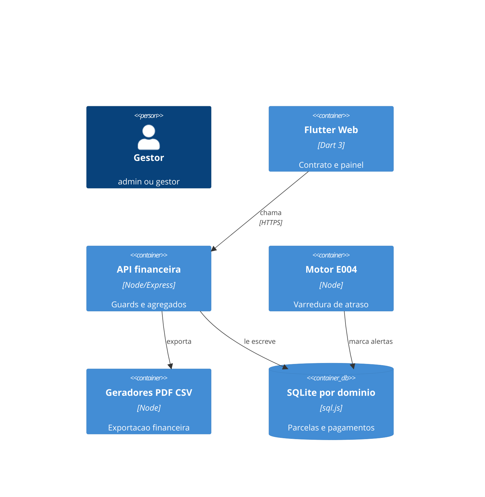

# Implementation Plan: Previsibilidade financeira por contrato (00020)

**Branch**: dev · **Date**: 2026-11-22 · **Spec**: `spec.md` · **Epic**: E018

## Summary

**Goal**: parcelas, pagamentos, indicadores e exportação financeira por contrato.
**Approach**: 2 tabelas por domínio, roteador financeiro sob guards E001, agregado no dashboard e alerta em `extracted_alerts`.
**Key Constraint**: somente admin/gestor; BRL em centavos; nenhuma integração externa.

## Instructions Check

| Regra | Status |
|---|---|
| I — `dev`, `main` intocada | PASS |
| II — suíte verde antes de promoção | PASS |
| III — TODO intake | PASS |
| IV — saída concisa | PASS |
| Stack / layout | PASS — brownfield, 0 dependência nova |
| QC mínimo | PASS — lint, segurança, unit |

**Instructions Check (2026-11-22): PASS** — 0 violações.

## Technical Context

| Campo | Valor |
|---|---|
| Language / Version | Dart 3 (Flutter Web) + Node.js ≥22 |
| Primary Dependencies | Flutter, Express, sql.js — 0 novas |
| Storage | SQLite por domínio: 2 tabelas + `attachments.payment` |
| Testing | `npm test`, `backend/test.sh`, `flutter test/analyze`, `npm audit` |
| Project Type | web multi-tenant, brownfield |
| Perf. Goals | resumo em 1 leitura; 500 parcelas/contrato |
| Constraints | BRL centavos; 2 MB; prestador/visitante 403; 0 externo |
| Scale / Scope | 3 US P1 · 7 FR P1 · 6 endpoints |

## Architecture



## Architecture Decisions

| ID | Decisão | Opções | Escolhida | Racional |
|----|---------|--------|-----------|----------|
| AD-001 | Valores monetários | float / cents INTEGER | centavos INTEGER | soma exata e comparação confiável |
| AD-002 | Comprovante | coluna em `payments` / `attachments.category='payment'` | categoria `payment` com `payment_id` | reusa upload sem poluir evidência (STF-005) |
| AD-003 | Pagamento acima da parcela | aceitar e estornar / 400 atômico | 400 dentro da transação | sem escrita parcial (STF-001) |
| AD-004 | Agregado no painel | endpoint novo / chave em `/dashboard/stats` | chave `finance` condicional | menos chamadas, sem vazamento (STF-002) |
| AD-005 | Alerta de atraso | tabela nova / `extracted_alerts` | `extracted_alerts` com UPSERT | dedup tripla já existe (STF-003) |
| AD-006 | Exportação | gerar na rota / serviço dedicado | `financeReport.js` reusa helpers | mantém `report.js` < 500 linhas |
| AD-007 | Exclusão de parcela | permitir com pagamento / bloquear | bloquear se houver pagamento | evita órfão (STF-004) |
| AD-008 | Limite | ilimitado / 500 | 500 | contém varredura |

## Data Model Summary

| Entity | Key Fields | Relationships | Notes |
|--------|------------|---------------|-------|
| `contract_installments` | contract_id, description, amount_cents, due_date | N:1 contracts; 1:N payments | CHECK amount > 0; máx. 500/contrato |
| `contract_payments` | installment_id, contract_id, amount_cents, paid_at | N:1 installment; 1:1 attachment | imutável; soma ≤ parcela |
| `attachments` (rebuild) | payment_id, category `payment` | N:1 payments | CHECK aceita payment_id; ids preservados |


## API Surface Summary

| Method | Path | Purpose | Auth | Req/Res |
|--------|------|---------|------|---------|
| GET | `/contracts/:id/finance` | resumo + parcelas + pagamentos | JWT · admin/gestor | → `{summary,installments}` |
| POST | `/contracts/:id/finance/installments` | criar parcela | mesmo | `{description,amount_cents,due_date}` → 201 |
| DELETE | `/contracts/:id/finance/installments/:iid` | excluir sem pagamento | mesmo | → 204 |
| POST | `/contracts/:id/finance/installments/:iid/payments` | registrar pagamento | mesmo | `{amount_cents,paid_at?,receipt?}` → 201 |
| GET | `/contracts/:id/finance/export.csv` | resumo em CSV | mesmo | → `text/csv` |
| GET | `/contracts/:id/finance/export.pdf` | resumo em PDF | mesmo | → `application/pdf` |


## Testing Strategy

| Tier | Tool | Scope | Mock Boundary | Install |
|------|------|-------|---------------|---------|
| Unit backend | `node --test` + supertest | rotas, migração, serviços, export | `DATA_DIR`/`UPLOAD_DIR` temp | configured |
| Unit frontend | `flutter test` | seção financeira e card | `ApiService` stub | configured |
| Integration | `backend/test.sh` | E2E servidor real | `DATA_DIR`/`PORT` descartáveis | configured |
| Lint | `flutter analyze` | frontend | — | configured |
| Security | `npm audit --audit-level=high` | dependências backend | — | configured |
| Coverage | `node --test --experimental-test-coverage` | measurement | — | configured |

## Acceptance Test Stubs

| Req ID | Test File | Stub Blocks (framework-native) | RED Status |
|--------|-----------|----------------------------------|------------|
| FR-064 | `backend/src/routes/finance.test.js` | `test('FR-064 installments CRUD e limite 500')` | failing-assertion |
| FR-065 | `backend/src/routes/finance.test.js` | `test('FR-065 payment with optional receipt')` | failing-assertion |
| FR-066 | `backend/src/routes/finance.test.js` | `test('FR-066 overpay and invalid upload are 400')` | failing-assertion |
| FR-067 | `backend/src/services/finance.test.js` | `test('FR-067 summary and dashboard aggregate')` | failing-assertion |
| FR-068 | `backend/src/services/financeAlerts.test.js` | `test('FR-068 overdue alert dedup')` | failing-assertion |
| FR-069 | `backend/src/services/financeReport.test.js` | `test('FR-069 csv pdf parity')` | failing-assertion |
| FR-070 | `backend/src/routes/finance.test.js` | `test('FR-070 finance roles and domains')` | failing-assertion |

## Error Handling Strategy

| Error Category | Pattern | Response | Retry |
|----------------|---------|----------|-------|
| Validação | fail-fast | 400 `{error,code}` | não |
| Pagamento acima do saldo | transação | 400 `PAYMENT_EXCEEDS_INSTALLMENT` | não |
| Arquivo inválido | validação antes de disco | 400 sem pagamento | não |
| Parcela paga | guard | 400 `INSTALLMENT_HAS_PAYMENT` | não |
| Fora do escopo | guard | 403/404 sem leitura | não |
| Varredura repetida | UPSERT | alerta atualizado | idempotente |

## Risk Mitigation

| Risk (from spec) | Likelihood | Impact | Mitigation | Owner |
|-------------------|------------|--------|------------|-------|
| Pagamento duplicado | medium | high | saldo na transação | `routes/finance.js` |
| Vazamento financeiro | low | high | requireRole + testes 403 | `routes/finance.js` |
| Alerta duplicado | medium | medium | UNIQUE + UPSERT | `financeAlerts.js` |

## Requirement Coverage Map

| Req ID | Component(s) | File Path(s) | Function(s)/Symbol(s) | Notes |
|--------|--------------|--------------|------------------------|-------|
| FR-064 | migration, route | `backend/src/config/database.js`, `backend/src/routes/finance.js` | `CONTRACT_INSTALLMENTS_DDL`, `listInstallments`, `createInstallment`, `deleteInstallment` | AD-001, AD-007, AD-008 |
| FR-065 | route, upload | `backend/src/routes/finance.js`, `backend/src/middleware/upload.js` | `postPayment`, `saveToUploads`, `decodeAndValidate` | AD-002 |
| FR-066 | route validation | `backend/src/routes/finance.js` | `validatePayment`, `assertInstallmentScope`, `assertFinanceAccess` | AD-003; transação atômica |
| FR-067 | service, dashboard | `backend/src/services/finance.js`, `backend/src/routes/dashboard.js` | `getContractFinance`, `getDomainFinance`, `getDomainMetrics` | AD-004; chave `finance` |
| FR-068 | sweep, panel | `backend/src/services/financeAlerts.js`, `backend/src/services/alerts.js`, `backend/src/routes/alerts.js` | `runInstallmentSweep`, `runExpirySweep`, `listPanel` | AD-005; UPSERT |
| FR-069 | report, route | `backend/src/services/financeReport.js`, `backend/src/routes/finance.js` | `generateFinancePdf`, `exportFinanceCsv`, `exportFinance` | AD-006 |
| FR-070 | guards | `backend/src/routes/finance.js`, `backend/src/routes/dashboard.js`, `backend/src/middleware/auth.js` | `assertFinanceAccess`, `getDomainMetrics`, `requireRole` | STF-002 |
| FR-071 | spec only | `specs/00020-previsibilidade-financeira/spec.md` | `FR-071` | P2 fora do MVP; sem código |

## Project Structure

### Source Code

```text
+ backend/src/routes/finance.js (+ finance.test.js) — AD-003/007/008
+ backend/src/services/finance.js (+ finance.test.js) — AD-004
+ backend/src/services/financeAlerts.js (+ financeAlerts.test.js) — AD-005
+ backend/src/services/financeReport.js (+ financeReport.test.js) — AD-006
~ backend/src/config/database.js (2 tabelas + rebuild de attachments) — AD-001/002
~ backend/src/routes/dashboard.js (chave finance) — AD-004
~ backend/src/routes/alerts.js (extracted no painel) — AD-005
~ backend/src/services/alerts.js (chamada da varredura) — AD-005
~ backend/src/server.js (monta roteador)
+ frontend/lib/screens/contract_detail_screen_finance.dart
+ frontend/lib/screens/dashboard_screen_finance.dart
~ frontend/lib/screens/contract_detail_screen.dart
~ frontend/lib/screens/dashboard_screen_kpis.dart
~ frontend/lib/services/api_service.dart
```

**Patterns**: `migrateSchema`, `requireRole`, `decodeAndValidate`, `buildPdf`. **Tests**: `database`, `dashboard`, `alerts`, `report`. **Naming**: EN no código, PT na UI.

## Implementation Hints

- **[HINT-001]** Ordem: stubs RED → DDL → serviços → rotas → painel → UI → suítes.
- **[HINT-002]** `db.transaction(fn)` executa `fn`; nunca chamar `db.transaction(fn)()`.
- **[HINT-003]** Validar arquivo antes da transação; gravar bytes só após checar saldo.
- **[HINT-004]** `extracted_alerts` já tem UNIQUE(contract_id, source_kind, source_id): use UPSERT.
- **[HINT-005]** O rebuild de `attachments` precisa preservar `message_id` e a categoria `chat`.
