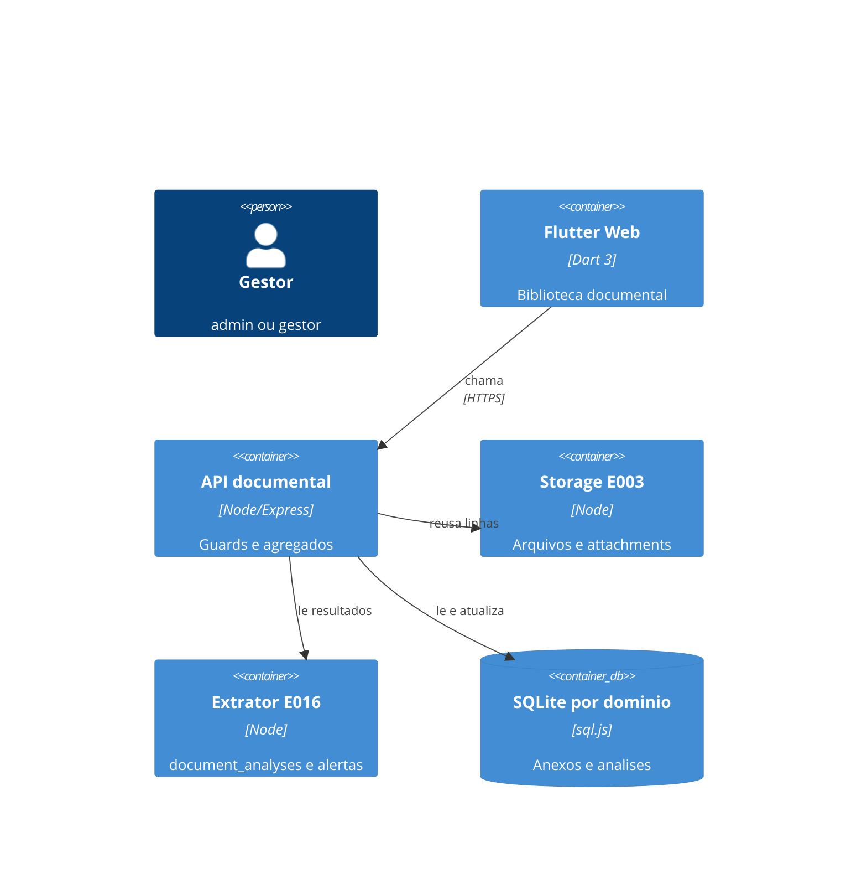

# Implementation Plan: Gestão documental do contrato (00021)

**Branch**: dev · **Date**: 2026-11-23 · **Spec**: `spec.md` · **Epic**: E019

## Summary

**Goal**: biblioteca documental por contrato sobre `attachments`, com análise e conferência.
**Approach**: roteador `documents.js` sob guards E001/E002, leitura de `attachments`/`document_analyses`/`extracted_alerts`, UI extraída em arquivo dedicado.
**Key Constraint**: 0 tabela nova, 0 dependência nova; somente admin/gestor.

## Instructions Check

| Regra | Status |
|---|---|
| I — `dev`, `main` intocada | PASS |
| II — suíte verde antes de promoção | PASS |
| III — TODO intake | PASS |
| IV — saída concisa | PASS |
| Stack / layout | PASS — brownfield, reuso de E001/E002/E003/E016/E018 |
| QC mínimo | PASS — lint, segurança, unit |

**Instructions Check (2026-11-23): PASS** — 0 violações.

## Technical Context

| Campo | Valor |
|---|---|
| Language / Version | Dart 3 (Flutter Web) + Node.js ≥22 |
| Primary Dependencies | Flutter, Express, sql.js — 0 novas |
| Storage | SQLite por domínio: 0 tabela nova; rebuild guardado de `attachments` com 2 colunas |
| Testing | `npm test`, `backend/test.sh`, `flutter test/analyze`, `npm audit` |
| Project Type | web multi-tenant, brownfield |
| Perf. Goals | 1 leitura para listar; até 500 anexos/contrato |
| Constraints | 0 migracao; prestador/visitante/auditor 403; arquivos locais |
| Scale / Scope | 2 US P2 · 7 FR P2 · 3 endpoints |

## Architecture



## Architecture Decisions

| ID | Decisão | Opções | Escolhida | Racional |
|----|---------|--------|-----------|----------|
| AD-001 | Armazenamento | tabela nova / reusar `attachments` | reusar `attachments` | V3 item 2; sem duplicar arquivo |
| AD-002 | Origem do documento | coluna nova / derivar de `message_id`/`payment_id` | derivar | 0 migracao, preserva E016/E018 |
| AD-003 | Analise exibida | reextrair / ler `document_analyses` | ler | extrator determinstico ja existe |
| AD-004 | Conferencia | tabela de eventos / 2 colunas no anexo | 2 colunas no anexo | rebuild guardado, idempotente, sem novo evento |
| AD-005 | Categoria | enum aberto / categorias existentes | categorias existentes | contrato de E003/E016/E018 |
| AD-006 | UI | nova rota / secao na tela do contrato | secao extraida | sem mudanca de navegacao raiz |
| AD-007 | Permissao | qualquer papel autenticado / admin e gestor | admin e gestor | deny-by-default E001 |

## Data Model Summary

Nenhuma tabela nova. Rebuild guardado de `attachments` adicionando `reviewed_by` e `reviewed_at`; ids, categorias, `message_id` e `payment_id` preservados por copia → drop → rename, no mesmo padrao de E011/E016/E018.

**Detail**: `N/A — no persistent data schema change`

## API Surface Summary

| Method | Path | Purpose | Auth | Req/Res |
|--------|------|---------|------|---------|
| GET | `/contracts/:id/documents` | lista anexos, analise e alertas | JWT · admin/gestor | → `{documents}` |
| PATCH | `/contracts/:id/documents/:attachmentId` | altera categoria | mesmo | `{category}` → 200 |
| POST | `/contracts/:id/documents/:attachmentId/review` | marca conferido | mesmo | → `{reviewed_by,reviewed_at}` |

**Detail**: `N/A — inline above`

## Testing Strategy

| Tier | Tool | Scope | Mock Boundary | Install |
|------|------|-------|---------------|---------|
| Unit | node:test | rotas e agregacao documental | SQLite em memoria | configurado |
| Integration | bash backend/test.sh | fluxo HTTP ponta a ponta | servidor de teste | configurado |
| Security | npm audit | dependencias | — | configurado |
| Coverage | flutter analyze/test | UI e estatico | — | configurado |

## Acceptance Test Stubs

N/A — no P1 requirements.

## Error Handling Strategy

| Error Category | Pattern | Response | Retry |
|----------------|---------|----------|-------|
| Validacao | fail-fast | 400 sem escrita | no |
| Autorizacao | guard E001 | 403 antes da consulta | no |
| Dominio divergente | scopeDomain | 403 | no |

## Integration Points

N/A — nenhum ponto de integracao externo; spec nao declara Integration Points.

## Risk Mitigation

| Risk (from spec) | Likelihood | Impact | Mitigation | Owner |
|-------------------|------------|--------|------------|-------|
| Isolamento de dominio | L | H | scopeDomain + requireRole em todas as rotas | routes/documents.js |
| Duplicacao de anexo | M | M | UPDATE na linha existente; teste de nao duplicar | routes/documents.js |

## Requirement Coverage Map

| Req ID | Component(s) | File Path(s) | Function(s)/Symbol(s) | Notes |
|--------|--------------|--------------|------------------------|-------|
| FR-064 | listDocuments | backend/src/routes/documents.js, backend/src/server.js, frontend/lib/screens/contract_detail_documents.dart, frontend/lib/screens/contract_detail_screen.dart, backend/test.sh | `listDocuments()`, `_DocumentsSection` | SELECT unico em attachments por contrato; AD-001/AD-002 |
| FR-065 | listDocuments | backend/src/routes/documents.js, frontend/lib/screens/contract_detail_documents.dart, backend/test.sh | `attachAnalysis()`, `_DocumentsSection` | le document_analyses e extracted_alerts; AD-003 |
| FR-066 | listDocuments | backend/src/routes/documents.js, frontend/lib/screens/contract_detail_documents.dart, backend/test.sh | `parseDocumentFilters()`, `_DocumentsSection` | filtro category/source pos-scope; AD-002 |
| FR-067 | guards | backend/src/routes/documents.js, frontend/lib/screens/contract_detail_documents.dart, frontend/lib/screens/contract_detail_screen.dart, backend/test.sh, TECHNICAL.md | `assertDocumentDomain()`, `_DocumentsSection` | deny-by-default; AD-007 |
| FR-068 | updateCategory | backend/src/routes/documents.js, frontend/lib/screens/contract_detail_documents.dart, backend/test.sh | `updateCategory()` | UPDATE in-place; 400 desconhecida; AD-005 |
| FR-069 | reviewDocument | backend/src/config/database.js, backend/src/routes/documents.js, frontend/lib/screens/contract_detail_documents.dart, backend/test.sh | `ATTACHMENTS_DDL`, `reviewDocument()` | UPDATE idempotente reviewed_by/at; AD-004 |
| FR-070 | guards | backend/src/routes/documents.js, backend/test.sh | `assertDocumentDomain()` | 403 antes da consulta; AD-006/AD-007 |

## Project Structure

### Source Code

```text
+ backend/src/routes/documents.js
~ backend/src/server.js (registro do roteador)
~ backend/src/config/database.js (DDL + rebuild de attachments)
+ backend/src/routes/documents.test.js
+ frontend/lib/screens/contract_detail_documents.dart
+ frontend/test/contract_detail_documents_test.dart
~ frontend/lib/screens/contract_detail_screen.dart (secao extraida)
```

**Patterns to reuse**: `finance.js`, `chat.js`, `scopeDomain`/`requireRole`, `getDomainDb()`.
**Tests to extend**: `backend/src/routes/documents.test.js`, `backend/test.sh`, `frontend/test/`.

## Implementation Hints

- **[HINT-001]** Derivar origem de `message_id`/`payment_id` sem ALTER de tabela.
- **[HINT-002]** Conferencia e categoria usam UPDATE na linha existente, nunca INSERT.
- **[HINT-003]** `extracted_alerts` ja tem dedup por `(contract_id, source_kind, source_id)`.
- **[HINT-004]** Manter `contract_detail_screen.dart` abaixo de 500 linhas ao extrair secao.
- **[HINT-005]** Rotas montadas sob `/api/v2/contracts` com o mesmo middleware de finance.
