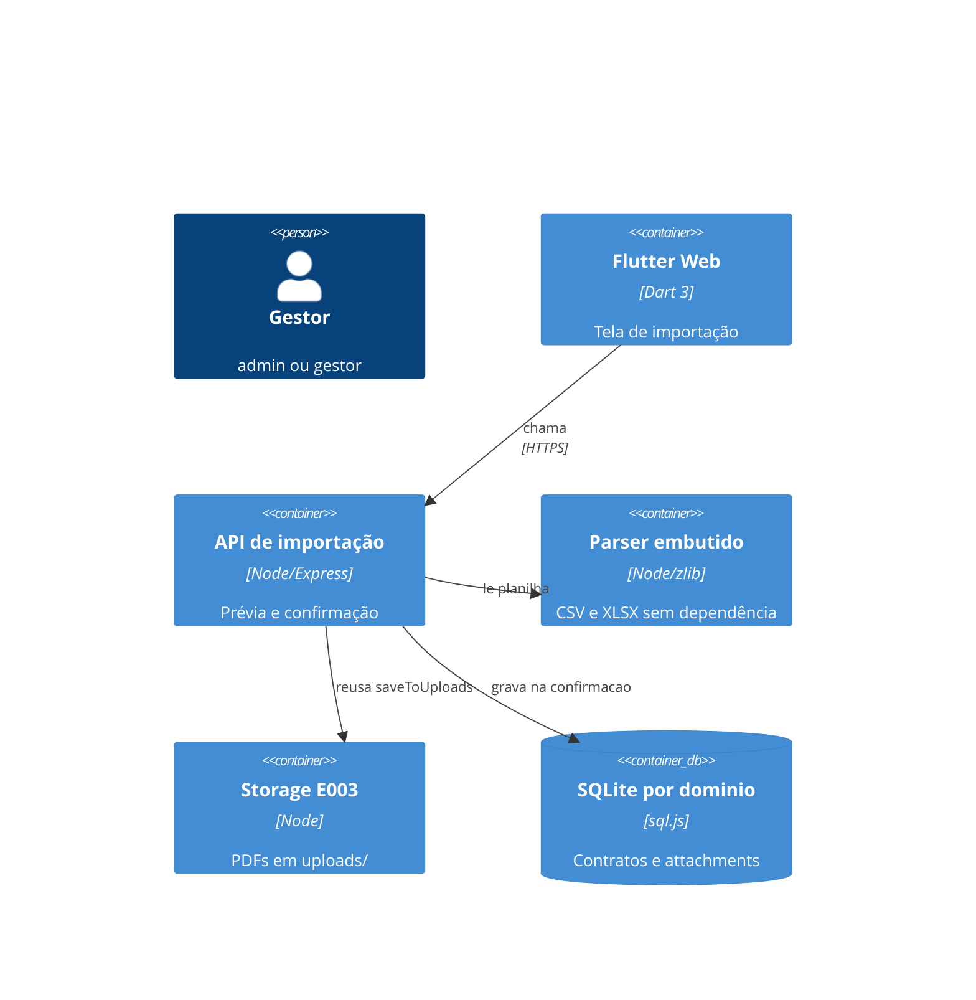

# Implementation Plan: Importação de acervo (00022)

**Branch**: dev · **Date**: 2026-11-23 · **Spec**: `spec.md` · **Epic**: E020

## Summary

**Goal**: importar contratos de CSV/XLSX com mapeamento e prévia, confirmar em uma transação e anexar PDFs em massa.
**Approach**: roteador `imports.js` sob guards E001, parser embutido sem dependência nova, reuso de `attachments` com `contract_id`.
**Key Constraint**: 0 tabela nova, 0 dependência nova; somente admin/gestor; nenhuma gravação antes da confirmação.

## Instructions Check

| Regra | Status |
|---|---|
| I — `dev`, `main` intocada | PASS |
| II — suíte verde antes de promoção | PASS |
| III — TODO intake | PASS |
| IV — saída concisa | PASS |
| Stack / layout | PASS — brownfield, reuso de E001/E002/E003/E016/E018/E019 |
| QC mínimo | PASS — lint, segurança, unit |

**Instructions Check (2026-11-23): PASS** — 0 violações.

## Technical Context

| Campo | Valor |
|---|---|
| Language / Version | Dart 3 (Flutter Web) + Node.js ≥22 |
| Primary Dependencies | Flutter, Express, sql.js, `zlib` nativo — 0 novas |
| Storage | SQLite por domínio: 0 tabela nova; rebuild guardado de `attachments` com `contract_id` |
| Testing | `npm test`, `backend/test.sh`, `flutter test/analyze`, `npm audit` |
| Project Type | web multi-tenant, brownfield |
| Perf. Goals | prévia em memória até 500 linhas; confirmação em 1 transação |
| Constraints | envelope 4 MB; só admin/gestor; PDFs até 2 MB cada |
| Scale / Scope | 2 US P1 · 9 FR P1 · 3 endpoints · 1 tela |

## Architecture



## Architecture Decisions

| ID | Decisão | Opções | Escolhida | Racional |
|----|---------|--------|-----------|----------|
| AD-001 | Leitura de planilha | biblioteca npm / parser embutido | parser embutido | `xlsx` e `read-excel-file` têm high sem fix; 0 dependência nova |
| AD-002 | Fluxo de gravação | gravar no upload / prévia + confirmação | prévia + confirmação | SC-001/SC-004: zero escrita antes do gestor confirmar |
| AD-003 | CSV | separador fixo / `;` ou `,` com aspas | `;` ou `,` com aspas | Excel pt-BR exporta `;`; aspas preservam vírgulas |
| AD-004 | XLSX | ZIP+XML via `zlib` / biblioteca | ZIP+XML via `zlib` | primeira aba, shared strings e inline strings; 0 pacote novo |
| AD-005 | Vínculo do PDF | tabela nova / `attachments.contract_id` | `attachments.contract_id` | rebuild guardado preserva ids, categorias e pais de E016/E018/E019 |
| AD-006 | Concorrência | estado de prévia no servidor / revalidar payload | revalidar payload | STF-003: sem sessão compartilhada; transação atômica |
| AD-007 | Autorização | guard depois da leitura / guard antes | guard antes | STF-002: `authenticateToken` → `scopeDomain` → `requireRole` |

## Data Model Summary

Nenhuma tabela nova. `ATTACHMENTS_DDL` ganha `contract_id INTEGER REFERENCES contracts(id)` e amplia o CHECK. Rebuild guardado por `PRAGMA table_info` + `sqlite_master`: copy → drop → rename preserva ids, categorias e pais de E016/E018/E019.

**Detail**: `N/A — no new table`

## API Surface Summary

| Method | Path | Purpose | Auth | Req/Res |
|--------|------|---------|------|---------|
| GET | `/contracts/import/template` | baixa template CSV versionado | JWT · admin/gestor | → texto CSV |
| POST | `/contracts/import/preview` | lê cabeçalhos e classifica linhas | JWT · admin/gestor | `{fileName, dataBase64, mapping}` → `{headers, rows, total, valid, invalid}` |
| POST | `/contracts/import/confirm` | grava contratos e anexa PDFs | JWT · admin/gestor | `{fileName, dataBase64, mapping, pdfs}` → `{created, skipped, errors}` |

**Detail**: `N/A — inline above`

## Testing Strategy

| Tier | Tool | Scope | Mock Boundary | Install |
|------|------|-------|---------------|---------|
| Unit | node:test | parser CSV/XLSX, mapeamento, validação, rotas | SQLite em memória | configurado |
| Integration | bash backend/test.sh | fluxo HTTP template → prévia → confirmação | servidor de teste | configurado |
| Security | npm audit | dependências | — | configurado |
| Coverage | flutter analyze/test | tela e serviço de importação | — | configurado |

## Acceptance Test Stubs

| Req ID | Test File | Stub Blocks (framework-native) | RED Status |
|--------|-----------|--------------------------------|------------|
| FR-071 | backend/src/routes/imports.test.js | `test('FR-071 template versionado ...', (t) => {})` | failing-assertion |
| FR-072 | backend/src/utils/spreadsheet.test.js | `test('FR-072 CSV e XLSX ...', (t) => {})` | failing-assertion |
| FR-073 | backend/src/routes/imports.test.js | `test('FR-073 mapeamento de colunas ...', (t) => {})` | failing-assertion |
| FR-074 | backend/src/routes/imports.test.js | `test('FR-074 previa sem gravar ...', (t) => {})` | failing-assertion |
| FR-075 | backend/src/routes/imports.test.js | `test('FR-075 validacao por campo ...', (t) => {})` | failing-assertion |
| FR-076 | backend/src/routes/imports.test.js | `test('FR-076 transacao unica ...', (t) => {})` | failing-assertion |
| FR-077 | backend/src/routes/imports.test.js | `test('FR-077 PDFs vinculados ...', (t) => {})` | failing-assertion |
| FR-078 | backend/src/routes/imports.test.js | `test('FR-078 relatorio de pulos ...', (t) => {})` | failing-assertion |
| FR-079 | backend/src/routes/imports.test.js | `test('FR-079 papeis e dominio ...', (t) => {})` | failing-assertion |

## Error Handling Strategy

| Error Category | Pattern | Response | Retry |
|----------------|---------|----------|-------|
| Validação | fail-fast | 400 + `code`, zero escrita | no |
| Autorização | guard E001 | 403 antes da leitura | no |
| Domínio divergente | `scopeDomain` | 403 | no |
| Falha na confirmação | revert na transação | 400/500 sem contrato parcial | no |

## Integration Points

N/A — spec sem Integration Points.

## Risk Mitigation

| Risk (from spec) | Likelihood | Impact | Mitigation | Owner |
|-------------------|------------|--------|------------|-------|
| Envelope estourado em lote grande | M | H | limite de 500 linhas e erro 400 antes da transação | routes/imports.js |
| Exposição entre domínios | L | H | guards antes de ler payload; `getDomainDb(domainId)` | routes/imports.js |
| Duplo envio duplicar contratos | M | M | sem estado de prévia; revalidação no confirm | routes/imports.js |

## Requirement Coverage Map

| Req ID | Component(s) | File Path(s) | Function(s)/Symbol(s) | Notes |
|--------|--------------|--------------|------------------------|-------|
| FR-071 | template | backend/assets/contract-import-template.csv, backend/src/routes/imports.js, backend/src/server.js, frontend/lib/services/imports_api.dart, backend/test.sh | `sendTemplate()`, `downloadImportTemplate()` | CSV versionado; AD-002 |
| FR-072 | parser | backend/src/utils/spreadsheet.js, backend/src/routes/imports.js, backend/test.sh | `parseSpreadsheet()`, `parseCsv()`, `parseXlsx()`, `MAX_IMPORT_ROWS` | primeira aba; AD-001/AD-003/AD-004 |
| FR-073 | mapping | backend/src/routes/imports.js, frontend/lib/screens/imports_screen.dart, backend/test.sh | `mapColumns()`, `_buildMappingStep()` | 7 campos; 400 se obrigatório ausente; AD-003 |
| FR-074 | preview | backend/src/routes/imports.js, backend/src/utils/spreadsheet.js, frontend/lib/services/imports_api.dart, backend/test.sh | `buildPreview()`, `MAX_IMPORT_ROWS`, `previewImport()` | somente leitura; AD-002 |
| FR-075 | validation | backend/src/routes/imports.js, backend/test.sh | `validateImportRow()`, `validDate()` | erro por campo; AD-002 |
| FR-076 | confirm | backend/src/routes/imports.js, frontend/lib/services/imports_api.dart, backend/test.sh | `confirmImport()` | transação única; AD-006 |
| FR-077 | attachments | backend/src/routes/imports.js, backend/src/config/database.js, backend/test.sh | `attachImportedPdfs()`, `ATTACHMENTS_DDL` | `contract_id`; AD-005 |
| FR-078 | report | backend/src/routes/imports.js, frontend/lib/screens/imports_screen.dart, backend/test.sh | `confirmImport()`, `buildReportStep()` | criados/pulados/motivos; AD-002 |
| FR-079 | guards | backend/src/routes/imports.js, backend/src/server.js, backend/test.sh, frontend/lib/main.dart | `IMPORT_ROLES`, `_entriesForRole()` | 403 antes da leitura; AD-007 |

## Project Structure

### Source Code

```text
+ backend/assets/contract-import-template.csv
+ backend/src/utils/spreadsheet.js
+ backend/src/utils/spreadsheet.test.js
+ backend/src/routes/imports.js
+ backend/src/routes/imports.test.js
~ backend/src/config/database.js (DDL + rebuild de attachments)
~ backend/src/server.js (registro do roteador)
~ backend/test.sh (cenários HTTP de importação)
+ frontend/lib/screens/imports_screen.dart
+ frontend/lib/screens/imports_screen_report.dart
+ frontend/test/imports_screen_test.dart
+ frontend/lib/services/imports_api.dart
~ frontend/lib/main.dart (entrada no rail)
```

**Patterns to reuse**: `finance.js`, `documents.js`, `scopeDomain`/`requireRole`, `saveToUploads`, `getDomainDb`.
**Tests to extend**: `backend/src/routes/imports.test.js`, `backend/test.sh`, `frontend/test/`.

## Implementation Hints

- **[HINT-001]** `xlsx`/`read-excel-file` têm advisory high sem fix; não instalar.
- **[HINT-002]** Rebuild de `attachments` precisa trocar também o CHECK para aceitar `contract_id`.
- **[HINT-003]** Prévia e confirmação recebem o mesmo payload; o confirm revalida antes de gravar.
- **[HINT-004]** PDF sem linha correspondente vira item pulado, nunca arquivo órfão em disco.
- **[HINT-005]** `imports_screen.dart` fica em arquivo próprio; `main.dart` só ganha a entrada do rail.
