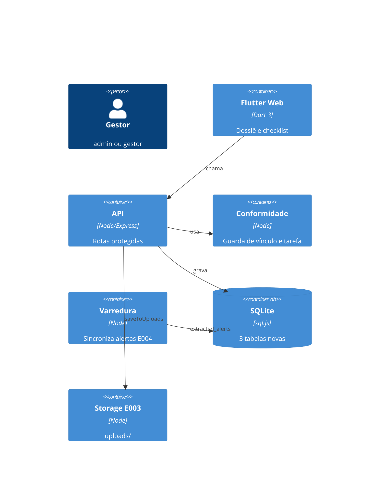

# Implementation Plan: Dossiê documental do prestador (00023)

**Branch**: `dev` · **Date**: 2026-11-24 · **Spec**: `spec.md` · **Epic**: E021

## Summary

**Goal**: controlar ASO, NR e certidões com vigência, alerta e bloqueio de vínculo/tarefa.
**Approach**: 3 tabelas, serviço de conformidade em E002/E003 e sincronização em `extracted_alerts`.
**Key Constraint**: 0 deps; só admin/gestor escrevem.

## Technical Context

**Language/Version**: Dart 3 + Node.js ≥22 · **Deps**: Express, sql.js, Flutter, `zlib` (0 novas) · **Storage**: SQLite por domínio, `uploads/`
**Testing**: `npm test`, `bash backend/test.sh`, `flutter test/analyze`, `npm audit` · **Platform**: web multi-tenant · **Mode**: brownfield
**Perf/Limits**: varredura idempotente; envelope 4 MB, 2 MB/arquivo; guards antes de gravar
**Scope**: 3 US P1 · 12 FR P1 · 1 serviço · 1 roteador · 2 telas

## Instructions Check

| Regra | Status |
|---|---|
| I — `dev`, `main` intocada | PASS |
| II — suíte verde antes de promoção | PASS |
| III — TODO intake | PASS |
| IV — saída concisa | PASS |
| Stack / QC | PASS — brownfield; lint, unit, audit |


## Architecture



## Architecture Decisions

| ID | Decision | Options | Chosen | Rationale |
|---|---|---|---|---|
| AD-001 | Persistência | tabelas próprias / `attachments` | 3 tabelas próprias | vigência e conferência pertencem ao documento |
| AD-002 | Alertas | nova tabela / `extracted_alerts` | `provider_document` | reuso do painel e dedup tripla |
| AD-003 | Checklist | regra fixa / por finalidade | por finalidade + ASO global | NR-35 depende do serviço |
| AD-004 | Guarda | duplicar / serviço único | serviço único | mesma regra em vínculo e tarefa |
| AD-005 | Limpeza | `status=resolved` / remover | remover | alerta deve sair do painel |
| AD-006 | Trabalhador | apagar / situação ativa | situação ativa | preserva histórico |
| AD-007 | Tipos | TEXT / INTEGER via `enums.js` | INTEGER | convenção do repo |

## Data Model Summary

| Entity | Key Fields | Relationships | Notes |
|---|---|---|---|
| `provider_workers` | id, provider_id, name, role, active | `users.id` | desativação lógica |
| `provider_documents` | id, provider_id, worker_id, document_type, number, path, valid_until, reviewed_by/at | `users.id`, `provider_workers.id` | worker nulo = prestador |
| `purpose_document_requirements` | id, purpose_id, document_type, applies_to, active | `purposes.id` | purpose nulo = global |


## API Surface Summary

| Method | Path | Purpose | Auth | Req/Res |
|---|---|---|---|---|
| GET | `/providers/:id/dossier` | documentos, trabalhadores, conformidade | JWT · admin/gestor ou próprio prestador | → `{workers,documents,compliance}` |
| POST | `/providers/:id/workers` | cadastrar trabalhador | JWT · admin/gestor | `{name,role}` → `{worker}` |
| POST | `/providers/:id/documents` | anexar documento | JWT · admin/gestor | `{workerId?,type,number,validUntil,file}` → `{document}` |
| PATCH | `/providers/:id/documents/:docId` | editar e conferir | JWT · admin/gestor | `{number?,validUntil?,review?}` → `{document}` |
| DELETE | `/providers/:id/documents/:docId` | remover e limpar alertas | JWT · admin/gestor | → `{removed}` |
| GET | `/providers/requirements` | listar checklist | JWT · admin/gestor/prestador | → `{requirements}` |
| POST | `/providers/requirements` | adicionar item | JWT · admin/gestor | `{purposeId?,type,appliesTo}` → `{requirement}` |
| DELETE | `/providers/requirements/:reqId` | remover item | JWT · admin/gestor | → `{removed}` |


## Testing Strategy

| Tier | Tool | Scope | Mock Boundary | Install |
|---|---|---|---|---|
| Unit | node:test | conformidade, varredura, rotas, DDL | SQLite memória | configurado |
| Integration | bash backend/test.sh | vínculo, atribuição, painel | servidor de teste | configurado |
| UI | flutter test/analyze | tela e API client | HTTP fake | configurado |
| Security | npm audit | backend | — | `cd backend && npm audit --audit-level=high` |

## Acceptance Test Stubs

| Req ID | Test File | Stub Blocks | RED Status |
|---|---|---|---|
| FR-080 | backend/src/routes/providerDocuments.test.js | `test('FR-080')` | failing-assertion |
| FR-081 | backend/src/routes/providerDocuments.test.js | `test('FR-081')` | failing-assertion |
| FR-082 | backend/src/routes/providerDocuments.test.js | `test('FR-082')` | failing-assertion |
| FR-083 | backend/src/routes/providerDocuments.test.js | `test('FR-083')` | failing-assertion |
| FR-084 | backend/src/services/providerCompliance.test.js | `test('FR-084')` | failing-assertion |
| FR-085 | backend/src/routes/contracts.test.js | `test('FR-085')` | failing-assertion |
| FR-086 | backend/src/routes/tasks.test.js | `test('FR-086')` | failing-assertion |
| FR-087 | backend/src/services/providerCompliance.test.js | `test('FR-087')` | failing-assertion |
| FR-088 | backend/src/services/providerDocumentAlerts.test.js | `test('FR-088')` | failing-assertion |
| FR-089 | backend/src/services/providerDocumentAlerts.test.js | `test('FR-089')` | failing-assertion |
| FR-090 | backend/src/routes/providerDocuments.test.js | `test('FR-090')` | failing-assertion |
| FR-091 | backend/src/routes/providerDocuments.test.js | `test('FR-091')` | failing-assertion |

## Error Handling Strategy

| Category | Pattern | Response | Retry |
|---|---|---|---|
| Documento ausente/vencido | fail-fast | 400 + `PROVIDER_DOCUMENTS_MISSING` + `missing` | no |
| Payload inválido | validar antes de gravar | 400, disco intacto | no |
| Domínio alheio | guard E001 | 403 | no |
| Falha na varredura | isolar por domínio | contadores intactos | próxima passada |

## Integration Points

| Spec Reference | System | Technical Approach | Contract |
|---|---|---|---|
| IP-001 | E002 | guard em `linkPrestador`/`assertLinkedPrestador` | JSON existente |
| IP-002 | E004 | chamada em `runExpirySweep` | `extracted_alerts` |
| IP-003 | E003 | `saveToUploads` | `uploads/` |
| IP-004 | E005/E010 | leitura do painel | `{extracted}` |

## Risk Mitigation

| Risk | L | I | Mitigation | Owner |
|---|---|---|---|---|
| Bloqueio excessivo | M | H | motivos explícitos e consulta prévia | `providerCompliance.js` |
| Alerta órfão | M | M | sincronização com vínculos ativos | varredura |
| Carga no painel | L | M | uma janela por documento, 2 MB | roteador |

## Requirement Coverage Map

| Req ID | Component(s) | File Path(s) | Function(s)/Symbol(s) | Notes |
|---|---|---|---|---|
| FR-080 | roteador, DDL | backend/src/routes/providerDocuments.js, backend/src/config/database.js | `createWorker`, `PROVIDER_WORKERS_DDL` | AD-006 |
| FR-081 | roteador, storage | backend/src/routes/providerDocuments.js, backend/src/middleware/upload.js, backend/src/config/database.js | `createDocument`, `saveToUploads`, `PROVIDER_DOCUMENTS_DDL` | AD-001, AD-007 |
| FR-082 | roteador | backend/src/routes/providerDocuments.js | `updateDocument`, `reviewDocument` | AD-006 |
| FR-083 | roteador, DDL | backend/src/routes/providerDocuments.js, backend/src/config/database.js | `createRequirement`, `PURPOSE_DOCUMENT_REQUIREMENTS_DDL` | AD-003 |
| FR-084 | serviço | backend/src/services/providerCompliance.js | `resolveChecklist` | AD-003 |
| FR-085 | rota, serviço | backend/src/routes/contracts.js, backend/src/services/providerCompliance.js | `linkPrestador`, `assertProviderCompliant` | AD-004 |
| FR-086 | rota, serviço | backend/src/routes/tasks.js, backend/src/services/providerCompliance.js | `assertLinkedPrestador`, `assertProviderCompliant` | AD-004 |
| FR-087 | serviço | backend/src/services/providerCompliance.js, backend/src/services/providerCompliance.test.js | `evaluateProviderCompliance` | leitura pura |
| FR-088 | serviço, motor | backend/src/services/providerDocumentAlerts.js, backend/src/services/alerts.js | `syncProviderDocumentAlerts`, `runExpirySweep` | AD-002 |
| FR-089 | serviço | backend/src/services/providerDocumentAlerts.js, backend/src/services/providerDocumentAlerts.test.js | `syncProviderDocumentAlerts` | AD-005 |
| FR-090 | roteador, UI | backend/src/routes/providerDocuments.js, frontend/lib/screens/dossier_screen.dart | `listDossier`, `DossierScreen` | AD-001 |
| FR-091 | guards | backend/src/routes/providerDocuments.js, backend/src/middleware/auth.js, backend/src/middleware/upload.js | `router.use`, `authenticateToken`, `scopeDomain`, `requireRole`, `decodeAndValidate` | E001 |

## Project Structure

```text
+ backend/src/config/database.js (DDL em DOMAIN_SCHEMA)
+ backend/src/config/enums.js (tipos e abrangência)
+ backend/src/services/providerCompliance.js
+ backend/src/services/providerDocumentAlerts.js
+ backend/src/routes/providerDocuments.js
~ backend/src/routes/contracts.js, tasks.js, services/alerts.js, server.js
+ frontend/lib/services/provider_documents_api.dart, screens/dossier_screen.dart, screens/dossier_checklist_screen.dart
~ frontend/lib/main.dart
```

**Reuso**: guards E001, `saveToUploads`, dedup tripla, `code`/`sqlCodes`.
**Testes a estender**: `contracts.test.js`, `tasks.test.js`, `alerts.test.js`, `database.test.js`.
**Nomenclatura**: DDL em inglês, rotas `camelCase`, telas `snake_case`.

## Implementation Hints

- **[HINT-001]** `CREATE TABLE IF NOT EXISTS` cobre domínios novos e legados.
- **[HINT-002]** Guardar antes de `INSERT` em `contract_providers` e `Task.update`.
- **[HINT-003]** `source_id = <documentId>:<window>`; remover variantes ao regularizar.
- **[HINT-004]** Banco em memória e `UPLOAD_DIR` temporário por suíte.
- **[HINT-005]** Dividir dossiê e checklist em arquivos distintos (500 linhas).
