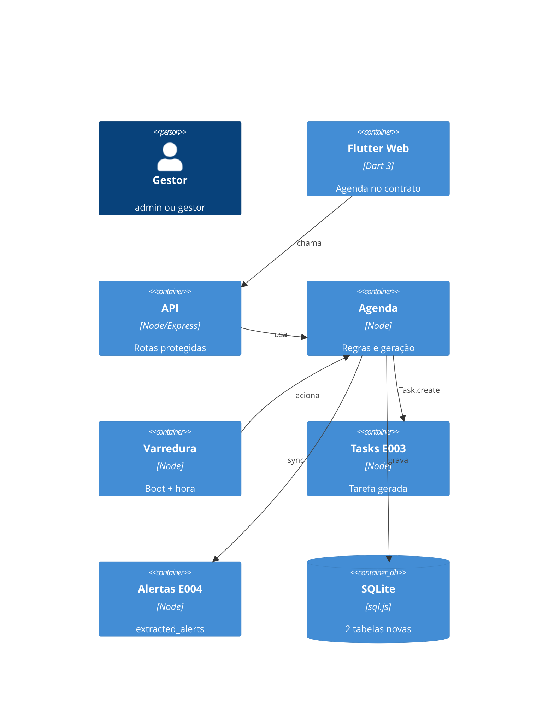

# Implementation Plan: Agenda de manutenção preventiva recorrente (00024)

**Branch**: `dev` · **Date**: 2026-11-24 · **Spec**: `spec.md` · **Epic**: E022

## Summary

**Goal**: gerar tarefas e alertas de manutenção a partir de uma recorrência por contrato.
**Approach**: 2 tabelas por domínio, varredura boot/hora reaproveitada e sync em `extracted_alerts`.
**Key Constraint**: zero novas dependências; escrita só para admin/gestor.

## Technical Context

**Language/Version**: Dart 3 + Node.js ≥22 · **Deps**: Express, sql.js, Flutter, node:test (0 novas) · **Storage**: SQLite por domínio
**Testing**: `npm test`, `bash backend/test.sh`, `flutter test/analyze`, `npm audit` · **Platform**: web multi-tenant · **Mode**: brownfield
**Perf/Limits**: janela de 90 dias; idempotência por `(rule_id, due_date)`
**Scope**: 4 US (3 P1) · 13 FR (12 P1) · 1 serviço · 1 roteador · 1 tela

## Instructions Check

| Regra | Status |
|---|---|
| I — `dev`, `main` intocada | PASS |
| II — suíte verde antes de promoção | PASS |
| III — TODO intake | PASS |
| IV — saída concisa | PASS |
| Stack / QC | PASS — brownfield; lint, unit, audit |
| Governança — `TECHNICAL.md` em progresso | PASS |

## Architecture



## Architecture Decisions

| ID | Decision | Options | Chosen | Rationale |
|---|---|---|---|---|
| AD-001 | Persistência | tabelas próprias / reuso `tasks` | 2 tabelas próprias | regra e ocorrência têm ciclo distinto da tarefa |
| AD-002 | Alertas | nova tabela / `extracted_alerts` | `maintenance_schedule` | reuso do painel e dedup tripla |
| AD-003 | Grade | fixa / floating | fixa ancorada no início | evita acúmulo de atraso |
| AD-004 | Idempotência | UNIQUE / checagem em memória | `UNIQUE(rule_id,due_date)` | sweeps concorrentes sem duplicata |
| AD-005 | Sync de alertas | serviço separado / mesmo da geração | mesmo serviço | STF-001: estado determinístico |
| AD-006 | Janelas | só domínio / domínio + antecedência | ambas | STF-002: aviso em janelas customizadas |
| AD-007 | Acionamento manual | rota isolada / mesmo serviço | mesmo serviço | mesmos contadores e transação |
| AD-008 | Situação da regra | apagar / inativação lógica | `active` 0/1 | preserva histórico e ocorrências |

## Data Model Summary

| Entity | Key Fields | Relationships | Notes |
|---|---|---|---|
| `maintenance_rules` | contract_id, title, interval_days, start_date, assignee_id, lead_days, active | `contracts.id`, `users.id` | auditoria created/updated |
| `maintenance_occurrences` | rule_id, contract_id, due_date, task_id, lead_days | `maintenance_rules.id`, `tasks.id` | `UNIQUE(rule_id,due_date)` |

**Detail**: `data-model.md`

## API Surface Summary

| Method | Path | Purpose | Auth | Req/Res |
|---|---|---|---|---|
| GET | `/contracts/:id/maintenance-schedules` | listar regras e ocorrências | JWT · admin/gestor | → `{rules,occurrences}` |
| POST | `/contracts/:id/maintenance-schedules` | criar regra | JWT · admin/gestor | `ScheduleInput` → `201` |
| PATCH | `/contracts/:id/maintenance-schedules/:ruleId` | editar/inativar | JWT · admin/gestor | `SchedulePatch` → `200` |
| POST | `/maintenance/sweep` | acionamento manual | JWT · admin/gestor | → `SweepResult` |

**Detail**: `contracts/`

## Testing Strategy

| Tier | Tool | Scope | Mock Boundary | Install |
|---|---|---|---|---|
| Unit | node:test | CRUD, geração, dedup, alertas | SQLite memória | configurado |
| Integration | bash backend/test.sh | rotas, sweep manual, painel | servidor de teste | configurado |
| UI | flutter test/analyze | seção de agenda e API client | HTTP fake | configurado |
| Security | npm audit | backend | — | `cd backend && npm audit --audit-level=high` |
| Coverage | node:test --experimental-test-coverage | serviço de varredura | SQLite memória | configurado |

## Acceptance Test Stubs

| Req ID | Test File | Stub Blocks | RED Status |
|---|---|---|---|
| FR-092 | backend/src/routes/maintenanceSchedules.test.js | `test('FR-092')` | failing-assertion |
| FR-093 | backend/src/routes/maintenanceSchedules.test.js | `test('FR-093')` | failing-assertion |
| FR-094 | backend/src/services/maintenanceSchedules.test.js | `test('FR-094')` | failing-assertion |
| FR-095 | backend/src/services/maintenanceSchedules.test.js | `test('FR-095')` | failing-assertion |
| FR-096 | backend/src/services/maintenanceSchedules.test.js | `test('FR-096')` | failing-assertion |
| FR-097 | backend/src/services/maintenanceSchedules.test.js | `test('FR-097')` | failing-assertion |
| FR-098 | backend/src/services/maintenanceSchedules.test.js | `test('FR-098')` | failing-assertion |
| FR-099 | backend/src/services/maintenanceSchedules.test.js | `test('FR-099')` | failing-assertion |
| FR-100 | backend/src/services/maintenanceSchedules.test.js | `test('FR-100')` | failing-assertion |
| FR-101 | backend/src/services/maintenanceSchedules.test.js | `test('FR-101')` | failing-assertion |
| FR-103 | backend/src/routes/maintenanceSchedules.test.js | `test('FR-103')` | failing-assertion |
| FR-104 | backend/src/routes/maintenanceSchedules.test.js | `test('FR-104')` | failing-assertion |

## Error Handling Strategy

| Category | Pattern | Response | Retry |
|---|---|---|---|
| Payload inválido | validar antes de gravar | 400, disco intacto | no |
| Papel/domínio alheio | guard E001 + requireRole | 403 | no |
| Regra/contrato ausente | fail-fast | 404 | no |
| Falha na varredura | isolar por domínio | contadores por domínio | próxima passada |
| Corrida de varreduras | INSERT OR IGNORE | ocorrência ignorada contabilizada | no |

## Risk Mitigation

| Risk | L | I | Mitigation | Owner |
|---|---|---|---|---|
| Varreduras concorrentes | M | H | `UNIQUE(rule_id,due_date)` + transação por domínio | `maintenanceSchedules.js` |
| Volume de regras curtas | M | M | janela de 90 dias, uma tarefa por ocorrência | varredura |
| Alerta desatualizado após conclusão | L | M | sync na mesma transação + acionamento manual | `syncMaintenanceAlerts` |

## Requirement Coverage Map

| Req ID | Component(s) | File Path(s) | Function(s)/Symbol(s) | Notes |
|---|---|---|---|---|
| FR-092 | roteador, serviço, DDL | backend/src/routes/maintenanceSchedules.js, backend/src/services/maintenanceSchedules.js, backend/src/config/database.js | `createRule`, `createMaintenanceRule`, `MAINTENANCE_RULES_DDL` | AD-008 |
| FR-093 | roteador, validação | backend/src/routes/maintenanceSchedules.js, backend/src/services/maintenanceSchedules.js | `validate`, `validateScheduleInput` | AD-003 |
| FR-094 | serviço | backend/src/services/maintenanceSchedules.js | `updateMaintenanceRule` | auditoria |
| FR-095 | serviço, DDL | backend/src/services/maintenanceSchedules.js, backend/src/config/database.js | `generateOccurrences`, `MAINTENANCE_OCCURRENCES_DDL` | AD-001, AD-003 |
| FR-096 | serviço, DDL | backend/src/services/maintenanceSchedules.js, backend/src/config/database.js | `runMaintenanceSweep`, `MAINTENANCE_OCCURRENCES_DDL` | AD-004 |
| FR-097 | serviço, modelo | backend/src/services/maintenanceSchedules.js, backend/src/models/Task.js | `createTaskForOccurrence`, `Task.create` | AD-003 |
| FR-098 | serviço | backend/src/services/maintenanceSchedules.js | `calculateDueDates` | janela 90 dias |
| FR-099 | serviço | backend/src/services/maintenanceSchedules.js | `updateMaintenanceRule` | AD-001 |
| FR-100 | serviço, motor | backend/src/services/maintenanceSchedules.js, backend/src/services/alerts.js | `syncMaintenanceAlerts`, `readWindows` | AD-002, AD-006 |
| FR-101 | serviço | backend/src/services/maintenanceSchedules.js | `syncMaintenanceAlerts` | AD-005 |
| FR-102 | roteador, UI | backend/src/routes/maintenanceSchedules.js, frontend/lib/widgets/maintenance_schedule_section.dart | `listRules`, `MaintenanceScheduleSection` | P2 |
| FR-103 | guards | backend/src/routes/maintenanceSchedules.js, backend/src/middleware/auth.js, backend/src/middleware/validate.js | `router.use`, `authenticateToken`, `scopeDomain`, `requireRole`, `validate` | E001 |
| FR-104 | roteador, serviço | backend/src/routes/maintenanceSchedules.js, backend/src/services/maintenanceSchedules.js | `runSweep`, `runMaintenanceSweep` | AD-007 |

## Project Structure

```text
+ backend/src/config/database.js (DDL em DOMAIN_SCHEMA)
+ backend/src/services/maintenanceSchedules.js
+ backend/src/routes/maintenanceSchedules.js
~ backend/src/server.js
~ frontend/lib/services/maintenance_schedules_api.dart
+ frontend/lib/widgets/maintenance_schedule_section.dart
~ frontend/lib/screens/contract_detail_screen.dart
```

**Reuso**: guards E001, `Task.create`, dedup tripla de `extracted_alerts`, sweeps boot/hora.
**Testes a estender**: `database.test.js` (DDL). Cobertura de tarefas e alertas em `maintenanceSchedules.test.js` (novo).
**Nomenclatura**: DDL em inglês, rotas `camelCase`, telas `snake_case`.

## Implementation Hints

- **[HINT-001]** `CREATE TABLE IF NOT EXISTS` cobre domínios novos e legados.
- **[HINT-002]** Gerar e sincronizar alertas na mesma `db.transaction`.
- **[HINT-003]** `source_id = <occurrenceId>:<windowDays>`; remover variantes ao concluir.
- **[HINT-004]** Janelas efetivas = janelas do domínio ∪ `{lead_days}`.
- **[HINT-005]** `start_date` passada: calcular primeira data ≥ hoje sem gravar retroativas.
