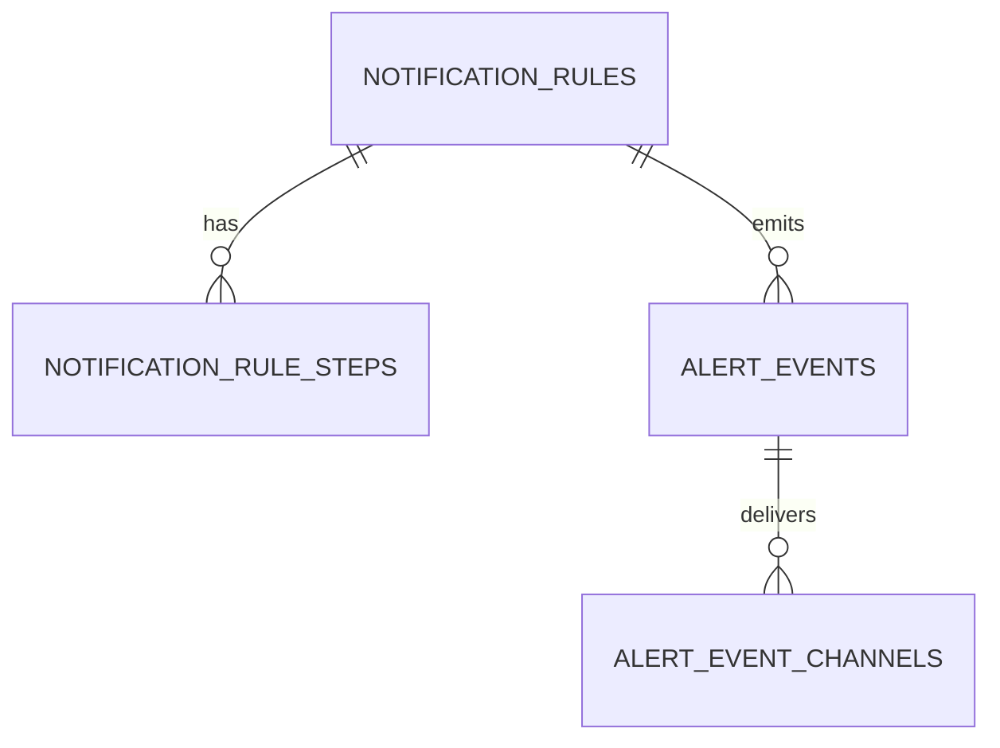

# Data Model: Régua de notificação configurável

> E023 · 2026-11-24 · SQLite por domínio; criação aditiva antes de `applySchema`, sem apagar `alert_events` legados.

| Entity | Attributes (name: type, constraints) | Relationships | State Transitions |
|--------|--------------------------------------|---------------|-------------------|
| `notification_rules` | id: INTEGER PK, event_type: TEXT NOT NULL UNIQUE, max_reminders: INTEGER NOT NULL CHECK (1..5), interval_days: INTEGER NOT NULL CHECK (>0), active: INTEGER NOT NULL CHECK (0..1), created_by: INTEGER NOT NULL, created_at: TEXT NOT NULL, updated_by: INTEGER, updated_at: TEXT | has_many `notification_rule_steps` | inactive → active → inactive |
| `notification_rule_steps` | id: INTEGER PK, rule_id: INTEGER NOT NULL FK, step: INTEGER NOT NULL, window_days: INTEGER NOT NULL CHECK (>0), UNIQUE(rule_id,step), UNIQUE(rule_id,window_days) | belongs_to `notification_rules` | — |
| `alert_events` | id: INTEGER PK, contract_id: INTEGER NOT NULL, window_days: INTEGER NOT NULL, event_type: TEXT NOT NULL DEFAULT 'vigencia', rule_id: INTEGER NULL, step: INTEGER NOT NULL DEFAULT 0, email_status: TEXT NOT NULL CHECK ('sent','failed','skipped'), created_at: TEXT NOT NULL, UNIQUE(contract_id,window_days) | belongs_to `contracts`, has_many `alert_event_channels` | skipped → sent / failed |
| `alert_event_channels` | id: INTEGER PK, alert_event_id: INTEGER NOT NULL FK, contract_id: INTEGER NOT NULL, event_type: TEXT NOT NULL, step: INTEGER NOT NULL, channel: TEXT NOT NULL CHECK ('in_app','email'), status: TEXT NOT NULL CHECK ('skipped','sent','failed'), UNIQUE(contract_id,event_type,step,channel) | belongs_to `alert_events` | skipped → sent / failed |

**Validation rules**

- `max_reminders` aceita 1–5; `interval_days` é inteiro positivo; `event_type` precisa existir no catálogo de E004.
- `window_days` de uma etapa precisa estar em `domains.alert_windows`; seleção começa na menor janela e só acrescenta janelas com distância ≥ `interval_days`.
- Linhas legadas de `alert_events` recebem `event_type='vigencia'`, `rule_id=NULL`, `step=window_days` e uma linha `in_app` correspondente; nenhuma linha é apagada.
- Inativação é lógica (`active=0`); eventos e etapas permanecem intactos.

ER Diagram (visual reference)

