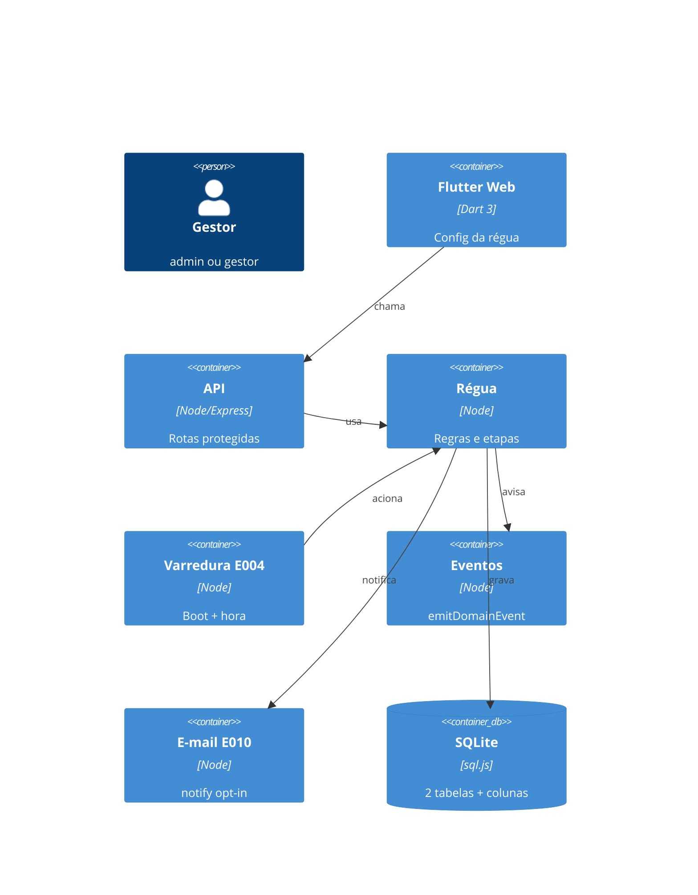

# Implementation Plan: Régua de notificação configurável (00025)

**Branch**: `dev` · **Date**: 2026-11-24 · **Spec**: `spec.md` · **Epic**: E023

## Summary

**Goal**: configurar por domínio e tipo de evento quantos lembretes um alerta recebe e em quais janelas.
**Approach**: 2 tabelas e colunas aditivas em `alert_events`; varredura E004 reaproveitada; canais E010.
**Key Constraint**: zero novas dependências; só in-app e e-mail opt-in; `PDD-008` preservada.

## Technical Context

**Language/Version**: Dart 3 + Node.js ≥22 · **Deps**: Express, sql.js, Flutter, node:test (0 novas) · **Storage**: SQLite por domínio
**Testing**: `npm test`, `bash backend/test.sh`, `flutter test/analyze`, `npm audit` · **Platform**: web multi-tenant · **Mode**: brownfield
**Perf/Limits**: até 5 etapas; intervalo em dias inteiros; identidade por `(alerta,etapa,canal)`
**Scope**: 4 US (3 P1) · 11 FR (10 P1) · 1 serviço · 2 rotas · 1 tela · 1 migration

## Instructions Check

| Regra | Status |
|---|---|
| I — `dev`, `main` intocada | PASS |
| II — suíte verde antes de promoção | PASS |
| III — TODO intake | PASS |
| IV — saída concisa | PASS |
| Stack / QC | PASS — brownfield; lint, unit, audit |
| Governança — `TECHNICAL.md` em progresso | PASS |

## Architecture



## Architecture Decisions

| ID | Decision | Options | Chosen | Rationale |
|---|---|---|---|---|
| AD-001 | Persistência da régua | plataforma / domínio | domínio | isolamento multi-tenant e mesmo ciclo dos alertas |
| AD-002 | Origem das janelas | próprias / E004 | E004 | deriva das janelas ativas, sem criar janela nova |
| AD-003 | Identidade do lembrete | memória / `UNIQUE` | `UNIQUE(contract,event,step,channel)` | dedup em sweeps repetidos |
| AD-004 | Ajuste e desativação | apagar / lógico | `active` 0/1 | preserva eventos já emitidos |
| AD-005 | Configuração na varredura | reler por etapa / snapshot | snapshot | STF-002: uma régua por varredura |
| AD-006 | Entrega | novo adaptador / reuso | `notify` + `emitDomainEvent` | canais existentes, sem `PDD-008` |

## Data Model Summary

| Entity | Key Fields | Relationships | Notes |
|---|---|---|---|
| `notification_rules` | event_type, max_reminders, interval_days, active, created_by/at, updated_by/at | `notification_rule_steps` | `UNIQUE(event_type)`, 1–5 lembretes; AD-001, AD-004 |
| `notification_rule_steps` | rule_id, step, window_days | `notification_rules.id` | `UNIQUE(rule_id,step)`, `UNIQUE(rule_id,window_days)`; AD-002 |
| `alert_events` | contract_id, window_days, event_type, rule_id, step, email_status | `alert_event_channels` | colunas aditivas; legados viram `vigencia` com `step=window_days` |
| `alert_event_channels` | alert_event_id, contract_id, event_type, step, channel, status | `alert_events.id` | `UNIQUE(contract_id,event_type,step,channel)`; AD-003 |

**Detail**: `data-model.md`

## API Surface Summary

| Method | Path | Purpose | Auth | Req/Res |
|---|---|---|---|---|
| GET | `/api/v2/alerts/rules` | listar réguas e etapas | JWT · admin/gestor | → `{rules}` |
| PUT | `/api/v2/alerts/rules/:eventType` | criar/atualizar com etapas | JWT · admin/gestor | `RuleInput` → `NotificationRule` |
| PATCH | `/api/v2/alerts/rules/:eventType` | ativar/desativar | JWT · admin/gestor | `{active}` → `NotificationRule` |
| GET | `/api/v2/alerts/panel` | painel com `rules` e `reminders` | JWT · admin/gestor | → `PanelResponse` |

**Detail**: `contracts/openapi.yaml`

## Testing Strategy

| Tier | Tool | Scope | Mock Boundary | Install |
|---|---|---|---|---|
| Unit | node:test | CRUD, derivação, dedup, canais | SQLite memória | configurado |
| Integration | bash backend/test.sh | rotas, varredura, painel | servidor de teste | configurado |
| UI | flutter test/analyze | seção de régua e client | HTTP fake | configurado |
| Security | npm audit | backend | — | `cd backend && npm audit --audit-level=high` |
| Coverage | node:test --experimental-test-coverage | serviço de régua | SQLite memória | configurado |

## Acceptance Test Stubs

| Req ID | Test File | Stub Blocks | RED Status |
|---|---|---|---|
| FR-105 | backend/src/routes/notificationRules.test.js | `test('FR-105 save')` | failing-assertion |
| FR-106 | backend/src/services/notificationRules.test.js | `test('FR-106 deriveSteps')` | failing-assertion |
| FR-107 | backend/src/routes/notificationRules.test.js | `test('FR-107 reject')` | failing-assertion |
| FR-108 | backend/src/services/notificationRules.test.js | `test('FR-108 emit')` | failing-assertion |
| FR-109 | backend/src/services/notificationRules.test.js | `test('FR-109 channels')` | failing-assertion |
| FR-110 | backend/src/services/notificationRules.test.js | `test('FR-110 dedup')` | failing-assertion |
| FR-111 | backend/src/services/notificationRules.test.js | `test('FR-111 snapshot')` | failing-assertion |
| FR-112 | backend/src/routes/alerts.test.js | `test('FR-112 panel')` | failing-assertion |
| FR-113 | backend/src/services/notificationRules.test.js | `test('FR-113 preserve')` | failing-assertion |
| FR-114 | backend/src/services/alerts.test.js | `test('FR-114 unchanged')` | failing-assertion |

## Error Handling Strategy

| Category | Pattern | Response | Retry |
|---|---|---|---|
| Payload inválido | validar antes de gravar | 400, disco intacto | no |
| Papel/domínio alheio | guards E001 | 403 | no |
| Tipo de evento ausente | fail-fast | 400 | no |
| Falha de e-mail | isolar por canal | status `failed`; aviso interno | no |
| Corrida de varreduras | `INSERT OR IGNORE` | evento ignorado | no |

## Risk Mitigation

| Risk | L | I | Mitigation | Owner |
|---|---|---|---|---|
| Régua e janelas divergentes | M | H | derivar de E004 e recusar combinações | `deriveSteps` |
| Duplicação entre canais e etapas | M | H | `UNIQUE` por `(alerta,evento,etapa,canal)` | `emitRuleReminders` |
| Reenvio de histórico | L | H | snapshot por varredura + inativação lógica | `notificationRules.js` |

## Requirement Coverage Map

| Req ID | Component(s) | File Path(s) | Function(s)/Symbol(s) | Notes |
|---|---|---|---|---|
| FR-105 | roteador, serviço, DDL | backend/src/routes/notificationRules.js, backend/src/services/notificationRules.js, backend/src/config/database.js | `putRule`, `saveRule`, `NOTIFICATION_RULES_DDL` | AD-001, AD-004 |
| FR-106 | serviço | backend/src/services/notificationRules.js, backend/src/services/alerts.js | `deriveSteps`, `readWindows` | AD-002 |
| FR-107 | roteador, validação | backend/src/routes/notificationRules.js, backend/src/services/notificationRules.js | `validate`, `validateRuleInput` | AD-002 |
| FR-108 | serviço, DDL | backend/src/services/notificationRules.js, backend/src/config/database.js | `emitRuleReminders`, `ALERT_EVENT_CHANNELS_DDL` | AD-003 |
| FR-109 | serviço, canais | backend/src/services/notificationRules.js, backend/src/services/email.js, backend/src/services/events.js | `deliverReminder`, `notify`, `emitDomainEvent` | AD-006 |
| FR-110 | serviço, DDL | backend/src/services/notificationRules.js, backend/src/config/database.js | `insertReminder`, `ALERT_EVENT_CHANNELS_DDL` | AD-003 |
| FR-111 | serviço, motor | backend/src/services/notificationRules.js, backend/src/services/alerts.js | `loadRuleSnapshot`, `runExpirySweep` | AD-005 |
| FR-112 | roteador, painel | backend/src/routes/alerts.js, frontend/lib/screens/vencimentos_screen.dart | `listPanel`, `VencimentosScreen` | AD-001 |
| FR-113 | serviço, DDL | backend/src/services/notificationRules.js, backend/src/config/database.js | `setRuleActive`, `NOTIFICATION_RULES_DDL` | AD-004 |
| FR-114 | motor | backend/src/services/alerts.js, backend/src/services/notificationRules.js | `runExpirySweep`, `hasActiveRule` | AD-002 |
| FR-115 | roteador, serviço | backend/src/routes/notificationRules.js, backend/src/services/notificationRules.js | `putRule`, `patchRule`, `auditRuleChange` | P2; AD-004 |

## Project Structure

```text
~ backend/src/config/database.js (DDL aditiva em migrateSchema)
+ backend/src/services/notificationRules.js
+ backend/src/routes/notificationRules.js
~ backend/src/services/alerts.js
~ backend/src/routes/alerts.js
~ backend/src/server.js
+ frontend/lib/services/notification_rules_api.dart
+ frontend/lib/widgets/notification_rule_section.dart
~ frontend/lib/screens/vencimentos_screen.dart
```

**Reuso**: guards E001, `readWindows`, `runExpirySweep`, `notify`, `emitDomainEvent`, padrão de DDL aditiva.
**Testes a estender**: `database.test.js`, `alerts.test.js`. Cobertura em `notificationRules.test.js` (novo).
**Nomenclatura**: DDL em inglês, rotas `camelCase`, telas `snake_case`.

## Implementation Hints

- **[HINT-001]** DDL aditiva roda em `migrateSchema` antes de `applySchema`, guardada por `tableExists`.
- **[HINT-002]** Backfill de `alert_events` legados: `event_type='vigencia'`, `step=window_days`, linha `in_app`.
- **[HINT-003]** Etapas: menor janela primeiro; acrescentar janela maior se `window - previous >= interval_days`.
- **[HINT-004]** `loadRuleSnapshot` uma vez por varredura; mudança no meio vale só na próxima (STF-002).
- **[HINT-005]** Emitir `in_app` antes de `notify`; falha de SMTP marca `failed` sem abortar.
