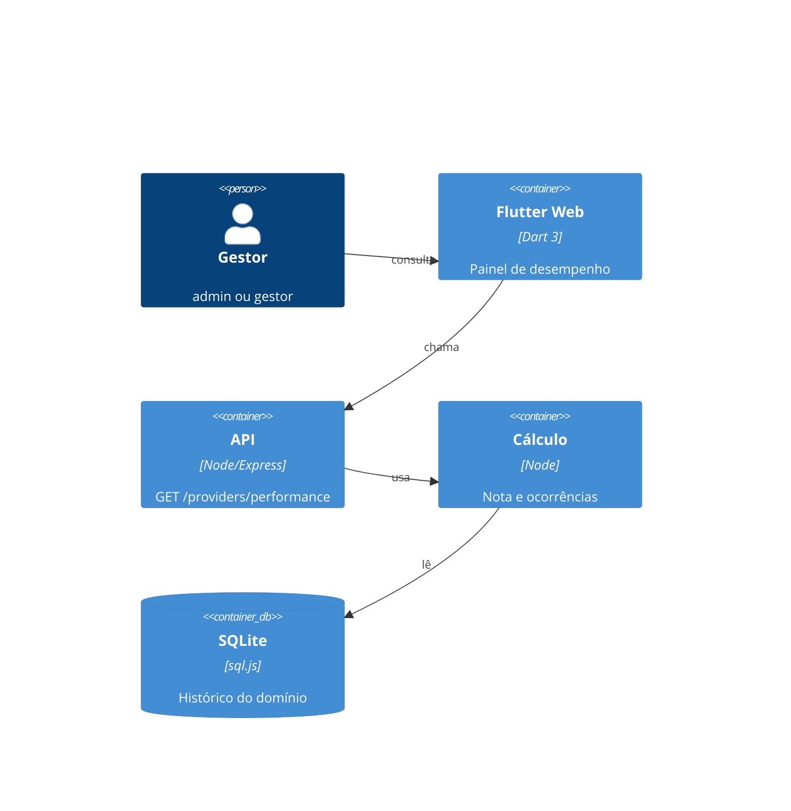

# Implementation Plan: Desempenho do prestador (00026)

**Branch**: `dev` · **Date**: 2026-11-25 · **Spec**: `spec.md` · **Epic**: E024

## Summary

**Goal**: derivar nota, componentes e ocorrências por prestador a partir de tarefas já registradas.
**Approach**: serviço puro de agregação + rota GET restrita + tela de leitura no painel; zero tabela nova.
**Key Constraint**: nenhuma dependência nova, nenhum job, nenhum acesso do prestador à nota.

## Technical Context

| Field | Value |
|---|---|
| Language/Version | Dart 3 + Node.js ≥22 |
| Primary Dependencies | Express, sql.js, Flutter, node:test — 0 novas |
| Storage | SQLite por domínio; leitura de `tasks`, `task_history`, `contract_providers`, `users` |
| Testing | `npm test`, `backend/test.sh`, `flutter test/analyze`, `npm audit` |
| Target Platform | Flutter Web + API multi-tenant |
| Project Type / Mode | web / brownfield |
| Performance Goals | 100 prestadores/página; janela de 30 dias |
| Constraints | determinístico por `referenceDate`; isolado por domínio; 100 itens/página |
| Scale/Scope | 4 US (3 P1), 12 FR (9 P1), 1 serviço/rota/cliente/tela |

## Instructions Check

| Rule | Status |
|---|---|
| I — mudanças em `dev`; `main` intocada | PASS |
| II — suíte verde antes de qualquer promoção | PASS |
| III — `TODO.md` lido na entrada da sessão | PASS |
| IV — saída concisa e orientada a resultado | PASS |
| Segurança — sem segredo no artefato; JWT e `requireRole` reutilizados | PASS |
| Governança — `TECHNICAL.md` registra E024 e endpoint | PASS |

## Architecture



## Architecture Decisions

| ID | Decision | Options | Chosen | Rationale |
|---|---|---|---|---|
| AD-001 | Persistência da nota | tabela própria / cálculo sob demanda | cálculo sob demanda | evita invalidação e mantém fonte única no histórico |
| AD-002 | Origem das ocorrências | tabela manual / `task_history` | `task_history` | reabertura, manutenção e rejeição já têm autor, data e motivo |
| AD-003 | Identidade da ocorrência | nova linha por evento / chave `(task,action,created_at)` | chave estável | uma reabertura seguida de reconclusão vira uma ocorrência |
| AD-004 | Escopo dos dados | plataforma inteira / domínio da sessão | domínio da sessão | isolamento multi-tenant e mesmo nome em domínios distintos |
| AD-005 | Superfície HTTP | estender `/dashboard/stats` / rota dedicada | rota dedicada | leitura opcional não infla o payload do painel principal |
| AD-006 | Entrada na UI | card no dashboard / destino no rail | destino no rail | admin/gestor localizam a nota sem depender de card; prestador não vê a entrada |

## Data Model Summary

N/A — no persistent data. Nota, componentes e ocorrências são projeções derivadas de `tasks`, `task_history`, `contract_providers` e `users`; nenhuma tabela, coluna ou migração é acrescentada.

## API Surface Summary

| Method | Path | Purpose | Auth | Req/Res |
|---|---|---|---|---|
| GET | `/api/v2/providers/performance` | nota, componentes, ocorrências e total por prestador | JWT · admin/gestor | query `days`, `referenceDate`, `providerId`, `page` → `ProviderPerformanceResponse` |

**Detail**: `contracts/provider-performance.yaml`

## Testing Strategy

| Tier | Tool | Scope | Mock Boundary | Install |
|---|---|---|---|---|
| Unit | node:test | cálculo, componentes, dedup, filtro e ordenação | SQLite em memória via `testenv` | configurado |
| Integration | supertest + `bash backend/test.sh` | rota, guards e payload | servidor de teste em porta isolada | configurado |
| UI | `flutter test` + `flutter analyze` | cliente, tela, filtro e paginação | `ApiService` injetado | configurado |
| Security | `npm audit --audit-level=high` | backend e dependências | — | configurado |
| Coverage | `node:test --experimental-test-coverage` | serviço de desempenho | SQLite em memória | configurado |

## Acceptance Test Stubs

| Req ID | Test File | Stub Blocks | RED Status |
|---|---|---|---|
| FR-001 | backend/src/services/providerPerformance.test.js | `test('FR-001 score 0..100')` | failing-assertion |
| FR-002 | backend/src/services/providerPerformance.test.js | `test('FR-002 components')` | failing-assertion |
| FR-003 | backend/src/services/providerPerformance.test.js | `test('FR-003 no data')` | failing-assertion |
| FR-004 | backend/src/routes/providerPerformance.test.js | `test('FR-004 role guard')` | failing-assertion |
| FR-005 | backend/src/services/providerPerformance.test.js | `test('FR-005 derive occurrences')` | failing-assertion |
| FR-006 | backend/src/services/providerPerformance.test.js | `test('FR-006 source and reason')` | failing-assertion |
| FR-007 | backend/src/services/providerPerformance.test.js | `test('FR-007 dedupe reopen')` | failing-assertion |
| FR-008 | backend/src/services/providerPerformance.test.js | `test('FR-008 deterministic')` | failing-assertion |
| FR-009 | backend/src/routes/providerPerformance.test.js | `test('FR-009 domain scope')` | failing-assertion |

## Error Handling Strategy

| Category | Pattern | Response | Retry |
|---|---|---|---|
| Papel negado | fail-fast em `requireRole` | 403 sem nota | no |
| Query inválida | validar antes da consulta | 400 + `code` | no |
| Domínio ausente | guard existente | 401 | no |
| Fora do intervalo | clamp da página | lista vazia com `total` | no |

## Risk Mitigation

| Risk | L | I | Mitigation | Owner |
|---|---|---|---|---|
| Histórico incompleto | M | M | "sem dados" sem tarefas no período; componentes mostram a base | `computeProviderPerformance` |
| Veredito automático | M | M | detalhe mostra tipo, origem e motivo de cada ocorrência | `ProviderPerformanceScreen` |
| Custo de leitura | L | L | janela de 30 dias, página de 100, índices por `assignee_id`/`contract_id` | `listPerformance` |

## Requirement Coverage Map

| Req ID | Component(s) | File Path(s) | Function(s)/Symbol(s) | Notes |
|---|---|---|---|---|
| FR-001 | serviço, rota, UI | backend/src/services/providerPerformance.js, backend/src/routes/providerPerformance.js, frontend/lib/screens/provider_performance_screen.dart | `computeProviderPerformance`, `listPerformance`, `ProviderPerformanceScreen` | AD-001, AD-005 |
| FR-002 | serviço, UI | backend/src/services/providerPerformance.js, frontend/lib/screens/provider_performance_screen.dart | `computeProviderPerformance`, `scoreComponents`, `ProviderPerformanceScreen` | AD-001 |
| FR-003 | serviço, UI | backend/src/services/providerPerformance.js, frontend/lib/screens/provider_performance_screen.dart | `computeProviderPerformance`, `ProviderPerformanceScreen` | AD-001 |
| FR-004 | rota, navegação | backend/src/routes/providerPerformance.js, frontend/lib/main.dart | `requireRole`, `_baseEntriesForRole` | AD-006 |
| FR-005 | serviço | backend/src/services/providerPerformance.js | `deriveProviderOccurrences` | AD-002 |
| FR-006 | serviço, contrato | backend/src/services/providerPerformance.js, contracts/provider-performance.yaml | `deriveProviderOccurrences`, `ProviderOccurrence` | AD-002 |
| FR-007 | serviço | backend/src/services/providerPerformance.js | `dedupeOccurrences` | AD-003 |
| FR-008 | serviço | backend/src/services/providerPerformance.js | `computeProviderPerformance` | AD-001 |
| FR-009 | rota, serviço | backend/src/routes/providerPerformance.js, backend/src/services/providerPerformance.js | `listPerformance`, `computeProviderPerformance` | AD-004 |
| FR-010 | rota, cliente, UI | backend/src/routes/providerPerformance.js, frontend/lib/services/provider_performance_api.dart, frontend/lib/screens/provider_performance_screen.dart | `parsePerformanceQuery`, `ProviderPerformanceApi.fetchPerformance`, `ProviderPerformanceScreen` | P2; AD-005 |
| FR-011 | serviço, UI | backend/src/services/providerPerformance.js, frontend/lib/screens/provider_performance_screen.dart | `sortProviders`, `ProviderPerformanceScreen` | P2; AD-005 |
| FR-012 | rota, cliente, UI | backend/src/routes/providerPerformance.js, frontend/lib/services/provider_performance_api.dart, frontend/lib/screens/provider_performance_screen.dart | `parsePerformanceQuery`, `ProviderPerformanceApi.fetchPerformance`, `ProviderPerformanceScreen` | P2; STF-001; AD-005 |

## Project Structure

```text
+ backend/src/services/providerPerformance.js
+ backend/src/services/providerPerformance.test.js
+ backend/src/routes/providerPerformance.js
+ backend/src/routes/providerPerformance.test.js
~ backend/src/server.js
+ contracts/provider-performance.yaml
+ frontend/lib/services/provider_performance_api.dart
+ frontend/lib/screens/provider_performance_screen.dart
+ frontend/test/provider_performance_screen_test.dart
~ frontend/lib/main.dart
```

**Reuso**: `getDomainDb`, `requireRole`, enum `label`, `ApiService`, navegação por papel.
**Testes a estender**: `dashboard.test.js`, `roles_nav_test.dart`.
**Nomenclatura**: `camelCase.js` com testes co-locados; Dart em `snake_case.dart`.

## Implementation Hints

- **[HINT-001]** Ordem: serviço → rota → registration em `server.js` → cliente → tela → rail; cada camada com teste próprio.
- **[HINT-002]** Ocorrências: `task_history.action` em `reopen`, `maintain`, `reject` e `completed` com `due_date < completed_at`; motivo em `note`.
- **[HINT-003]** Pesos fixos: `score = round(0,4*pontualidade + 0,4*conclusaoNoPrazo + 0,2*max(0,100-20*ocorrencias))`.
- **[HINT-004]** `referenceDate` ausente usa hoje; `days` usa 30 e vai de 1 a 365; página fixa de 100 resolve STF-001.
- **[HINT-005]** Pontualidade usa tarefas com `due_date`; sem prazo, a tarefa entra só em `conclusaoNoPrazo`.
