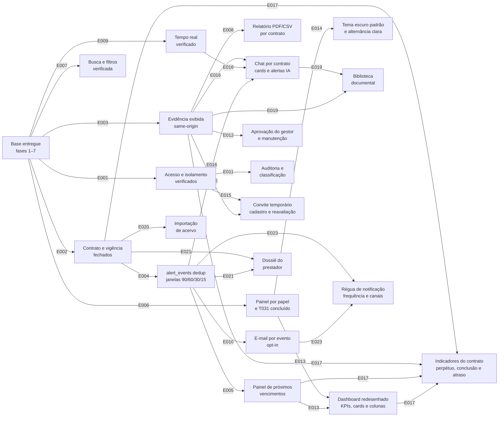

# Project Implementation Plan

| | |
|---|---|
| **Product** | Gestão de Contratos de Terceiros |
| **Created** | 2026-09-27 |
| **Status** | active |
| **Epics** | 23 — 16 × P1, 7 × P2 |
| **Categories** | 23 PRODUCT, 0 TECHNICAL, 0 OPERATIONAL |
| **Author** | Amarildo de Lacerda |
| **Waves** | 14 |
| **Progress** | 23/23 épicos (E001–E023, Waves 1–14 concluídas) |

## Epic Checklist

### Wave 1 — Base entregue em fechamento

> Capacidades já em produção e validadas (28 E2E, 16 fumaça, 35 unitários). Escopo de cada épica: verificação, fechamento do gap registrado e regressão — o que já está provado não é refeito.

- [X] E001 [P1] [PRODUCT] [P] {PRD:CAP-001} Domínio papéis e acesso — habilitação, permissões e suspensão [→ Details](plan/E001.md)
- [X] E002 [P1] [PRODUCT] [P] {PRD:CAP-002} Contrato e vigência — cadastro, vínculo, prorrogação, encerramento [→ Details](plan/E002.md)
- [X] E003 [P1] [PRODUCT] [P] {PRD:CAP-003} Execução de tarefas com evidência — conclusão, reabertura e proxy `/uploads` [→ Details](plan/E003.md)
- [X] E006 [P1] [PRODUCT] [P] {PRD:CAP-005} Painel por papel — visões por papel e fechamento de T031 [→ Details](plan/E006.md)
- [X] E007 [P1] [PRODUCT] {PRD:CAP-006} Busca e filtros — contrato, status, prioridade, prestador, finalidade, prazo [→ Details](plan/E007.md)
- [X] E009 [P2] [PRODUCT] [P] {PRD:CAP-008} Comunicação em tempo real — sessões acompanhando mutações [→ Details](plan/E009.md)

### Wave 2 — Motor de alertas e relatório

> Primeira entrega nova da release. E004 cria a migração aditiva preguiçosa dos alertas; E008 fecha o relatório sobre a base já entregue. Ambas paralelas: áreas de código disjuntas.

- [X] E004 [P1] [PRODUCT] [P] {PRD:CAP-004} Motor de alertas de vigência — varredura, dedup e janelas [→ Details](plan/E004.md)
- [X] E008 [P1] [PRODUCT] [P] {PRD:CAP-007} Relatório de serviços executados — PDF e CSV por contrato [→ Details](plan/E008.md)

### Wave 3 — Demonstração dos avisos

> E005 e E010 descem do motor (E004): o painel consome `alert_events` e as janelas configuráveis; o e-mail de vencimento nasce do gatilho da varredura.

- [X] E005 [P1] [PRODUCT] [P] {PRD:CAP-004} Painel de próximos vencimentos — janelas 90/60/30/15 [→ Details](plan/E005.md)
- [X] E010 [P2] [PRODUCT] [P] {PRD:CAP-009} Avisos por e-mail — envio opt-in por evento [→ Details](plan/E010.md)

### Wave 4 — Auditoria

> Fecha a pendência de acesso de auditoria (TODO item 3): leitura das tarefas executadas e classificação do atendimento sobre a base de E003, sem reescrever o PRD.

- [X] E011 [P1] [PRODUCT] [P] {PRD:CAP-003} Acesso de auditoria e classificação de tarefas executadas [→ Details](plan/E011.md)

### Wave 5 — Manutenção e aprovação de tarefas

> Fecha as pendências do TODO de 2026-10-17 sobre CAP-003, sem reescrever o PRD: aprovação/rejeição do gestor na revisão, manutenção do estado por admin/gestor com motivo e anexos com categoria (`evidence`/`documentation`). Entregue na feature workspace `specs/00014-manutencao-tarefas-aprovacao` (QC PASS, 2026-10-19).

- [X] E012 [P1] [PRODUCT] [P] {PRD:CAP-003} Manutenção de tarefas e aprovação do gestor — decisão na revisão, manutenção com motivo e anexos categorizados [→ Details](plan/E012.md)

### Wave 6 — Dashboard redesenhado e tema escuro

> Pendências do TODO decididas com o usuário em 2026-10-23, sobre a release fechada (E001–E012). E013 redesenha o dashboard no formato do mockup de referência usando só dados que já existem (KPIs por status de E002, janelas de vencimento de E005, cards com vencimento e responsável) — sem capacidade nova de dados. E014 muda o default para tema escuro, persiste a escolha e expõe a alternância na top toolbar do MainShell (construída fora do SDD). Ordem E013 → E014: ambos estendem `app_theme.dart` e `main.dart`, sem tocar backend; a ordem é para rebaixar seguro sobre os arquivos de tema.

- [X] E013 [P2] [PRODUCT] {PRD:CAP-004,CAP-005} Redesign visual do dashboard — KPIs por status, vencimentos, cards e layout em colunas [→ Details](plan/E013.md)
- [X] E014 [P2] [PRODUCT] {PRD:CAP-005} Tema escuro por padrão — alternância para claro persistida na top toolbar [→ Details](plan/E014.md)

### Wave 7 — Indicadores do painel de contratos

> Pedido do usuário em 2026-11-04: o card do painel precisa distinguir contrato perpétuo de cadastro incompleto, mostrar conclusão do trabalho e sinalizar tarefas abertas com prazo vencido. E017 estende o card de E013 e a tabela de E002 com uma coluna aditiva; não cria endpoint novo.

- [X] E017 [P1] [PRODUCT] {PRD:CAP-002,CAP-004,CAP-005} Indicadores do painel de contratos — perpétuo, conclusão e tarefas atrasadas [→ Details](plan/E017.md)

### Wave 8 — Convite de visitante e chat por contrato

> Pendências do TODO V2 registradas como specs em 2026-10-24: E015 fecha o ciclo de acesso temporário (estende E001 e E003) e E016 abre o canal por contrato com análise de documentos por IA (reutiliza E003, E004, E005, E009 e E012). Sem dependência entre si, mas sem `[P]`: ambos tocam a superfície de tarefas e guards. Ordem sugerida: E015 primeiro (escopo menor), depois E016.

- [X] E015 [P1] [PRODUCT] {PRD:CAP-001,CAP-003} Convite temporário e papel visitante — link com validade, cadastro e reavaliação [→ Details](plan/E015.md)
- [X] E016 [P1] [PRODUCT] {PRD:CAP-003,CAP-004,CAP-008} Chat colaborativo por contrato — canal, cards e análise IA [→ Details](plan/E016.md)

### Wave 9 — Previsibilidade financeira

- [X] E018 [P1] [PRODUCT] {PRD:CAP-002,CAP-007} Previsibilidade financeira — pagamentos, custos e indicadores por contrato [→ Details](plan/E018.md)

### Wave 10 — Gestão documental do contrato

> Escopo confirmado pelo usuário em 2026-11-23 (item 2 da avaliação V3, `specs/avaliacao-valor-v3.md`; roadmap formal esgotado). E019 reusa `attachments`, `document_analyses` e os alertas extraídos de E016 — duas colunas aditivas, nenhuma tabela nova. Feature `specs/00021-gestao-documental-contrato` concluída em 2026-11-23 (autopilot).

- [X] E019 [P2] [PRODUCT] {PRD:CAP-002,CAP-003} Gestão documental do contrato — biblioteca, filtro e conferência [→ Details](plan/E019.md)

### Wave 11 — Onboarding: importação de acervo

> R3 do roadmap (`docs/roadmap.md`), aprovado pelo usuário em 2026-11-23 — `PDD-007` revisada e importação reaberta; `HYP-002` segue aberta até validação com uso real. Pesquisa nov/2026 confirma migração de acervo como etapa obrigatória de onboarding.

- [X] E020 [P1] [PRODUCT] {PRD:CAP-002} Importação de acervo — planilha com mapeamento de colunas e PDFs em massa [→ Details](plan/E020.md)

### Wave 12 — Dossiê documental do prestador

> R7 do roadmap, eixo novo da pesquisa nov/2026 (`docs/pesquisa-mercado-2026-11.md`): ASO, NRs e certidões com vigência, alerta e bloqueio. Clarify fechou o checklist por finalidade com abrangência `provider`/`worker` e fallback global ASO; documento vencido não desfaz vínculo ou tarefa anteriores. `PDD-007` revisada na Wave 11; `PDD-008` segue pendente e `HYP-002` aberta até uso real.

- [X] E021 [P1] [PRODUCT] {PRD:CAP-002,CAP-004} Dossiê documental do prestador — documentos, vigências e bloqueio [→ Details](plan/E021.md)

### Wave 13 — Agenda de manutenção preventiva

> P2 priorizado na pesquisa nov/2026 (`docs/pesquisa-mercado-2026-11.md`): recorrência por contrato ou tipo de serviço que cria a tarefa automaticamente na data certa. Aprovado pelo usuário em 2026-11-24; reaproveita `tasks` de E003 e o fluxo de manutenção de E012, sem depender de `PDD-008`.

- [X] E022 [P2] [PRODUCT] {PRD:CAP-003,CAP-004} Agenda de manutenção preventiva recorrente [→ Details](plan/E022.md)

### Wave 14 — Régua de notificação configurável

> R8 do roadmap (`docs/roadmap.md`), quarto item da pesquisa nov/2026 (`docs/pesquisa-mercado-2026-11.md`). Entregue em 2026-11-25 como épica P2 (spec `00025-regua-de-notificacao-configuravel`, QC PASS). Mantém as janelas de E004 e os canais in-app/e-mail opt-in de E010; WhatsApp segue fora e depende da revisão de `PDD-008`.

- [X] E023 [P2] [PRODUCT] {PRD:CAP-004} Régua de notificação configurável — janelas, frequência e canais existentes [→ Details](plan/E023.md)

## Dependency Diagram

Aresta ausente de propósito: E004 consome `emitDomainEvent()` e a sala `domain_<id>` da infraestrutura já entregue (T033), não a saída de E009 — criar a aresta faria uma capacidade P2 (CAP-008) ser prerequisite de uma P1 e inflaria a prioridade de E009 contra o PRD. E011 e E012 apontam das entregas de base que consomem (E001 guards/papéis, E003 `tasks`/`task_history`/anexos), não da infraestrutura de tempo real. Wave 6: E013 consome o painel por papel de E006 e as janelas de vencimento de E005 (KPI `a vencer`), não o motor de E004 diretamente; E014 parte do tema produzido por E006 — a ordem E013 → E014 dentro da onda é só para rebaixar seguro sobre `app_theme.dart`, não um contrato de dependência. Wave 7: E017 consome a tabela de contratos de E002, as tarefas de E003, a lista de "sem previsão" de E005 e o card/KPIs de E013. Wave 8: E015 estende a matriz de papéis de E001 com o escopo de contrato de E003; E016 reutiliza o fluxo de tarefas de E003, a sala socket de E009 e o motor de alertas de E004 — o provedor de IA é configuração nova decidida dentro da própria épica. Waves 10–12: E019 consome os anexos de E003/E016 e as análises de E016, com duas colunas aditivas em `attachments`; E020 cria contratos em lote sobre a superfície de E002 e o storage de E003; E021 estende o vínculo de E002 com o motor de alertas de E004 — as três seguem o Wave Transition Protocol (E019 → E020 → E021). Wave 13: E022 reutiliza a criação de tarefas de E003 e o fluxo de manutenção de E012, com alertas pelo motor de E004; não depende de `PDD-008`. Wave 14: E023 consome as janelas e os eventos deduplicados de E004 e o e-mail opt-in de E010 para compor a régua por domínio/tipo de evento; nenhum canal novo entra nesta onda, e WhatsApp continua condicionado à revisão de `PDD-008`.

## Execution Wave Summary

| Wave | Epics | All Parallel? | Status | Concluída em | Notes |
|------|-------|---------------|--------|--------------|-------|
| 1 | E001, E002, E003, E006, E007, E009 | Não | Concluída | 2026-10-23 | E007 sem `[P]`: `ensureIndexes()` e as consultas de contrato/tarefa em `config/database.js` são superfície compartilhada com E002/E003 |
| 2 | E004, E008 | Sim | Concluída | 2026-10-23 | E004 escreve a migração de `alert_events`; E008 é leitura pura sobre `services/report.js` |
| 3 | E005, E010 | Sim | Concluída | 2026-10-23 | E005 só consome a API de alertas de E004; E010 só valida gatilhos de envio |
| 4 | E011 | Sim | Concluída | 2026-10-23 | Leitura sobre `tasks`/`task_history` já entregues (E003); classificação é coluna aditiva |
| 5 | E012 | Sim | Concluída | 2026-10-23 | Decide e mantém `tasks` de E003 sob os guards de E001; `category` é coluna aditiva em anexos já entregues |
| 6 | E013, E014 | Não | Concluída | 2026-10-30 | Só frontend, sem backend novo; sequenciais entre si por `app_theme.dart`/`main.dart` compartilhados |
| 7 | E017 | Sim | Concluída | 2026-11-15 | Coluna aditiva em `contracts` de E002 e extensão do payload do dashboard; consome `tasks` de E003 e a lista de E005 |
| 8 | E015, E016 | Não | Concluída | 2026-11-21 | E015 entregue em 2026-11-20 (spec `00016`, QC PASS) e E016 em 2026-11-21 (spec `00017`, QC PASS); última data é o `QC Passed` de E016 |
| 9 | E018 | Sim | Concluída | 2026-11-22 | E018 entregue em 2026-11-22 (spec `00020`, QC PASS) |
| 10 | E019 | Sim | Concluída | 2026-11-23 | E019 entregue em 2026-11-23 (spec `00021`, QC PASS) |
| 11 | E020 | Sim | Concluída | 2026-11-24 | R3 do roadmap; `PDD-007` revisada em 2026-11-23; abre após E019 |
| 12 | E021 | Sim | Concluída | 2026-11-24 | R7 do roadmap (pesquisa nov/2026); abre após E020; QC PASS (spec `00023`) |
| 13 | E022 | Não | Concluída | 2026-11-24 | P2 do research nov/2026; agenda recorrente cria tarefa sobre E003/E012 e alimenta E004; QC PASS (spec `00024`) |
| 14 | E023 | Sim | Concluída | 2026-11-25 | R8 do roadmap; régua sobre E004/E010, sem WhatsApp e sem `PDD-008`; QC PASS (spec `00025`) |

> **Status**: derivado dos checkboxes da Epic Checklist (onda concluída = todos os épicos `[X]`); data = último `QC Passed` dos markers `.qc-passed` dos épicos da onda. Wave 14 está concluída.

## Parallel Execution Guidance

- **Independent Epics**: Wave 1 — E001, E002, E003, E006, E009 em paralelo; E007 entra depois de E002/E003 na mesma onda. Wave 2 — E004 e E008 sem contato. Wave 3 — E005 e E010 sem contato. Wave 5 — E012 sozinha, estende CAP-003 sem tocar em E011. Wave 6 — E013 e E014 sem backend, mas sequenciais entre si pelo tema compartilhado. Wave 7 — E017 sozinha. Wave 8 — E015 e E016 sem dependência entre si, mas sem `[P]` pela superfície de tarefas e guards que ambos visitam; ordem sugerida E015 → E016.
- **Integration Risks**: E007 pode mexer em índices usados pelas listagens de contrato/tarefa (E002/E003). E006 altera `frontend/lib/main.dart` e `frontend/lib/theme/app_theme.dart`, importados por todas as telas — qualquer épica de tela da onda deve rebaixar sobre esses arquivos. E004 e E007 escrevem em `config/database.js` (migração × índices), mas estão em ondas diferentes. E012 adiciona coluna em `attachments` e ações em `tasks.js` — superfície já entregue por E003, em onda posterior. Wave 6 estende `app_theme.dart` e `main.dart` (superfície de E006) e reescreve `dashboard_screen.dart` — qualquer trabalho de tela simultâneo rebaixa sobre esses arquivos; E014 assume a top toolbar do MainShell já entregue pela obra ad-hoc em andamento. Wave 8: E015 adiciona o papel `visitante` à matriz de E001 e restringe leitura em rotas de tarefa de E003; E016 cria canais e cards que movem tarefas — trabalho simultâneo em `tasks.js` e `tasks_screen.dart` exige rebaixo cuidadoso.
- **Shared Resource Conflicts**: `backend/src/config/database.js` (E004 migração, E007 índices — ondas distintas); `frontend/lib/main.dart` e `app_theme.dart` (E006, compartilhado com qualquer trabalho de tela; E013 e E014 estendem na onda 6); `frontend/nginx.conf` (só E003); salas Socket.io `domain_<id>` (leitura por E004/E005, escrita já entregue); `backend/src/routes/tasks.js` e `frontend/lib/screens/tasks_screen.dart` (E003 origem, E012 extensão na onda 5, E015/E016 extensões na onda 8); `frontend/lib/screens/dashboard_screen.dart` (E006 origem, E013 reescrita na onda 6, E017 extensão na onda 7); `backend/src/routes/alerts.js` (E004 origem, E005 painel, E017 exclusão de perpétuos); migração preguiçosa em `config/database.js` na onda 8 (E015 convites, E016 mensagens/análises — executar em ordem).
- **Waves 10–12**: E019, E020 e E021 concluídas (features `00021`, `00022` e `00023`); E021 criou tabelas de documentos do prestador e regra de bloqueio sobre `tasks.js`/`routes/contracts.js`, além do motor de E004. Ordem mantida (Wave Transition Protocol): E019 → E020 → E021. `backend/src/routes/documents.js` nasce em E019 e é superfície de E020/E021 se forem tocadas.
- **Wave 13**: E022 concluída (feature `00024`); regras e ocorrências em tabelas próprias, grade fixa ancorada em `start_date`, tarefa por ocorrência sobre E003/E012 e alerta deduplicado no motor de E004. Sem dependência de `PDD-008`.
- **Wave 14**: E023 concluída (feature `00025`); a régua reaproveita janelas, eventos e dedup de E004 e o envio opt-in de E010. Canal in-app e e-mail são os únicos considerados; qualquer integração com WhatsApp passa primeiro pela revisão de `PDD-008`.

## Coverage Validation

### PRD Coverage

| Capability | Title | Priority | Epics |
|------------|-------|----------|-------|
| CAP-001 | Ciclo de domínio, papéis e acesso | P1 | E001, E015 |
| CAP-002 | Contrato e vigência | P1 | E002, E017, E019, E020, E021 |
| CAP-003 | Execução de tarefas com evidência | P1 | E003, E011, E012, E015, E016, E019, E022 |
| CAP-004 | Alertas de vigência e painel de próximos vencimentos | P1 | E004, E005, E013, E016, E017, E021, E022, E023 |
| CAP-005 | Painel por papel | P1 | E006, E013, E014, E017 |
| CAP-006 | Busca e filtros | P1 | E007 |
| CAP-007 | Relatório de serviços executados em PDF e CSV | P1 | E008 |
| CAP-008 | Comunicação em tempo real entre sessões | P2 | E009, E016 |
| CAP-009 | Avisos por e-mail quando o cliente tem envio configurado | P2 | E010 |

9/9 capacidades cobertas. Digest do PRD no frontmatter: `79217e0462c05e3342ef34636a7e0c7169ac118e0113805b979c0d091b2000ca`.

E015 e E016 (Wave 8) são extensões do V2 rastreadas às capacidades mais próximas — convite/visitante estende o ciclo de acesso e a execução de tarefas; chat reutiliza execução, alertas e tempo real. O mapa de capacidades do PRD permanece inalterado (9 CAPs), na mesma linha de E013/E014/E017. E019–E021 (Waves 10–12) seguem o mesmo padrão: gestão documental rastreada a CAP-002/CAP-003, importação de acervo a CAP-002 (cria contratos) e dossiê do prestador a CAP-002/CAP-004 (vínculo + alerta de vencimento). E022 (Wave 13) segue o mesmo padrão: agenda recorrente rastreada a CAP-003 (criação automática de tarefa) e CAP-004 (alerta de vencimento). E023 (Wave 14) amplia CAP-004 sem criar capacidade nova: a régua atua sobre janelas e canais já existentes em E004/E010.

### SAD Coverage

| ADR | Title | Status | Epics |
|-----|-------|--------|-------|
| — | Catálogo vazio (`specs/adrs/` não existe; criação adiada por decisão Q6=A) | — | — |

Zero ADRs aceitos: nenhuma épica técnica obrigatória. Decisões narrativas do SAD absorvidas por épicas de produto: Q1 (proxy `/uploads` no Edge, `nginx.conf` intocado) → E003; Q4 (`/uploads` sem token, revisão 2026-12-26) → E003; Q5 (migração aditiva preguiçosa) → E004.

### DOD Coverage

| DDR | Title | Status | Epics |
|-----|-------|--------|-------|
| — | Documento de Deployment & Operations não registrado na configuração | ausente | — |

Sem DOD: extração de épicas operacionais pulada; subida do stack, cópia de segurança e handoff de operação permanecem como prática manual descrita no SAD.

### Uncovered Items

- Importação de acervo (R3): saiu desta lista — `PDD-007` revisada em 2026-11-23 pelo usuário; virou E020 na Wave 11, `HYP-002` segue aberta até validação com uso real.
- Trilha de alterações do contrato (restante do roadmap R2) — a biblioteca documental entrou como E019 (Wave 10), mas a trilha de mudança de cadastro continua fora.
- Indicadores e nota de desempenho por prestador (roadmap R4/R9) — sem épica registrada; R9 é candidato da pesquisa nov/2026.
- WhatsApp, reajuste automático e aplicativo mobile — rejeitados por PDD-008 (R5/R6 no roadmap; WhatsApp segue como candidato P2 pendente de revisão).
- Escopo regulado (contratos públicos, Lei 14.133, NFS-e, ICP-Brasil) — rejeitado por PDD-009.
- Catálogo de ADRs — adiado por Q6=A; nenhuma decisão vira tag `{SAD:ADR-NNNN}` até o catálogo ser criado.

## Shared Artifact Surface

### Shared Data Entities

| Entity | Introduced by | Consumed by |
|--------|---------------|-------------|
| `domains`, `system_users` (`data/platform.db`) | E001 | E004, E005 (seleção de tenant) |
| `contratos` (status, previsão de finalização) | E002 | E004, E005, E007, E008 |
| Coluna `contracts.perpetual` (vigência indefinida) | E017 | E005 (exclusão de "sem previsão"), E013 (card do painel) |
| `tasks`, `task_history`, anexos de tarefa | E003 | E007, E008, E011, E012 |
| Coluna `attachments.category` (`evidence`/`documentation`) | E012 | — (leitura no detalhe da tarefa) |
| `alert_events`, janelas de alerta 90/60/30/15 | E004 | E005, E010, E013 |
| Arquivos em `backend/uploads/` | E003 | E008 (fotos no PDF) |
| Tabela de convites com cadastros consumidos | E015 | — |
| `chat_messages`, `document_analyses`, `extracted_alerts` (itens com data alimentam o painel de alertas) | E016 | — |

### API Surfaces

| API Surface | Introduced by | Consumed by |
|-------------|---------------|-------------|
| `/api/domains`, `/api/auth`, `/api/users` | E001 | E004, E005 |
| `/api/contracts` (CRUD, prorrogação, encerramento) | E002 | E004, E005, E007, E008 |
| `/api/tasks/:id/complete`, `/api/tasks/:id/reopen`, rota `/uploads` no Edge | E003 | E008 |
| `/api/v2/tasks/:id/approve`, `/reject`, `/maintenance`, `category` no upload de anexo | E012 | — |
| Varredura `runDueSweep` + endpoints de alertas e janelas | E004 | E005, E010, E013 |
| `/api/search` (contratos e tarefas) | E007 | — |
| `/api/reports` (PDF/CSV por contrato) | E008 | — |
| `/api/dashboard` | E006 | E013 |
| `GET /api/v2/dashboard/stats` — `contracts[].perpetual`, `tasks_total`, `tasks_done`, `tasks_overdue` | E017 | E013 (card do painel) |
| `/api/v2/invites` (lista, emissão, revogação, cadastro público) | E015 | — |
| `/api/v2/contracts/:id/chat` (mensagens, menu, análises) | E016 | — |

### Libraries / Modules

| Module / Export | Introduced by | Consumed by |
|-----------------|---------------|-------------|
| `requireRole()`, `scopeDomain()`, `assertDomainActive()` | E001 (base entregue) | E002, E003, E004, E005, E006, E007, E008 |
| `getDomainDb()`, migração aditiva preguiçosa | E001 (base entregue), E004 (migração de alertas) | E004, E005 |
| `emitDomainEvent()` e sala `domain_<id>` | E009 (infraestrutura já entregue) | E004, E005 |
| `notify()`, `smtpConfigured()` | E010 (notificador já entregue) | E004 |
| `generateContractPdf()`, `exportContractCsv()` | E008 | — |
| `AppTheme` (`frontend/lib/theme/app_theme.dart`) | E006 (tema e bootstrap entregues) | E013, E014 |

As linhas de `emitDomainEvent()`, `notify()`, `generateContractPdf()` e `AppTheme` são consumo de infraestrutura ou tema já em produção: as épicas citadas como `Introduced by` são as donas da verificação, não produtoras de novidade para a onda anterior — por isso nenhuma aresta de dependência aponta para elas.

## Wave Transition Protocol

Antes de abrir a Wave N+1, verificar:

- Toda épica da Wave N entregue e verificada, sem bug CRITICAL/ERROR aberto na feature workspace correspondente.
- Contexto técnico (`specs/sad.md`) atualizado quando a onda alterar esquema, fronteira ou fluxo — a Wave 2 altera esquema (`alert_events`, janelas) e a Wave 1 altera o Edge (`/uploads`).
- Artefatos compartilhados da seção anterior produzidos e consumíveis pelas épicas dependentes.
- Contratos de dependência satisfatóveis: entidade + épica de origem, endpoint + épica de origem, export + épica de origem (lista em cada `specs/plan/E###.md`).
