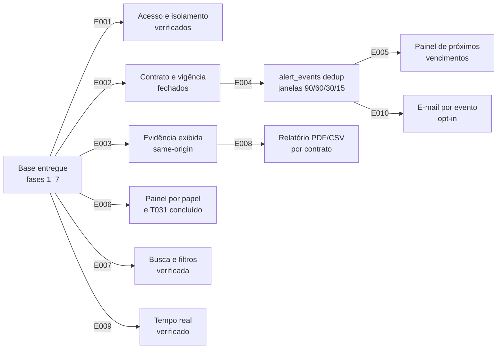

# Project Implementation Plan

| | |
|---|---|
| **Product** | Gestão de Contratos de Terceiros |
| **Created** | 2026-09-27 |
| **Status** | active |
| **Epics** | 10 — 8 × P1, 2 × P2 |
| **Categories** | 10 PRODUCT, 0 TECHNICAL, 0 OPERATIONAL |
| **Author** | Amarildo de Lacerda |
| **Waves** | 3 |

## Epic Checklist

### Wave 1 — Base entregue em fechamento

> Capacidades já em produção e validadas (28 E2E, 16 fumaça, 35 unitários). Escopo de cada épica: verificação, fechamento do gap registrado e regressão — o que já está provado não é refeito.

- [ ] E001 [P1] [PRODUCT] [P] {PRD:CAP-001} Domínio papéis e acesso — habilitação, permissões e suspensão [→ Details](plan/E001.md)
- [ ] E002 [P1] [PRODUCT] [P] {PRD:CAP-002} Contrato e vigência — cadastro, vínculo, prorrogação, encerramento [→ Details](plan/E002.md)
- [ ] E003 [P1] [PRODUCT] [P] {PRD:CAP-003} Execução de tarefas com evidência — conclusão, reabertura e proxy `/uploads` [→ Details](plan/E003.md)
- [ ] E006 [P1] [PRODUCT] [P] {PRD:CAP-005} Painel por papel — visões por papel e fechamento de T031 [→ Details](plan/E006.md)
- [ ] E007 [P1] [PRODUCT] {PRD:CAP-006} Busca e filtros — contrato, status, prioridade, prestador, finalidade, prazo [→ Details](plan/E007.md)
- [ ] E009 [P2] [PRODUCT] [P] {PRD:CAP-008} Comunicação em tempo real — sessões acompanhando mutações [→ Details](plan/E009.md)

### Wave 2 — Motor de alertas e relatório

> Primeira entrega nova da release. E004 cria a migração aditiva preguiçosa dos alertas; E008 fecha o relatório sobre a base já entregue. Ambas paralelas: áreas de código disjuntas.

- [ ] E004 [P1] [PRODUCT] [P] {PRD:CAP-004} Motor de alertas de vigência — varredura, dedup e janelas [→ Details](plan/E004.md)
- [ ] E008 [P1] [PRODUCT] [P] {PRD:CAP-007} Relatório de serviços executados — PDF e CSV por contrato [→ Details](plan/E008.md)

### Wave 3 — Demonstração dos avisos

> E005 e E010 descem do motor (E004): o painel consome `alert_events` e as janelas configuráveis; o e-mail de vencimento nasce do gatilho da varredura.

- [ ] E005 [P1] [PRODUCT] [P] {PRD:CAP-004} Painel de próximos vencimentos — janelas 90/60/30/15 [→ Details](plan/E005.md)
- [ ] E010 [P2] [PRODUCT] [P] {PRD:CAP-009} Avisos por e-mail — envio opt-in por evento [→ Details](plan/E010.md)

## Dependency Diagram

Aresta ausente de propósito: E004 consome `emitDomainEvent()` e a sala `domain_<id>` da infraestrutura já entregue (T033), não a saída de E009 — criar a aresta faria uma capacidade P2 (CAP-008) ser prerequisite de uma P1 e inflaria a prioridade de E009 contra o PRD.

## Execution Wave Summary

| Wave | Epics | All Parallel? | Notes |
|------|-------|---------------|-------|
| 1 | E001, E002, E003, E006, E007, E009 | Não | E007 sem `[P]`: `ensureIndexes()` e as consultas de contrato/tarefa em `config/database.js` são superfície compartilhada com E002/E003 |
| 2 | E004, E008 | Sim | E004 escreve a migração de `alert_events`; E008 é leitura pura sobre `services/report.js` |
| 3 | E005, E010 | Sim | E005 só consome a API de alertas de E004; E010 só valida gatilhos de envio |

## Parallel Execution Guidance

- **Independent Epics**: Wave 1 — E001, E002, E003, E006, E009 em paralelo; E007 entra depois de E002/E003 na mesma onda. Wave 2 — E004 e E008 sem contato. Wave 3 — E005 e E010 sem contato.
- **Integration Risks**: E007 pode mexer em índices usados pelas listagens de contrato/tarefa (E002/E003). E006 altera `frontend/lib/main.dart` e `frontend/lib/theme/app_theme.dart`, importados por todas as telas — qualquer épica de tela da onda deve rebaixar sobre esses arquivos. E004 e E007 escrevem em `config/database.js` (migração × índices), mas estão em ondas diferentes.
- **Shared Resource Conflicts**: `backend/src/config/database.js` (E004 migração, E007 índices — ondas distintas); `frontend/lib/main.dart` e `app_theme.dart` (E006, compartilhado com qualquer trabalho de tela); `frontend/nginx.conf` (só E003); salas Socket.io `domain_<id>` (leitura por E004/E005, escrita já entregue).

## Coverage Validation

### PRD Coverage

| Capability | Title | Priority | Epics |
|------------|-------|----------|-------|
| CAP-001 | Ciclo de domínio, papéis e acesso | P1 | E001 |
| CAP-002 | Contrato e vigência | P1 | E002 |
| CAP-003 | Execução de tarefas com evidência | P1 | E003 |
| CAP-004 | Alertas de vigência e painel de próximos vencimentos | P1 | E004, E005 |
| CAP-005 | Painel por papel | P1 | E006 |
| CAP-006 | Busca e filtros | P1 | E007 |
| CAP-007 | Relatório de serviços executados em PDF e CSV | P1 | E008 |
| CAP-008 | Comunicação em tempo real entre sessões | P2 | E009 |
| CAP-009 | Avisos por e-mail quando o cliente tem envio configurado | P2 | E010 |

9/9 capacidades cobertas. Digest do PRD no frontmatter: `79217e0462c05e3342ef34636a7e0c7169ac118e0113805b979c0d091b2000ca`.

### SAD Coverage

| ADR | Title | Status | Epics |
|-----|-------|--------|-------|
| — | Catálogo vazio (`specs/adrs/` não existe; criação adiada por decisão Q6=A) | — | — |

Zero ADRs aceitos: nenhuma épica técnica obrigatória. Decisões narrativas do SAD absorvidas por épicas de produto: Q1 (proxy `/uploads` no Edge, `nginx.conf` intocado) → E003; Q4 (`/uploads` sem token, revisão 2026-12-26) → E003; Q5 (migração aditiva preguiçosa) → E004.

### DOD Coverage

| DDR | Title | Status | Epics |
|-----|-------|--------|-------|
| — | Documento de Deployment & Operations não registrado na configuração | ausente | — |

Sem DOD: extração de épicas operacionais pulada; subida do stack, cópia de segurança e handoff de operação permanecem como prática manual descrita no SAD.

### Uncovered Items

- Importação de planilha CSV (R3) — adiada por PDD-007, `HYP-002` aberta; fora desta release.
- Central documental (anexos de contrato, ocorrências, trilha de alterações) e indicadores por prestador — roadmap R2/R4, decididos fora por PDD-003.
- WhatsApp, reajuste automático e aplicativo mobile — rejeitados por PDD-008.
- Escopo regulado (contratos públicos, Lei 14.133, NFS-e, ICP-Brasil) — rejeitado por PDD-009.
- Catálogo de ADRs — adiado por Q6=A; nenhuma decisão vira tag `{SAD:ADR-NNNN}` até o catálogo ser criado.

## Shared Artifact Surface

### Shared Data Entities

| Entity | Introduced by | Consumed by |
|--------|---------------|-------------|
| `domains`, `system_users` (`data/platform.db`) | E001 | E004, E005 (seleção de tenant) |
| `contratos` (status, previsão de finalização) | E002 | E004, E005, E007, E008 |
| `tasks`, `task_history`, anexos de tarefa | E003 | E007, E008 |
| `alert_events`, janelas de alerta 90/60/30/15 | E004 | E005, E010 |
| Arquivos em `backend/uploads/` | E003 | E008 (fotos no PDF) |

### API Surfaces

| API Surface | Introduced by | Consumed by |
|-------------|---------------|-------------|
| `/api/domains`, `/api/auth`, `/api/users` | E001 | E004, E005 |
| `/api/contracts` (CRUD, prorrogação, encerramento) | E002 | E004, E005, E007, E008 |
| `/api/tasks/:id/complete`, `/api/tasks/:id/reopen`, rota `/uploads` no Edge | E003 | E008 |
| Varredura `runDueSweep` + endpoints de alertas e janelas | E004 | E005, E010 |
| `/api/search` (contratos e tarefas) | E007 | — |
| `/api/reports` (PDF/CSV por contrato) | E008 | — |
| `/api/dashboard` | E006 | — |

### Libraries / Modules

| Module / Export | Introduced by | Consumed by |
|-----------------|---------------|-------------|
| `requireRole()`, `scopeDomain()`, `assertDomainActive()` | E001 (base entregue) | E002, E003, E004, E005, E006, E007, E008 |
| `getDomainDb()`, migração aditiva preguiçosa | E001 (base entregue), E004 (migração de alertas) | E004, E005 |
| `emitDomainEvent()` e sala `domain_<id>` | E009 (infraestrutura já entregue) | E004, E005 |
| `notify()`, `smtpConfigured()` | E010 (notificador já entregue) | E004 |
| `generateContractPdf()`, `exportContractCsv()` | E008 | — |

Os três últimos são consumo de infraestrutura já em produção: as épicas citadas como `Introduced by` são as donas da verificação, não produtoras de novidade para a onda anterior — por isso nenhuma aresta de dependência aponta para elas.

## Wave Transition Protocol

Antes de abrir a Wave N+1, verificar:

- Toda épica da Wave N entregue e verificada, sem bug CRITICAL/ERROR aberto na feature workspace correspondente.
- Contexto técnico (`specs/sad.md`) atualizado quando a onda alterar esquema, fronteira ou fluxo — a Wave 2 altera esquema (`alert_events`, janelas) e a Wave 1 altera o Edge (`/uploads`).
- Artefatos compartilhados da seção anterior produzidos e consumíveis pelas épicas dependentes.
- Contratos de dependência satisfatóveis: entidade + épica de origem, endpoint + épica de origem, export + épica de origem (lista em cada `specs/plan/E###.md`).
