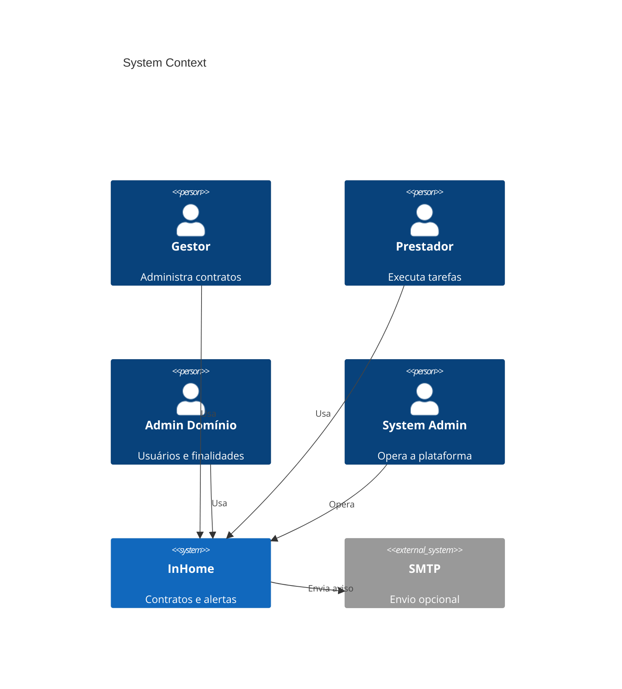
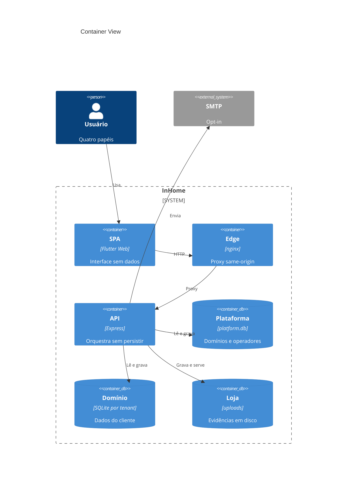
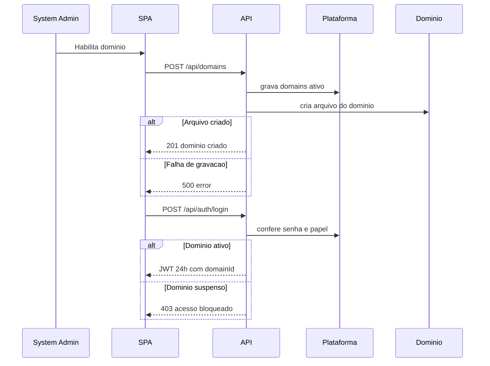
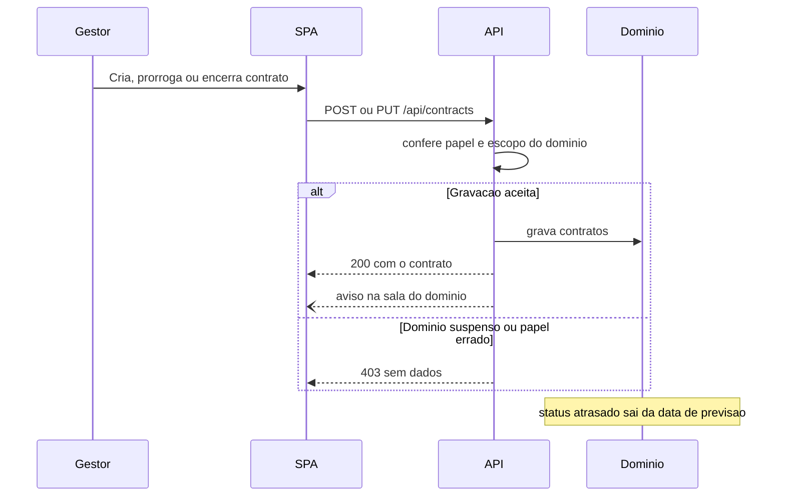
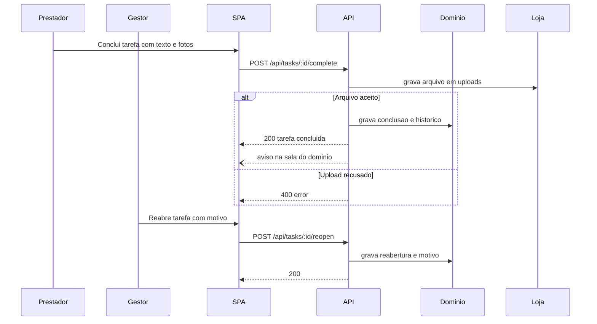
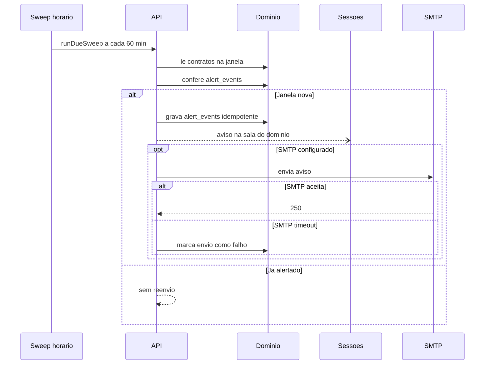
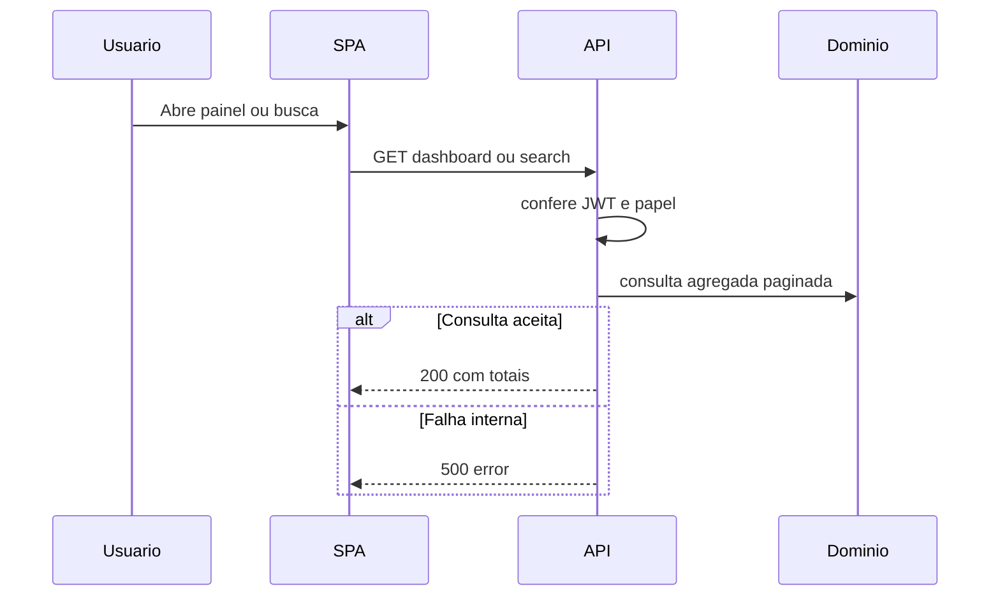
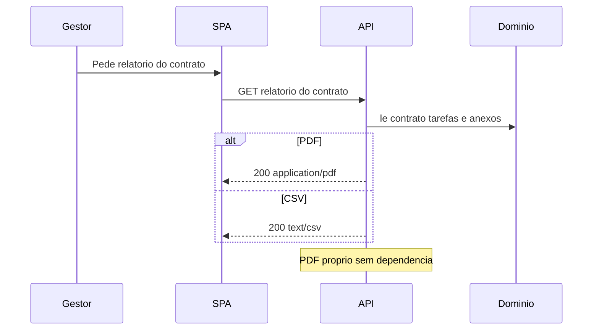
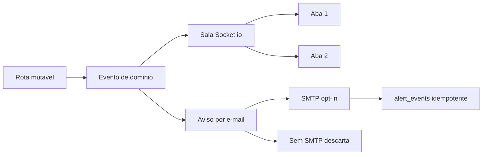
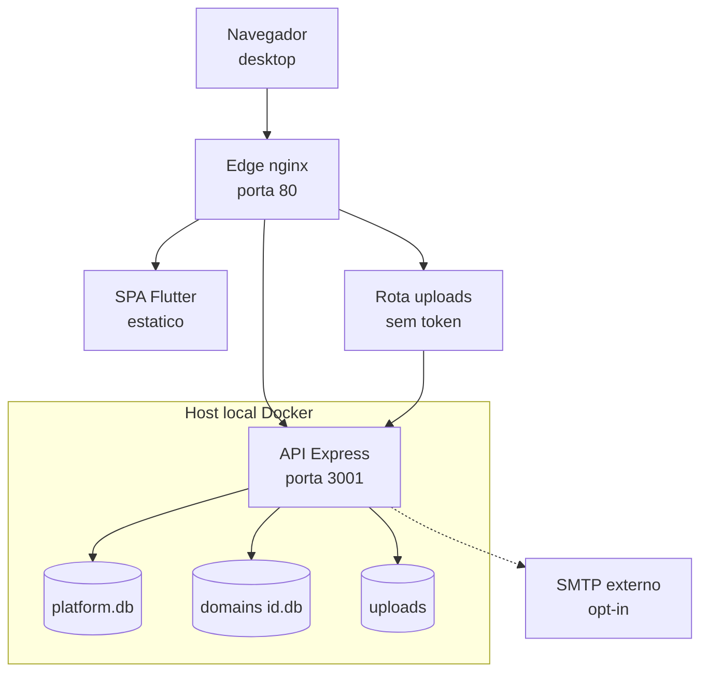

# Software Architecture Document: Gestão de Contratos de Terceiros

## Purpose and Scope

Sistema de administração de contratos de terceiros em que cada cliente opera como um domínio isolado, com seus contratos, usuários, finalidades e histórico próprios. A primeira release canônica (PDD-003) combina a base já entregue e validada com o motor de alertas de vigência da CAP-004.

Este documento descreve a arquitetura do nível de projeto: as sete fronteiras aprovadas, os sete fluxos principais, a posse de dados, as fronteiras de confiança e as metas mensuráveis que orientam planos de feature e decisões de infraestrutura.

Fora do alcance: importação de planilha, central documental, WhatsApp, aplicativo mobile, escopo regulado, publicação em produção e qualquer integração externa além do SMTP opcional.

## Technical Context

**Language/Version**: Dart 3 (Flutter Web) no cliente; Node.js 22+ na API (executado em 24.18.1)<br>
**Primary Dependencies**: Express, Socket.io, sql.js, jsonwebtoken, bcryptjs, nginx, Docker Compose<br>
**Storage**: `data/platform.db` (domínios e system_users); `data/domains/<id>.db` (dados de negócio por tenant); `backend/uploads/` (evidências em disco)<br>
**Testing**: `node:test` com supertest (35 unitários), `backend/test.sh` em PORT=3199 (16 verificações), suíte fim a fim 28/28 e 16 de fumaça; `flutter test` sem SDK disponível<br>
**Target Platform**: Docker Compose local em `http://localhost/` (nginx porta 80, API porta 3001); Chrome, Edge, Firefox e Safari desktop<br>
**Project Type**: web multi-tenante, brownfield (remodelagem `projects` → `contratos`)<br>
**Performance Goals**: p95 abaixo de 2 s em listagens locais; milhares de contratos por domínio<br>
**Constraints**: uso e validação apenas em ambiente local; sem telemetria; e-mail opt-in; isolamento por domínio inegociável; sem build nativo (PDD-003); suíte verde antes de qualquer promoção; `/uploads` sem token nesta release<br>
**Scale/Scope**: múltiplos domínios de clientes, 4 papéis, 9 capacidades (7 P1 e 2 P2)

## System Decomposition

| Boundary | Responsibilities | Data Ownership | Exposed Interfaces | Dependencies | Deployment Independence |
|----------|------------------|----------------|--------------------|--------------|-------------------------|
| SPA (`frontend/lib/`) | Telas, validação de formulário, sessão e assinatura das salas de domínio | Nenhum dado persistido | Consome `/api` e `/socket.io` | Edge, API | Empacotada como estáticos no Edge |
| Edge/Proxy (`frontend/nginx.conf`) | Servir estáticos, fallback de rota e encaminhamento same-origin | Nenhum dado persistido | Porta 80, rotas `/api/`, `/socket.io/`, `/uploads/` | API | Contêiner próprio |
| API (`backend/src/`) | Autenticação, autorização, regras de negócio, relatórios e motor de alertas CAP-004 | Nenhum dado persistido em processo próprio | REST em `/api`, Socket.io, arquivo em `/uploads` | Plataforma, Domínio, Loja, SMTP | Contêiner próprio, instância única |
| Plataforma (`data/platform.db`) | Ciclo de domínio e contas de operadores | `domains`, `system_users` | Consultas pela API | Nenhum | Arquivo de dados separado |
| Domínio (`data/domains/<id>.db`) | Contratos, tarefas, usuários, finalidades, histórico e alertas por tenant | Dado de negócio do cliente por inteiro | Consultas pela API | Plataforma (apenas seleção de tenant) | Um arquivo por domínio |
| Loja (`backend/uploads/`) | Evidências de execução (fotos e anexos) | Arquivos em disco referenciados por caminho | Servida pela API em `/uploads` | Domínio (referência do caminho) | Volume de dados separado |
| SMTP externo | Entrega de avisos quando o cliente tem envio configurado | Nenhum dado persistido | Sessão SMTP opt-in | API | Externo e opcional |

## System Scope and Context

Usuários do sistema: gestor de contratos, prestador de serviço, administrador de domínio e system_admin da plataforma. O system_admin opera apenas o ciclo de domínio e nunca acessa dados de contrato ou tarefa.

Sistemas externos: servidor SMTP do cliente (opcional, ativa a CAP-009) e a infraestrutura Docker local que hospeda o stack. Não há integração com ERP, pagamento, assinatura eletrônica ou serviço de mensagens.

Fronteiras de confiança: o navegador atravessa o Edge sem credencial; toda rota de negócio exige JWT; os arquivos de upload são servidos sem token nesta release, com a restrição registrada em Cross-Cutting Concerns e revisão marcada para 2026-12-26.

Exclusões: multi-região, offline-first, failover ativo e residência de dados fora do host local.

### C4 System Context



### C4 Container View



## Architecture View Catalog

| View | Concern | Scope | Notation | Rationale |
|------|---------|-------|----------|-----------|
| System Context | Atores e dependências externas | Sistema inteiro | C4 Context | Visão obrigatória do alcance |
| Container View | Unidades de execução e donos de dados | Sistema inteiro | C4 Container | Materializa as sete fronteiras aprovadas |
| FLOW-001 | Habilitação e sessão | Plataforma e domínio | Sequence | Caminho crítico de identidade |
| FLOW-002 | Vigência do contrato | Domínio | Sequence | Estados de contrato e sinalização de atraso |
| FLOW-003 | Evidência de execução | Domínio e Loja | Sequence | Único caminho que cruza para disco |
| FLOW-004 | Alerta de vigência | API, Domínio e SMTP | Sequence | Assíncrono, dedup e canal opt-in |
| FLOW-005 | Painel e busca | Domínio | Sequence | Leitura síncrona com escopo por papel |
| FLOW-006 | Relatório | Domínio | Sequence | Egresso de arquivo gerado sob demanda |
| FLOW-007 | Tempo real e e-mail | Sessões e SMTP | Flowchart | Caminho assíncrono puro, sem resposta HTTP |
| Deployment e confiança | Zonas, portas e fronteira de token | Host local | Flowchart | Topologia de implantação e superfície de risco |

## Solution Strategy and Architecture Style

- **Architecture Style**: monólito modular com dados separados por tenant (banco por domínio), exposto por uma única API atrás de proxy same-origin.
- **Source Code Layout**: layout brownfield preservado, sem imposição de `/src`. Backend em `backend/src/` (`config/`, `middleware/`, `models/`, `routes/`, `services/`, `server.js`), cliente em `frontend/lib/` (`models/`, `screens/`, `services/`, `widgets/`, `theme/`), edge em `frontend/nginx.conf`, scripts em `scripts/`, artefatos em `specs/`, governança na raiz.
- **Why this style fits**: validação local em host único, um processo por instância e ausência de build nativo tornam qualquer decomposição em serviços um custo sem benefício. O isolamento é resolvido no formato do dado, não na rede.
- **Alternatives considered**: PostgreSQL foi descartado porque o build nativo falha neste ambiente (PDD-003); microsserviços foram descartados porque dobrariam a operação local sem exigência de escala ou falha isolável.

## Major Data Flow Catalog

| Flow ID | Trigger | Source / Actor | Processing Boundaries | Stores | Egress | Trust / Data Class | Consistency / Transaction | Failure / Recovery | Diagram |
|---------|---------|----------------|-----------------------|--------|--------|--------------------|---------------------------|--------------------|---------|
| FLOW-001 | Habilitação de domínio e login | system_admin e usuário | Edge → API → Plataforma → Domínio | `platform.db`; `domains/<id>.db` | Resposta JSON com JWT de 24 h | Confiança pública até o token; cadastro de clientes | Criação do arquivo do domínio em operação única antes da resposta | Falha de gravação devolve 500 e nada é criado; sem retry automático; sessão inválida devolve 403 | FLOW-001 |
| FLOW-002 | Criação, prorrogação e encerramento | gestor ou admin | Edge → API → Domínio | `domains/<id>.db` | JSON e evento na sala do domínio | Dado de negócio por tenant | Uma gravação por requisição no banco do domínio | Papel errado ou domínio suspenso devolve 403 sem ler dados; validação devolve 400; sem retry | FLOW-002 |
| FLOW-003 | Conclusão documentada e reabertura | prestador e gestor | Edge → API → Domínio → Loja | `domains/<id>.db`; `backend/uploads/` | JSON, evento em tempo real e arquivo em disco | Evidência com foto; dado sensível por contrato | Arquivo e registro gravados no mesmo pedido, sem transação distribuída | Upload recusado devolve 400 e nada é gravado; gravação de banco falha devolve 500; sem retry automático | FLOW-003 |
| FLOW-004 | Varredura horária de vencimento | agendador interno | API → Domínio → Socket.io → SMTP | `domains/<id>.db`; `alert_events` | Aviso na sala do domínio e e-mail | Aviso operacional; endereço de e-mail pessoal | Dedup idempotente por contrato e janela gravada antes do envio | SMTP com timeout de 5 s é marcado como falho e não derruba a API; sem retry; canal inerte sem `SMTP_*` | FLOW-004 |
| FLOW-005 | Painel e busca por papel | usuário autenticado | Edge → API → Domínio | `domains/<id>.db` | JSON agregado e paginado | Dado de negócio por tenant | Leitura única por requisição, sem cache compartilhado | Erro interno devolve 500; latência acima de 2 s é regressão; sem fallback | FLOW-005 |
| FLOW-006 | Relatório por contrato | gestor | API → Domínio → download | `domains/<id>.db` | `application/pdf` ou `text/csv` | Relatório por contrato, mesmo escopo do token | Leitura consistente do banco já carregado em memória | Falha de leitura devolve 500; CSV é o caminho alternativo ao PDF; sem retry | FLOW-006 |
| FLOW-007 | Mutação em qualquer sessão | rota de negócio autenticada | API → Socket.io → sessões; API → SMTP | N/A (sem estado próprio) | Sala do domínio e e-mail | Aviso operacional; sem dado persistido pelo transporte | Sem transação; entrega em melhor esforço | Emissor com erro é engolido e a API segue; falha de envio não interrompe a resposta | FLOW-007 |

## Major Data Flow Diagrams

### FLOW-001: Habilitação de domínio e sessão



Recuperação: a criação do domínio é uma única gravação seguida de criação de arquivo; se o arquivo falhar a API responde 500 e o registro de `domains` não é aproveitado. Não há retry automático. O token expira em 24 h e cada requisição revalida o status do domínio, então uma suspensão bloqueia sessões já emitidas sem timeout adicional.

### FLOW-002: Contrato e vigência



Recuperação: o status `atrasado` é derivado da data de previsão, então uma falha de gravação não deixa estado inconsistente para tratar depois. Requisição inválida devolve 400 e sessão sem escopo devolve 403 antes de qualquer leitura. Não há retry nem fila: o cliente reenvia apenas quando o usuário repete a ação.

### FLOW-003: Execução de tarefa com evidência



Recuperação: o caminho não usa transação distribuída entre disco e banco. O arquivo é gravado primeiro e a referência só entra no banco quando o arquivo já existe; se a gravação de banco falhar a API devolve 500 e o arquivo órfão permanece na loja, sem retrabalho automático. Reabertura sem motivo é recusada com 400 antes de qualquer escrita.

### FLOW-004: Alerta de vigência



Recuperação: `alert_events` é a chave de dedup por contrato e janela, gravada antes do envio, o que torna a passagem idempotente mesmo com o sweep reiniciando. SMTP sem resposta em 5 s é registrado como falho e não interrompe a varredura dos demais domínios. Sem `SMTP_HOST` e `SMTP_PORT` o envio é pulado por completo e o aviso em aplicativo continua funcionando.

### FLOW-005: Painel, busca e filtros



Recuperação: leitura sem escrita, portanto sem necessidade de compensação; erro interno devolve 500 e o cliente mantém a última tela renderizada. Não há cache nem fallback: a latência acima de 2 s em listagem paginada é tratada como regressão e atacada por índice, não por camada de cache.

### FLOW-006: Relatório de serviços executados



Recuperação: o PDF é gerado por um escritor próprio sem dependência externa, então não há falha de biblioteca a tratar; se a leitura do banco falhar a rota devolve 500 e o usuário repete a ação, sem retry automático. O CSV existe como caminho alternativo leve para o mesmo dado, sem fila nem pré-computo.

### FLOW-007: Tempo real e aviso por e-mail



Recuperação: o emissor de eventos captura a própria exceção e devolve `false`, então uma falha de entrega não propaga para a resposta HTTP que originou a mutação. O e-mail é melhor esforço: sem `SMTP_*` configurado a etapa é descartada e o aviso permanece disponível na tela. Dedup evita reenvio quando a mesma mutação é repetida.

## Deployment and Trust Topology



Zonas e fronteiras: o Edge é a única porta pública junto com a API exposta em 3001 para depuração; o navegador atravessa o Edge sem credencial e carrega o token em memória. `data/` e `backend/uploads/` são volumes montados no host e não entram no repositório. Não há região, escalonamento horizontal nem failover: a unidade de escala é um processo por host e a recuperação é o reinício automático do Compose.

Decisão de design pendente de implementação (aprovada, ainda não aplicada ao repositório): a rota `/uploads` precisa ser encaminhada pelo Edge para que a evidência resolva same-origin, hoje o fallback de rota devolveria o `index.html` do SPA.

```nginx
location ^~ /uploads/ {
    proxy_pass http://backend:3001;
    proxy_set_header Host $host;
    proxy_set_header X-Real-IP $remote_addr;
}
```

Os detalhes de health check, volumes e ordem de subida ficam a cargo do documento de Deployment & Operations.

## Cross-Cutting Concerns

### Security

Sessão por JWT assinado com `JWT_SECRET`, validade de 24 h, carregando `role` e `domainId`; senhas com `bcryptjs`. Autorização é deny by default: `requireRole` nega tudo que não esteja na lista do papel e `requireSystemAdmin` separa o operador da plataforma de qualquer rota de negócio. `scopeDomain` recusa com 403 qualquer parâmetro de domínio diferente do token antes de rodar consulta, e `assertDomainActive` revalida o status do domínio em toda rota protegida, então suspender um domínio derruba sessões já emitidas.

Isolamento por tenant é físico: cada cliente tem seu próprio arquivo de banco e nenhuma rota de negócio aceita caminho de arquivo vindo do cliente. Os segredos ficam em `backend/.env`, que não é versionado.

Restrição aceita para esta release: `/uploads` é servido sem token. O caminho usa nomes de arquivo opacos gerados no upload, mas alguém com a URL lê a evidência sem sessão. Dono da revisão: owner do projeto. Data de revisão: 2026-12-26. Enquanto isso a superfície é limitada ao host local.

### Reliability

Instância única por `DATA_DIR`, com escritas serializadas no processo do Node e persistência síncrona do banco inteiro a cada gravação. O serviço sobe com `restart: unless-stopped`; a varredura de alertas roda uma vez na subida e depois a cada 60 min, com erro engolido para não derrubar o agendador. Nenhuma dependência externa é bloqueante: SMTP é opt-in e `notify()` nunca lança exceção.

Não há replicação nem failover. Recuperação esperada: reinício do contêiner (segundos) e restauração da cópia diária de `data/` e `backend/uploads/` (RTO 30 min, RPO 24 h), ambas operações manuais.

### Observability

Sem telemetria, por decisão de produto: não há coleta de métricas, tracing nem painel de operação. O que existe é o suficiente para depuração local e para a medição manual das métricas do PRD.

- Logs de erro no stdout do contêiner, lidos com `docker compose logs`.
- `GET /api/health` para conferir que a API responde.
- Trilha de auditoria já presente em `task_history` (quem fez o quê e quando) e em `domains` (ciclo de habilitação e suspensão).
- Medição manual das métricas a cada 90 dias, a partir de relatórios e consulta ao banco do domínio.

### Data Management

Posse: a Plataforma guarda `domains` e `system_users`; cada Domínio guarda o dado de negócio do respectivo cliente por inteiro; a Loja guarda os arquivos de evidência referenciados por caminho gravado no banco do domínio. Não há dado de negócio fora desses três lugares, exceto o conteúdo transitório do relatório gerado sob demanda.

Ciclo de vida: suspender domínio bloqueia acesso sem apagar nada; remoção de registro é operação administrativa explícita. Migração de esquema é aditiva e preguiçosa, aplicada na abertura de cada `data/domains/<id>.db`, sem varredura no boot, então domínio que nunca é aberto só migra no primeiro acesso. Residência: tudo permanece no host local. Cópia diária de `data/` e `backend/uploads/` é a única expectativa de backup.

### Integration Strategy

Integração interna é HTTP/JSON sobre same-origin: o Edge encaminha `/api/` e `/socket.io/` para a API, e o cliente usa caminhos relativos, sem CORS em produção. Contrato de resposta é `{ data, error }`, sem versionamento de rota nesta release.

Tempo real usa Socket.io com salas por domínio (`domain_<id>`); o cliente entra na sala ao resolver o papel e a mutação publica para a sala inteira. Não há barramento de mensagens nem evento persistido para replay: entrega é melhor esforço e estado é sempre relido do banco.

E-mail usa sessão SMTP escrita à mão sobre socket TCP (`EHLO` → `MAIL` → `RCPT` → `DATA` → `QUIT`) com timeout de 5 s, ativada apenas por `SMTP_HOST` e `SMTP_PORT`. Sem essas variáveis a integração inteira permanece inerte.

### Operations

Ambiente único: `docker-compose.yml` sobe `backend` (volumes `./data` e `./backend/uploads`) e `frontend` (nginx na porta 80). Não há ambiente de homologação nem publicação contínua nesta release.

Responsabilidades: o owner do projeto aprova toda promoção; o desenvolvedor roda a suíte antes de promover. Ramo `dev` concentra o trabalho e `main` só muda com aprovação, com versão em SemVer registrada em `backend/.env` (`APP_VERSION`). Suporte é manual, sem plantão nem SLO contratado. Handoff de operação (subida, cópia de segurança, restauração) fica com o documento de Deployment & Operations.

## Quality Attributes

| Attribute | Target | Measurement | Architectural Response |
|-----------|--------|-------------|------------------------|
| Performance | p95 abaixo de 2 s em listagens locais | temporização manual no navegador durante a coleta de 90 dias | paginação e índices nas rotas quentes; varredura de alertas fora do caminho de requisição |
| Confiabilidade | 0 alertas duplicados por contrato e janela | consulta em `alert_events` por domínio a cada 90 dias | chave de dedup idempotente gravada antes do envio |
| Disponibilidade | RTO de 30 min e RPO de 24 h | ensaio manual de restauração a cada 90 dias | cópia diária de `data/` e `backend/uploads/`; reinício automático do Compose |
| Segurança | 100% das rotas de negócio atrás de JWT e escopo de domínio | suíte fim a fim com casos de 401 e 403 a cada promoção | deny by default, `scopeDomain`, `assertDomainActive`, banco por tenant |
| Manutenibilidade | 100% das promoções com suíte verde (28 fim a fim, 35 unitários, 16 fumaça) | execução da suíte antes de qualquer merge em `main` | testes unitários como gate de promoção |

## Architecture Traceability

| Capability / Objective | Boundary | Major Flow | Quality Target | ADRs |
|------------------------|----------|------------|----------------|------|
| CAP-001 Ciclo de domínio, papéis e acesso | Plataforma, API | FLOW-001 | RTO de 30 min; 100% das rotas com JWT | N/A |
| CAP-002 Contrato e vigência | Domínio, API | FLOW-002 | p95 abaixo de 2 s | N/A |
| CAP-003 Execução de tarefas com evidência | Domínio, Loja, API | FLOW-003 | 100% das conclusões com texto obrigatório | N/A |
| CAP-004 Alertas de vigência e painel de vencimentos | Domínio, API | FLOW-004 | 0 alertas duplicados por contrato e janela | N/A |
| CAP-005 Painel por papel | Domínio, API | FLOW-005 | p95 abaixo de 2 s | N/A |
| CAP-006 Busca e filtros | Domínio, API | FLOW-005 | p95 abaixo de 2 s | N/A |
| CAP-007 Relatório de serviços executados | Domínio, API | FLOW-006 | 100% das promoções com suíte verde | N/A |
| CAP-008 Comunicação em tempo real | API, SPA | FLOW-007 | p95 abaixo de 2 s | N/A |
| CAP-009 Avisos por e-mail | API, SMTP | FLOW-007 | 0 alertas duplicados por contrato e janela | N/A |

## Architecture Decision Records

Os registros de decisão de nível de projeto serão arquivos MADR independentes em `specs/adrs/`. Esta seção é apenas índice de navegação; o texto completo de cada decisão vive no arquivo vinculado. Nenhum ADR foi criado nesta execução, por decisão explícita: as escolhas ficam descritas na narrativa deste documento e o catálogo passa a ser preenchido por um comando posterior.

| ADR ID | Title | Status | Date | Supersedes | File |
|--------|-------|--------|------|------------|------|
| N/A | Catálogo adiado até a lane de ADR Author ficar disponível | — | — | — | — |

## Risks, Assumptions, Constraints, and Open Questions

### Risks

- Evidência de execução acessível por URL sem token: alguém com o endereço lê a foto fora da sessão. Mitigação registrada com dono e revisão em 2026-12-26; nomes opacos de arquivo já reduzem enumeração.
- Persistência síncrona do banco inteiro a cada gravação: com milhares de contratos, o custo por escrita cresce com o tamanho do arquivo. Mitigação: medir p95 nas listagens durante os primeiros 90 dias.
- Varredura de alertas depende do processo estar vivo: se o host cair durante a janela, o aviso sai na subida seguinte. Mitigação: o sweep roda uma vez logo na inicialização.
- Fotografias exibidas no cliente dependem do encaminhamento de `/uploads` pelo Edge, que ainda não está aplicado no repositório. Mitigação: tarefa de infraestrutura derivada da decisão registrada em Deployment and Trust Topology.
- Sem telemetria, um piora de latência só aparece na coleta manual de 90 dias.

### Assumptions

- A base entregue permanece disponível e o que já está validado não é refeito nesta release.
- Um único host e uma única instância atendem todos os domínios previstos.
- O cliente tem infraestrutura SMTP própria quando quiser e-mail; caso contrário o produto funciona pelo aviso em aplicativo.
- Os arquivos de domínio e de upload vivem no mesmo host e podem ser copiados a frio.

### Constraints

- Uso e validação apenas em ambiente local, em `http://localhost/`; publicação e integração contínua ficam fora.
- Isolamento por domínio é inegociável: nenhum dado de um cliente pode aparecer para outro.
- Sem build nativo: o driver de banco é `sql.js`, e PostgreSQL foi descartado por essa razão (PDD-003).
- E-mail é canal opcional e o produto não pode depender dele.
- Suíte verde (28 fim a fim, 35 unitários, 16 fumaça) antes de qualquer promoção.
- Acessibilidade formal nível AA não é meta desta release.

### Open Questions

- Data de revisão da restrição de `/uploads` sem token: 2026-12-26, dono owner do projeto.
- Catálogo de ADRs adiado até a lane do ADR Author estar disponível; as escolhas estão na narrativa deste documento.
- Janela de alerta padrão (90/60/30/15) precisa ser confirmada em uso real antes de virar configuração fixa.
- `HYP-001` sobre o valor pago por alertas segue aberto e não pode ser tratado como consenso.

## Project Context Baseline Updates

- `TECHNICAL.md` está desatualizado: ainda descreve `projects`, SQLite via arquivo JSON, endpoints antigos, WebSocket genérico e portas que não correspondem ao stack atual. Deve ser reescrito para refletir contratos, `sql.js`, salas de domínio e topologia real, depois que este documento for publicado.
- Decisão de design aprovada e ainda não aplicada: encaminhar `/uploads` no Edge com `location ^~ /uploads/ { proxy_pass http://backend:3001; }` em `frontend/nginx.conf`, same-origin. O diff acima é a entrada direta para a fase de tasks; o arquivo de configuração não foi alterado nesta execução.
- Motor de alertas de vigência (E004, 00009): tabela `alert_events` por domínio criada por guarda idempotente em `migrateSchema` (antes de `applySchema`, precedente Q5); coluna aditiva `domains.alert_windows` (TEXT JSON, NULL = `[90,60,30,15]`) com branch `kind === 'platform'` na mesma migração; worker `runExpirySweep` em `backend/src/services/alerts.js` agendado na subida e a cada 60 min em `server.js start()`, distinto de `runDueSweep` (tarefas); dedup `UNIQUE(contract_id, window_days)` gravada antes do envio; e-mail via `notify()` opt-in com timeout 5 s e estado em `alert_events`; `POST /api/alerts/sweep` admin + `scopeDomain`.
- Revisão de confiança registrada: restrição `/uploads` sem token, dono owner do projeto, data de revisão 2026-12-26.
- Escopo de observabilidade fixado nesta release: logs de erro em stdout, `GET /api/health` e a trilha já existente em `task_history` e `domains`; sem métricas nem tracing.
- Catálogo de ADRs vazio nesta execução por decisão do usuário; `specs/adrs/` passa a ser preenchido por um comando posterior.
- Superfície compartilhada de autorização (base de E001, consumida por E002–E011): a seleção de tenant sai do `domainId` do token em toda rota de negócio; `scopeDomain` (com teste unitário) cobre as rotas de tarefa (E003) e as novas rotas de auditoria (E011), e toda rota futura que aceitar `domainId` precisa ligar esse guarda ou repetir o filtro. O enum de papéis (`ROLES`) inclui `auditor` desde E011 — toda rota nova declara seus papéis explicitamente em `requireRole` (negar por padrão para quem não está na lista).
- Convenção de nomenclatura de banco: identificadores em inglês. Fase 1 concluída em 2026-10-06 (`finalidades` → `purposes`, `contract_prestadores` → `contract_providers`, migração preguiçosa em `migrateSchema`, 31/31 domínios migrados). Fases 2–5 (colunas, enums de dado, papéis, superfície de API), inventário por arquivo e critérios de entrada em `docs/naming-conventions.md`.

<!-- Managed by /sddp-plan: full rewrite of this section only; all other content preserved. -->

| Baseline entry | Source |
|---|---|
| Integração OpenCode (padrão reutilizável para futuras capacidades): CLI local em job assíncrono in-process (estilo `runDueSweep`), payload por allowlist montado no servidor, timeout configurável padrão 60 s → estado `falha` com retry manual, sem retry automático | specs/00003-workflow-assistido-contrato/plan.md (AD-001, AD-004, AD-008) |
| Geração assíncrona com estado persistido por domínio (`pendente→analisando→sugerido|falha`) e evento `analysis_state` na sala Socket.io `domain_<id>` | specs/00003-workflow-assistido-contrato/plan.md (AD-002, AD-005) |
| Escritor de PDF zero-dependência (E008, 00010): formatos de imagem embutidos nativamente — JPEG `DCTDecode` cru e PNG via concat de IDAT + `FlateDecode`/preditor (alpha via unfilter + SMask); `webp`/`gif`/arquivo ausente caem em referência textual, nunca derrubam a geração; qualquer futuro relatório deve seguir este contrato de fallback | specs/00010-e008-relatorio-pdf-csv/plan.md (AD-001) |
| Papel de domínio `auditor` (E011): enum de papéis aceita `auditor` além de admin/gestor/prestador; entrada de navegação por helper de papel no cliente, rotas de leitura/classificação protegidas por `requireRole('auditor','admin','gestor')` + `scopeDomain`, e `auditor` deliberadamente fora das rotas genéricas de `/api/tasks` | specs/00013-e011-auditoria-classificacao/plan.md (AD-001, AD-005) |
